# 接口定义

## Type-C

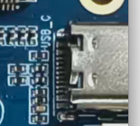

该接口为 USB Type C 接口，主要用于充电、供电、下载程 序与 ADB 调试。

## MIPI 摄像头

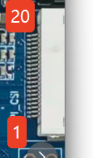

MIPI摄像头接口，开发板支持 1 路摄像头接口，用于识别周围环境和拍照。

| 引脚 | 信号 | 引脚 | 信号 |
| --- | --- | --- | --- |
| 1 | MIPI-CSI-D0P | 11 | GND |
| 2 | MIPI-CSI-D0N | 12 | TWI0-SCK |
| 3 | GND | 13 | TWI0-SDA |
| 4 | MIPI-CSI-D1P | 14 | MIPI-CSI-RSTN0 |
| 5 | MIPI-CSI-D1N | 15 | GND |
| 6 | GND | 16 | LDOB-2V8 |
| 7 | MIPI-CSI-CKP | 17 | LDOB-2V8 |
| 8 | MIPI-CSI-CKN | 18 | VCC-1V8 |
| 9 | GND | 19 | VCC-1V2 |
| 10 | MIPI-CSI-MCLK0 | 20 | NC |

## V881 扩展 IO

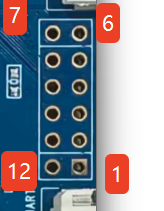

881未使用的GPIO引脚

| 引脚 | 信号 | 引脚 | 信号 |
| --- | --- | --- | --- |
| 1 | L22 | 7 | K23 |
| 2 | M21 | 8 | K19 |
| 3 | L21 | 9 | J19 |
| 4 | K21 | 10 | L19 |
| 5 | L20 | 11 | K22 |
| 6 | K20 | 12 | GND |

## V881 调试串口

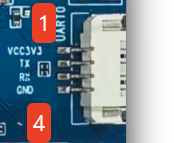

此接口为 4PIN 串口接口。

| 引脚 | 信号 |
| --- | --- |
| 1 | VCC3.3 |
| 2 | TX |
| 3 | RX |
| 4 | GND |

## DBI 屏幕

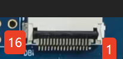

此接口为DBI接口，通过转接板可以连接SPI屏幕

| 引脚 | 信号 | 引脚 | 信号 |
| --- | --- | --- | --- |
| 1 | VCC33-STB | 9 | PD6-DBI-TE |
| 2 | VCC33-STB | 10 | GND |
| 3 | GND | 11 | PH15-LCD-PWM |
| 4 | PD1-DBI-CSX | 12 | GND |
| 5 | PD2-DBI-SCLK | 13 | PD19-TWI3-SDA |
| 6 | PD3-DBI-SDO | 14 | PD18-TWI3-SCK |
| 7 | PD4-DBI-SDI | 15 | PD21-CTP-INT |
| 8 | PD5-DBI-DCX | 16 | PD20-CTP-RESET |

## DBI 扩展 IO

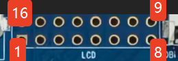

881未使用的GPIO引脚

| 引脚 | 信号 | 引脚 | 信号 |
| --- | --- | --- | --- |
| 1 | PD2-LCD-D4 | 9 | PD6-LCD-D10 |
| 2 | PD18-LCD-CLK | 10 | VCC33 |
| 3 | PD3-LCD-D5 | 11 | PD7-LCD-D11 |
| 4 | PD20-LCD-HSYNC | 12 | GND |
| 5 | PD4-LCD-D6 | 13 | PD1-LCD-D3 |
| 6 | PD21-LCD-VSYNC | 14 | PD19-LCD-DE |
| 7 | PD5-LCD-D7 | 15 | PH15-LCD-PWM |
| 8 | PD8-LCD-D12 | 16 | GND |

## MIC1

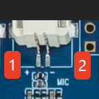

此接口为 2PIN 1.25mm 间距的 MIC 接口。连接至881的mic接口

| 引脚 | 信号 |
| --- | --- |
| 1 | MIC+ |
| 2 | MIC- |

## MIC2

此接口为 2PIN 1.25mm 间距的 MIC 接口。连接至881的mic接口

| 引脚 | 信号 |
| --- | --- |
| 1 | MIC+ |
| 2 | MIC- |

## Wi-Fi 调试串口

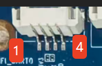

此接口为 4PIN 串口接口。适用于WIFI调试

| 引脚 | 信号 |
| --- | --- |
| 1 | VCC3.3 |
| 2 | TX |
| 3 | RX |
| 4 | GND |

## V881 喇叭

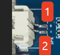

此接口为 2PIN 1.25mm 间距的喇叭接口。

| 引脚 | 信号 |
| --- | --- |
| 1 | SPK+ |
| 2 | SPK- |

## 电池

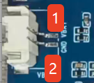

此接口为 2PIN 1.25mm 间距的电池接口。可外接3.7V锂电池给系统供电。

| 引脚 | 信号 |
| --- | --- |
| 1 | VBAT |
| 2 | GND |

## JL7018 喇叭 1

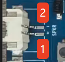

此接口为 2PIN 1.25mm 间距的喇叭接口。此喇叭是通过7018K控制

| 引脚 | 信号 |
| --- | --- |
| 1 | SPK+ |
| 2 | SPK- |

## JL7018 喇叭 2

此接口为 2PIN 1.25mm 间距的喇叭接口。此喇叭是通过7018K控制

| 引脚 | 信号 |
| --- | --- |
| 1 | SPK+ |
| 2 | SPK- |

## JL7018 扩展 IO

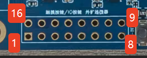

7018的GPIO引脚

| 引脚 | 信号 | 引脚 | 信号 |
| --- | --- | --- | --- |
| 1 | POW5V | 9 | TP-SDA |
| 2 | POW5V | 10 | TP-SCL |
| 3 | POW5V | 11 | BT-PWR-KEY |
| 4 | FLED- | 12 | BT-IOVDD3V |
| 5 | FLED- | 13 | GND |
| 6 | GND | 14 | SPKL+ |
| 7 | TP-INT | 15 | SPKL- |
| 8 | TP-RST | 16 | GND |

## JL7018 外接三麦克风

7018外接3mic接口

| 引脚 | 信号 | 引脚 | 信号 |
| --- | --- | --- | --- |
| 1 | NC | 9 | BT-MICIN2P |
| 2 | USBVBUS5V | 10 | BT-MICIN2N |
| 3 | BT-TX | 11 | BT-MICIN1P |
| 4 | USBVBUS5V | 12 | BT-MICIN1N |
| 5 | VBT-RX | 13 | GND |
| 6 | BT-MICLDO | 14 | GND |
| 7 | GND | 15 | BT-MICIN0P |
| 8 | DCDC3-3V3 | 16 | BT-MICIN0N |

## V881 天线

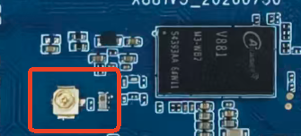

881内置 2.4 GHz/5 GHz 单频段 WIFI，通过 WiFi 天线实现连接网络

## JL7018 天线

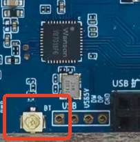

7018内置 2.4 GHz  WIFI，通过 WiFi 天线实现连接网络

串口按板上 TX/RX/GND 接线，3.3V 电源脚不作为外部电源输入。接摄像头、屏幕和音频扩展板前核对引脚顺序、电压及当前固件支持。

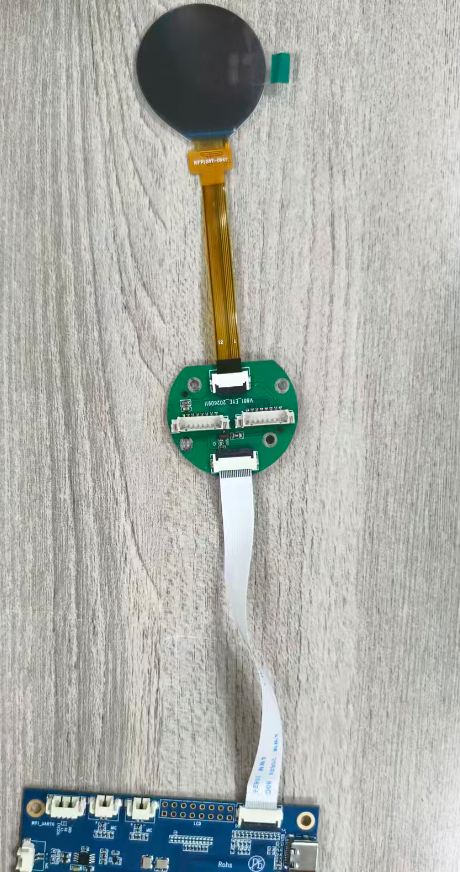
