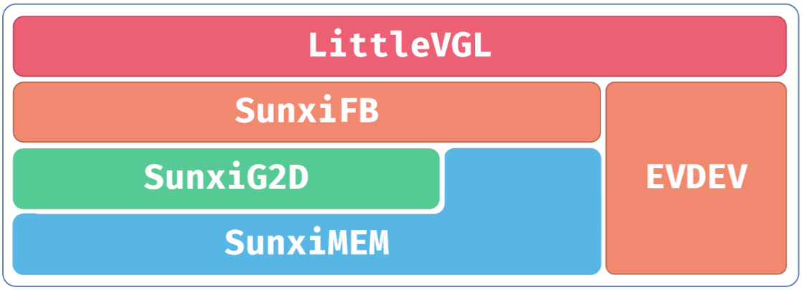

# LVGL 与图形加速

手册使用 LVGL 8.3.2、sunxifb/sunximem 和 evdev，源码位于 `platform/thirdparty/gui/lvgl-8`。



```bash
make menuconfig
# Gui -> Littlevgl -> lv_examples
lv_examples 0
lv_examples 1
lv_examples 2
lv_examples 3
lv_examples 4
```

测试编号依次为 widgets、music、benchmark、keypad_encoder、stress。双缓冲、cache、G2D 和 direct mode 按当前芯片与驱动支持选择，不能直接沿用其他平台的开关。

```text
platform/thirdparty/gui/lvgl-8/lv_drivers/display/sunxifb.c
platform/thirdparty/gui/lvgl-8/lv_drivers/display/sunxigmem.c
platform/thirdparty/gui/lvgl-8/lv_drivers/indev/evdev.c
platform/thirdparty/gui/lvgl-8/lv_examples/src/lv_drv_conf.h
```

`sunxifb_init` 初始化显示，`sunxifb_flush` 完成 draw/back/front buffer 交换，`sunxifb_get_sizes` 获取分辨率。G2D 使用驱动要求的连续物理内存或 fd，通过分配接口申请并维护 cache；触摸节点通过 `EVDEV_NAME` 选择。

```bash
ln -s /dev/input/eventX /dev/input/touchscreen
```

替换 eventX 为实际触摸节点。SPI 带宽可能成为刷新瓶颈，应减少全屏复制和图片缓存，分别测量渲染与发送时间。
