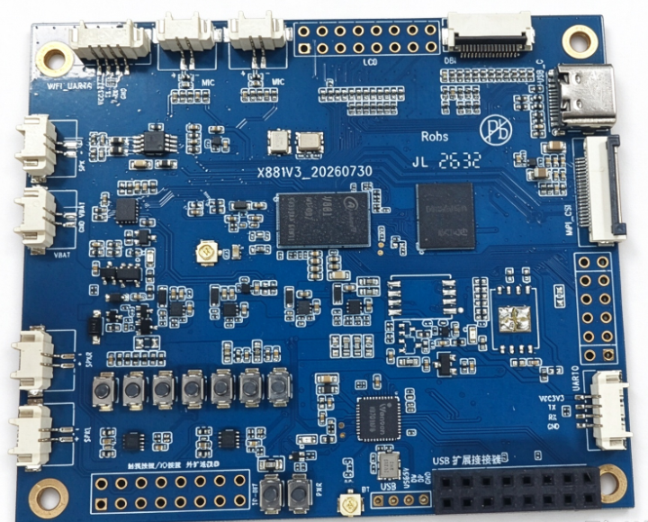
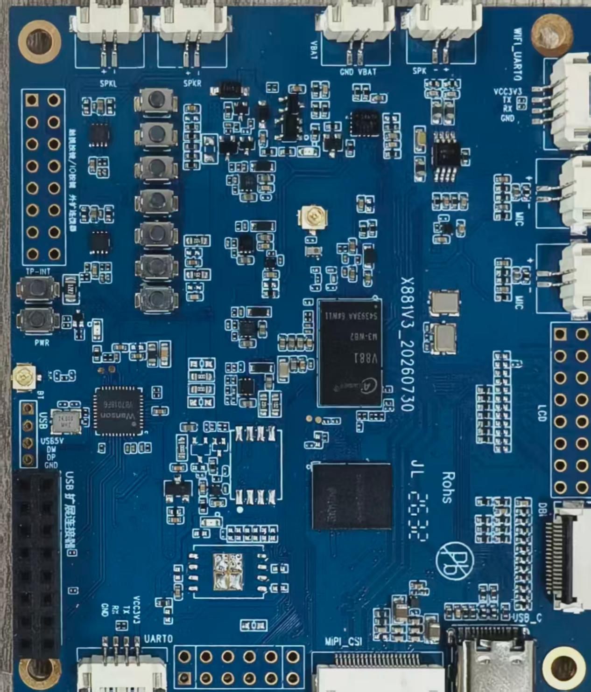
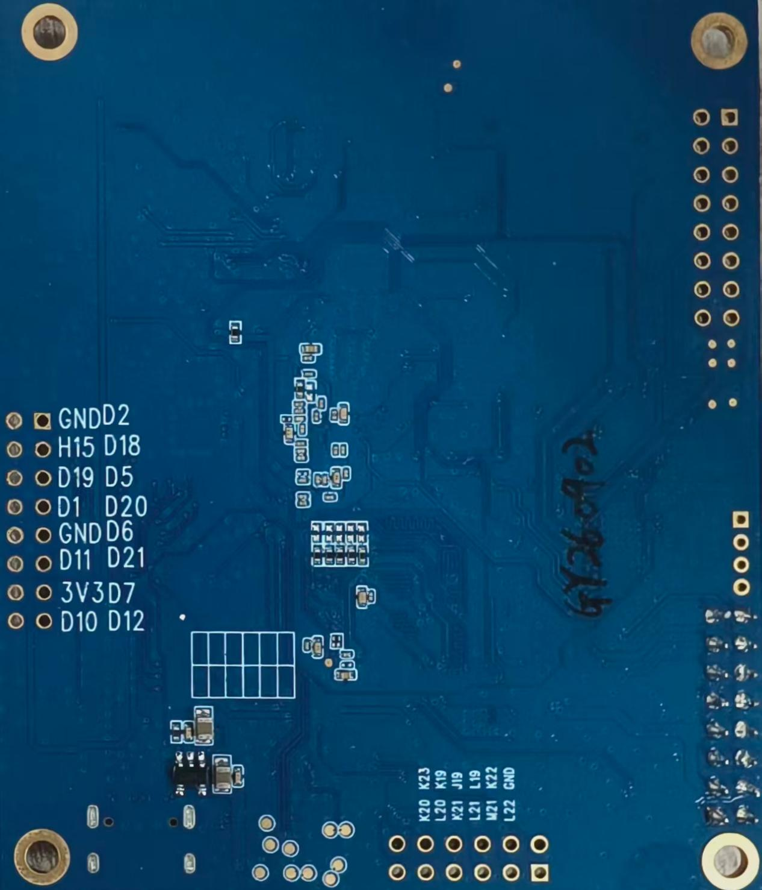
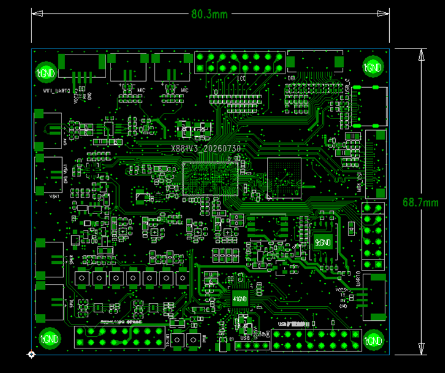

# 产品介绍

X881 是九鼎创展基于全志 V881 开发的 AI 眼镜主板，搭配 JL7018 实现低功耗唤醒，适用于语音视觉交互、AI 直播摄像头、手持相机及行业视觉终端。

V881 的 AI-ISP、H.264/H.265 编码、8MP 视频、EIS 防抖和对焦加速属于处理器能力；本开发板实际提供 1 路 MIPI 摄像头接口、1 路 DBI 显示连接和板载六轴 IMU。

## V881 与 JL7018 功能

| 项目 | 说明 |
| --- | --- |
| CPU | V881M3-WB2 |
| ROM | 外挂4G EMMC |
| 摄像头 | 一路mipi摄像头接口 |
| 喇叭 | 一路1.25*2P喇叭接口，4R 3W |
| 咪头 | 两路1.25*2P咪头接口 |
| LCD | 一路DBI屏幕接口，通过外置转接板连接SPI屏幕 |
| 电池 | 外置4.2V |
| Imu | 搭配一路6轴陀螺仪 |
| WIFI | 2.4GHz:20/40MHz,5GHz:20/40/80MHz |
| BT | BLE |

| 项目 | 说明 |
| --- | --- |
| Mic | 通过转接板外置3路mic |
| 喇叭 | 两路1.25*2P喇叭接口，4R 3W |
| 语音视觉模型 | 小艾小艾 |

## 系统配置

| 项目 | 参数 |
| --- | --- |
| CPU | 881 M3-WB2 |
| 主频 | 双核 RISC-V C907, 时钟速率最高 1.4 GHz |
| 内存 | 128 KB |
| 存储器 | 4GB/8GB emmc可选，标配4GB |

## 接口参数

| 项目 | 参数 |
| --- | --- |
| DBI接口 | 1路 |
| Camera接口 | 1路MIPI-CSI输入 |
| 音频接口 | 5路MIC输入，3路喇叭输出。其中881有2路MIC输入，1路喇叭输出。7018有3路MIC输入，2路喇叭输出 |
| IMU接口 | 板载6轴IMU，管脚不另外引出 |
| emmc接口 | 板载emmc接口，管脚不另外引出 |
| 电池供电接口 | 1路3.7V锂电池供电接口 |
| USB接口 | 1路TYPE-C接口 |
| USB HOST3.0接口 | 1路HOST3.0 |
| KEY接口 | 5路普通按键，1路复位按键，1路休眠按键 |

## 电气参数

| 项目 | 参数 |
| --- | --- |
| VBUS输入电压 | 5V/2A |
| VBAT输入电压 | 3.5到4.2V，典型值3.7V |
| 工作温度 | -10~70度 |
| 储存温度 | -10~40度 |
| 翘曲度 | 不超过0.5% |

内存字段按原硬件手册记录为 128KB。应用可用内存应在交付固件上通过 `/proc/meminfo`、`free` 和 `ramparser` 核对。

## 外观与机械尺寸

| 项目 | 参数 |
| --- | --- |
| 尺寸 | 80.3 mm × 68.7 mm × 1.6 mm |
| 工作温度 | 0~70℃ |
| 存储温度 | -10~50摄氏度 |

## 文档导航

- [硬件资源](./x881-hardware-resources.md)
- [接口定义](./x881-interface-definition.md)
- [SDK 框架与方案](./x881-sdk-overview-environment.md)
- [编译与烧录](./x881-build-flash.md)
- [SDK 核心配置](./x881-sdk-core-config.md)
- [内存资源与应用调试](./x881-system-resources-debug.md)
- [一键配置与优化](./x881-quick-config-optimization.md)
- [自定义 rootfs](./x881-custom-rootfs.md)
- [SDK AI 辅助开发](./x881-ai-assisted-development.md)
- [工具链与应用开发](./x881-toolchain-app-development.md)
- [Camera 驱动适配](./x881-camera-adaptation.md)
- [LCD 与 DRM 显示](./x881-display-drm.md)
- [SPI LCD 与启动 Logo](./x881-uboot-spi-lcd.md)
- [LVGL 与图形加速](./x881-lvgl-g2d.md)
- [多媒体 MPP](./x881-mpp.md)
- [常用系统模块](./x881-system-modules.md)
- [FASTBOOT 快启系统](./x881-fastboot.md)
- [RTOS 与多核协同](./x881-rtos-amp.md)
- [Linux 驱动与项目实战](./x881-linux-driver-projects.md)
- [FAQ](./x881-faq.md)
