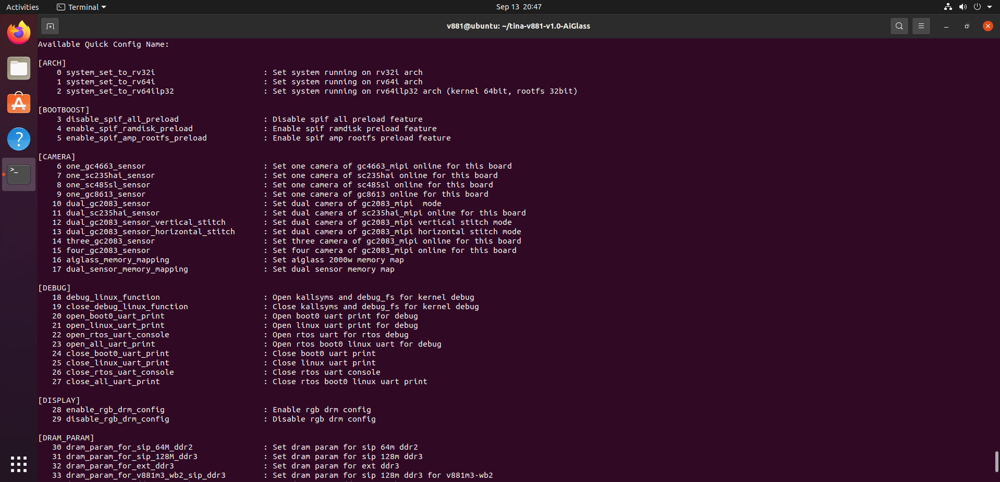
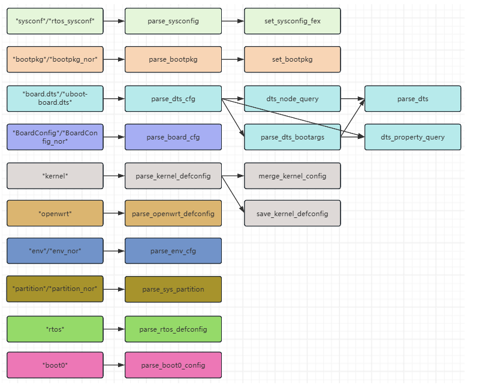

# 一键配置与优化

```bash
source build/envsetup.sh
lunch
quick_config
```





选择编号并确认 `y` 后会直接修改 SDK 配置；直接回车退出则不修改。工具输出变更文件和额外步骤，执行后检查 Git 差异，再编译打包。

```bash
git status
git diff
quick_config -h
pack
```

参数包括 `-c/--config` 选择配置、`-i/--include` 加载文件、`-gd/--gen_dts_base` 生成设备树基线。`-f/--force` 跳过检查，仅在明确配置后使用。工具没有统一撤销操作，按 Git 差异逐项恢复。

同名 key 通常按公共配置、引入文件、板级配置的顺序覆盖。JSON 最后一项不能保留尾逗号。传感器、存储或库类型切换后，按工具提示清理旧产物；线程数增加前先检查磁盘与内存瓶颈。
