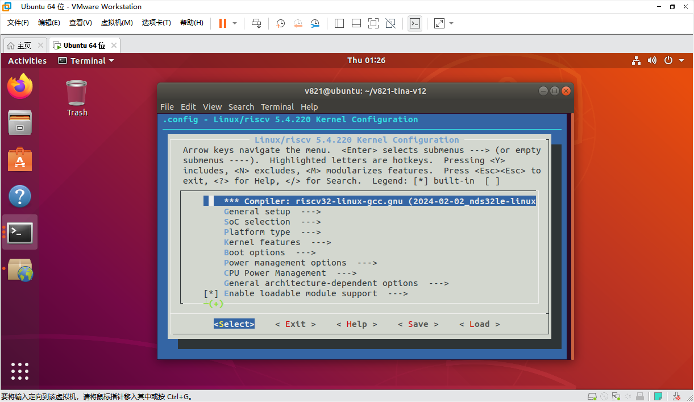
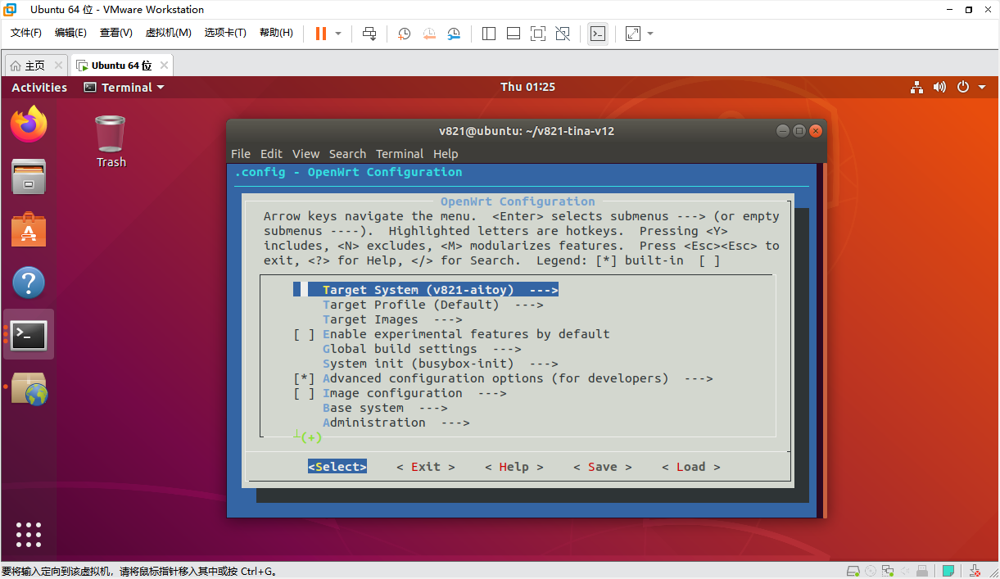
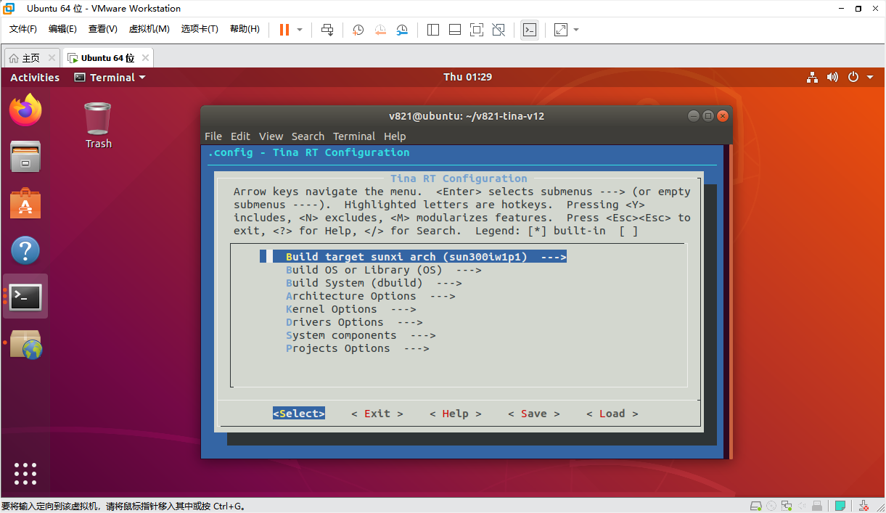

# SDK 核心配置

## 三类配置入口

```bash
source build/envsetup.sh
lunch
make kernel_menuconfig
make menuconfig
mrtos menuconfig
```







## 设备树与板级文件

```text
bsp/configs/linux-6.6-xuantie/sun252iw1p1.dtsi
device/config/chips/v861/configs/<board>/linux-6.6-xuantie/board.dts
device/config/chips/v861/configs/<board>/uboot-board.dts
device/config/chips/v861/configs/<board>/sys_config.fex
device/config/chips/v861/configs/<board>/env.cfg
```

方案 `board.dts` 覆盖芯片公共 DTS 的同名配置。优先修改当前方案文件，避免影响其他板型。`sys_config.fex` 管理 BOOT0 DRAM、引脚和存储，冲突时优先于 U-Boot 设备树；`env.cfg` 控制启动参数，快启方案不使用普通 U-Boot 环境。

## BOOT0 串口示例

```ini
[uart_para]
uart_debug_port = 0
uart_debug_tx = port:PD22<3><1><default><default>
uart_debug_rx = port:PD23<3><1><default><default>

[platform]
debug_mode = 0
```

串口引脚示例为 PD22/PD23，实际以板级复用为准。`debug_mode=0` 关闭 BOOT0 打印，`8` 打开全部打印。

## 分区与文件系统

```ini
[partition]
name = rootfs
size = 20480
downloadfile = "rootfs.fex"
user_type = 0x8000
```

非 NOR 介质使用 `sys_partition.fex`，NOR 使用 `sys_partition_nor.fex`。`size` 按介质对齐，普通分区单位为 512 字节扇区；最后 UDISK 不设置 size 时使用剩余空间。`downloadfile` 相对打包 image 目录。

根文件系统默认可使用 squashfs，写入层挂在 overlay。eMMC 写入层通常是 ext4，NOR 常用 jffs2。切换 EROFS 需同时启用 `CONFIG_TARGET_ROOTFS_EROFS` 和内核 `CONFIG_EROFS_FS`，关闭 squashfs 目标。
