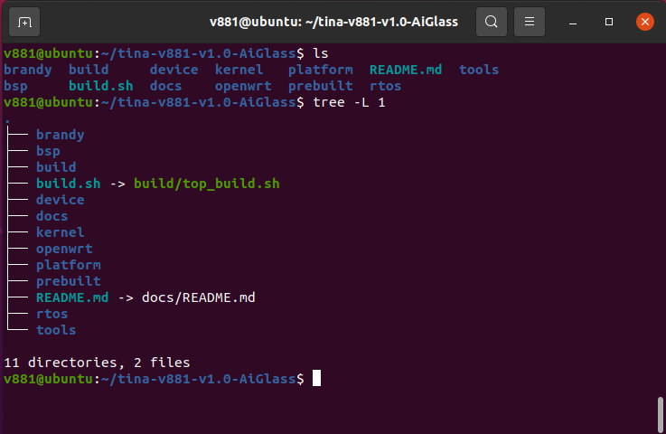

# SDK 框架与方案

当前 X881 Linux 手册的源码包为 `tina-v881-v1.0.tar.gz`，推荐方案为 `v861-9tripod_aiglass-tina`。SDK 内部包含 `v861` 配置目录和 `linux-6.6-xuantie` 内核目录，选择方案后再定位当前板级文件。



```text
brandy/       # BOOT0 and U-Boot
bsp/          # Drivers, headers and DTS
build/        # Build and packaging scripts
device/       # SoC and board configurations
kernel/       # Linux kernel
openwrt/      # Packages and rootfs configuration
out/          # Build output
platform/     # Platform libraries and applications
prebuilt/     # Prebuilt tools
rtos/         # RTOS, components and HAL
test/         # Tests
tools/        # Development utilities
```

## 初始化与快捷跳转

```bash
source build/envsetup.sh
lunch
croot
cconfigs
cplat
cbsp
cboot
crtos
cout
```

`cconfigs` 定位当前方案配置，`cplat` 定位 OpenWrt 板级目录，`cout` 定位当前输出。路径示例中的 `bga_perf1` 是手册的通用示例，实际修改前使用所选 aiglass 方案的目录。
