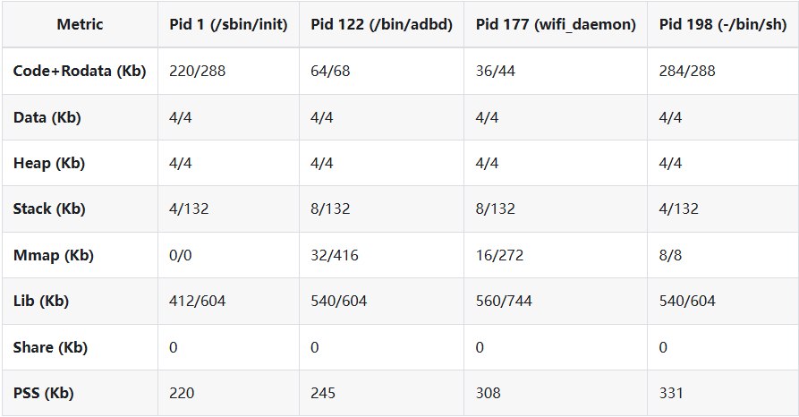
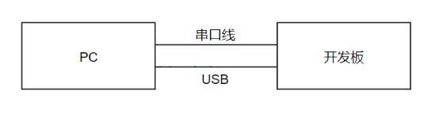
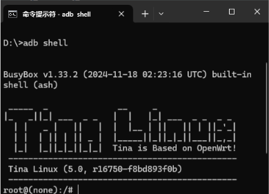

# 内存资源与应用调试

## 内存布局

为 Linux、RTOS、共享缓冲、OpenSBI 和多媒体池统一规划内存，reserved-memory/no-map 区域不能重叠。手册中的 RV32 示例要求内核起点 4MB 对齐，OpenSBI 起点 128KB 对齐；这些约束要与当前架构和启动代码核对。U-Boot 会重定位到内存尾部，应保留相应空间。

```bash
cat /proc/meminfo
free
ramparser -a
ramparser -r
ramparser -s
ramparser -p <pid>
```



截图中的容量和占用是工具示例，不能作为当前板卡的内存规格。录制前确认输出目录对应实际存储，防止没有挂载外部介质时写满 overlay。

## ADB 调试



在 Tina menuconfig 启用 `Allwinner → USB → adbd for Tina Linux`。PC 安装 platform-tools，将工具目录加入 PATH 后检查连接。

```bash
adb version
adb devices
adb shell
adb push <local-file> <board-path>
adb pull <board-path> <local-path>
```



应用异常时保存完整串口、dmesg 和进程信息。GDB/VSCode 可做断点调试，coredump 用于事后分析，工具链及符号文件必须与程序版本匹配。
