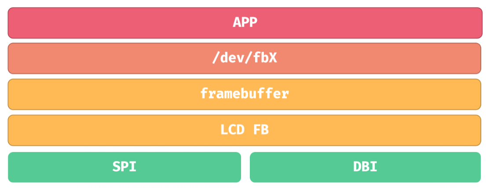
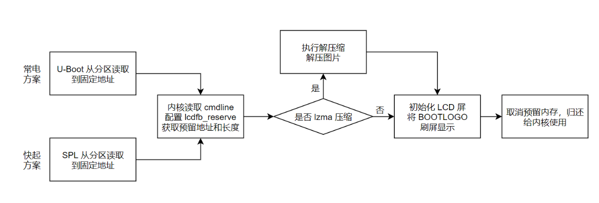

# SPI LCD 与启动 Logo





DBI 支持硬件控制 DC 的传输方式，具体线数、像素格式、TE 和 SPI 控制器由当前驱动决定。设备树应与转接板的 PD1 至 PD6、TWI3、复位和背光管脚一致。

## BOOTLOGO 配置

```text
CONFIG_AW_LCD_FB_DECOMPRESS_LZMA=y
openwrt/target/v881/v881-common/boot-resource/boot-resource/bootlogo.bmp
```

手册记录该路径的 BMP 会进行 LZMA 压缩，内核需启用对应解压选项。路径按交付 SDK 的实际板级资源目录调整。

```ini
[partition]
name = bootlogo
size = 256
user_type = 0x8000
downloadfile = bootlogo.fex
```

如果改为非压缩 Logo，需要同步修改 `build/pack` 中的拷贝和打包逻辑。区分 U-Boot 显示和内核 LCD_FB 显示，快启裁剪 U-Boot 后使用对应的内核显示链路。
