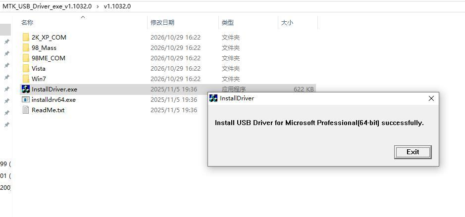
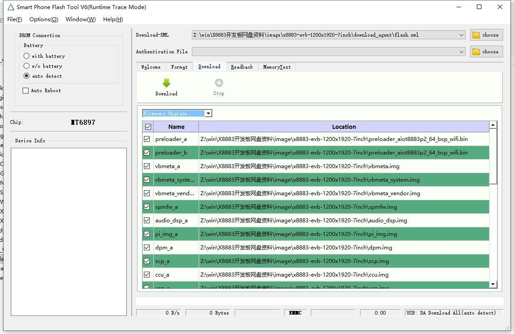
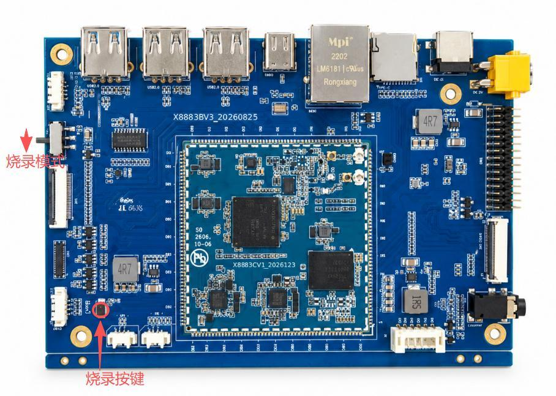
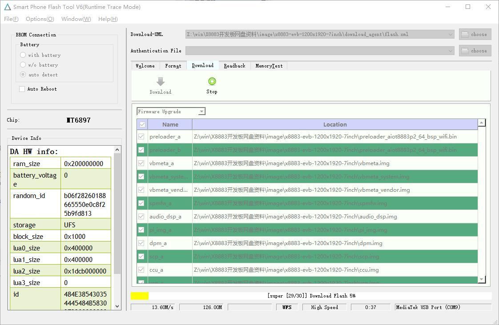

# Android 烧录

## 准备驱动与工具

获取与本板固件匹配的 Windows 烧录工具、USB 驱动及完整镜像包。升级前备份需要保留的数据、原固件及分区表。先安装配套 USB 驱动，再打开工具选择固件包中的 XML 配置文件，点击 **Download** 进入等待状态。

## 连接主板并烧录

1. 主板断电，Type-C J10 连接 PC。
2. 将下载拨动开关切换到烧录模式。
3. 按住主板烧录按键，再接入 DC 电源上电。
4. 等待工具识别设备并完成写入，确认成功提示后断电。
5. 恢复正常启动开关位置，再上电验证。

不要把接口图中并联的电池与 DC 输入同时接入。烧录后验证显示、触摸、摄像头、USB、以太网、音频、TF 与传感器；量产固件核对 MAC、序列号和地区码。

---

**参考资料**

网盘 `x8883-docs` → `X8883 Android平台用户手册-V1.0.pdf` → 第三章第 3.4 节“烧录固件”。
