# Android 功能测试

## 液晶、触摸与背光

打开 AndroidTest2 的液晶屏测试，点击纯色区域切换颜色，检查丢色、坏点和显示异常。触摸测试中点击 Start Test，画对角线检查坐标、断线和边缘区域。背光测试拖动中间圆形控件，观察亮度变化。

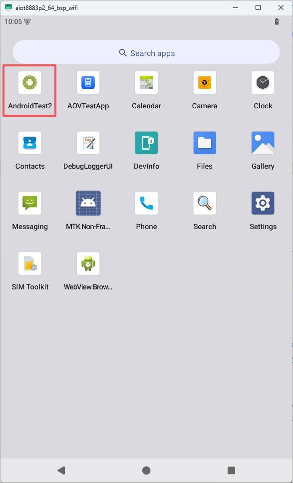

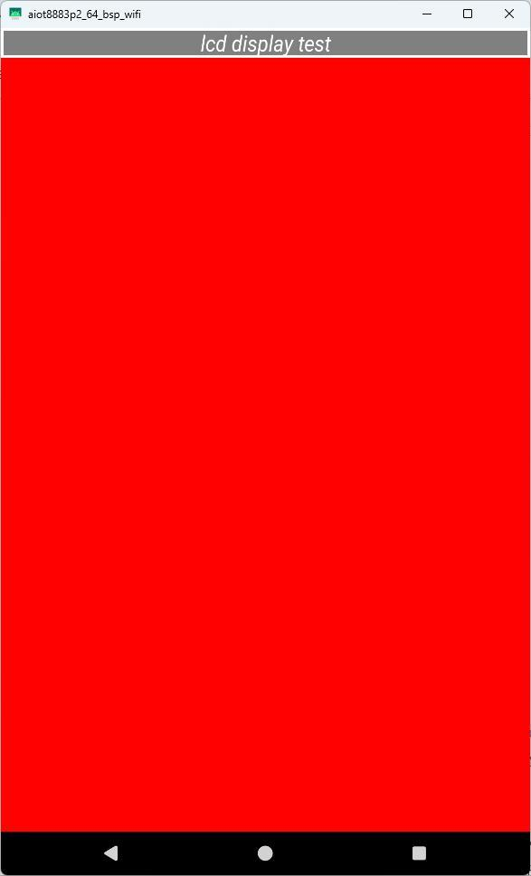

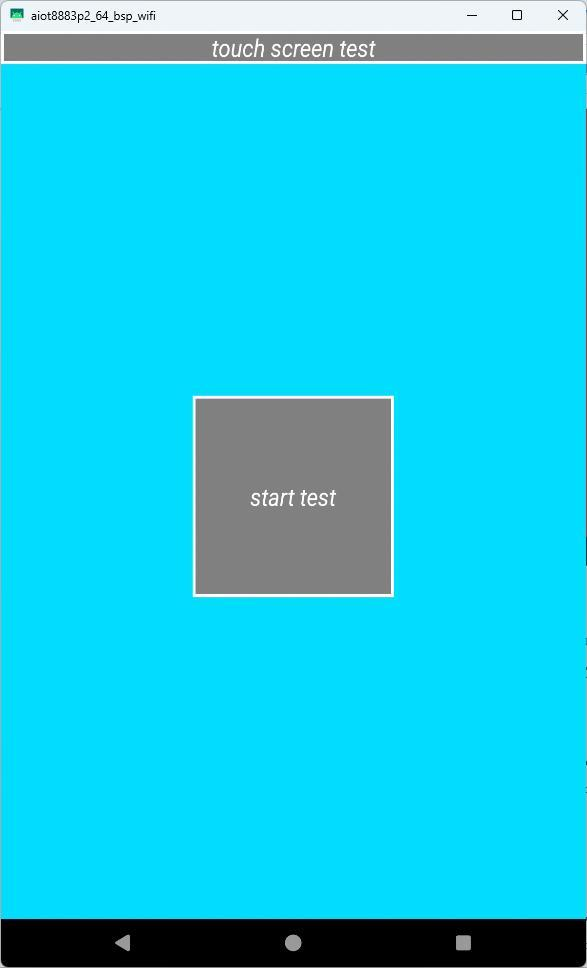

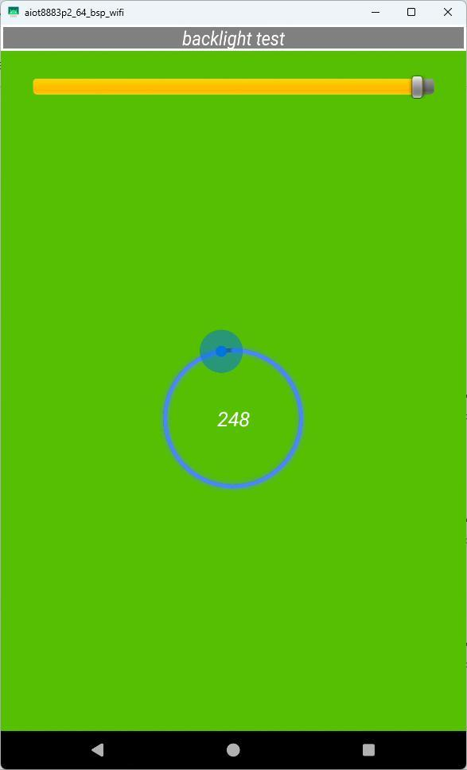

## 摄像头与传感器

打开 Camera 应用确认预览、方向和画面稳定。测试应用中依次查看 GSensor、Gyroscope、Magnetic 页面，改变板卡姿态观察各轴数据，保持周围磁场条件可控。

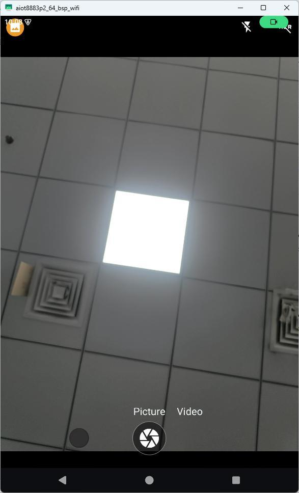

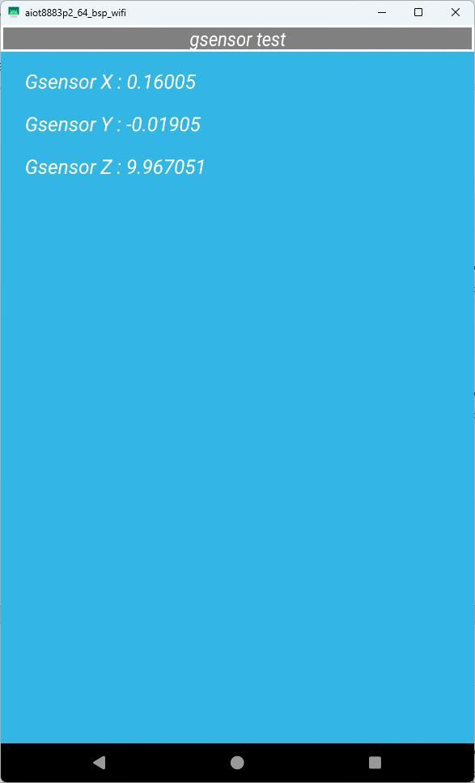

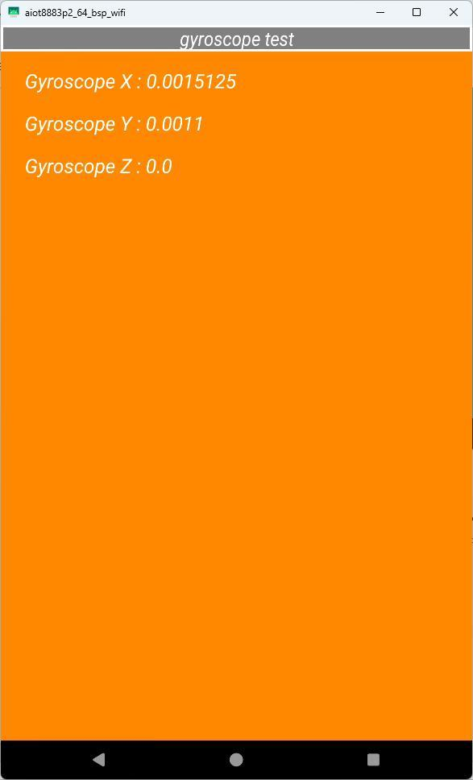

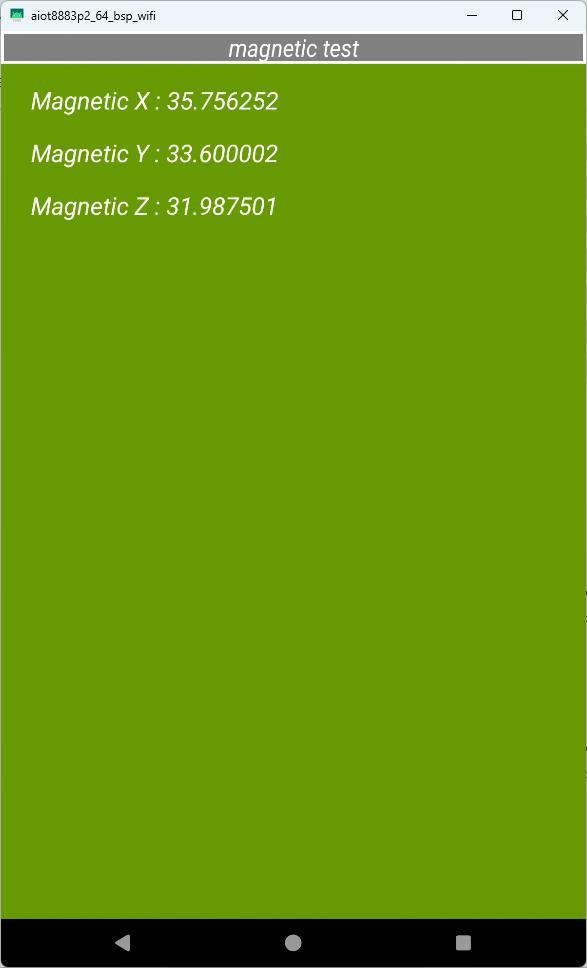

## Wi-Fi、蓝牙与以太网

Wi-Fi：进入 Settings → Network & Internet / Internet，启用 Wi-Fi，选择热点并连接，检查联网。蓝牙：进入 Settings → Connected devices → Bluetooth，搜索并选择设备，在主板和对端同时确认配对。以太网：连接 RJ45 网线，查看 Internet 页中的 Ethernet 状态与 IP。

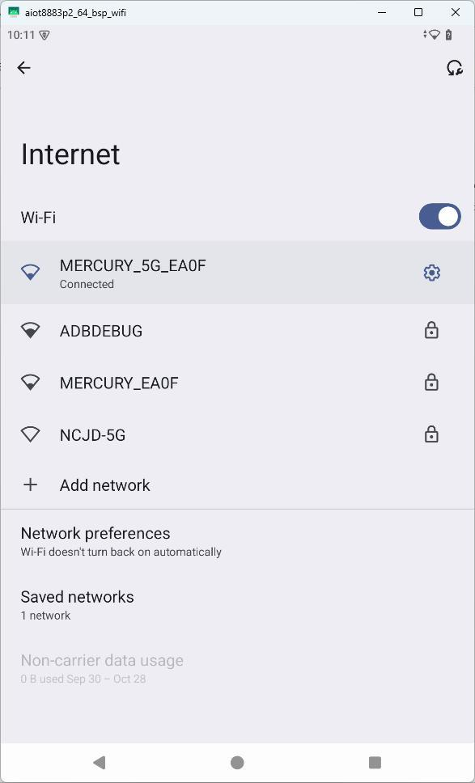

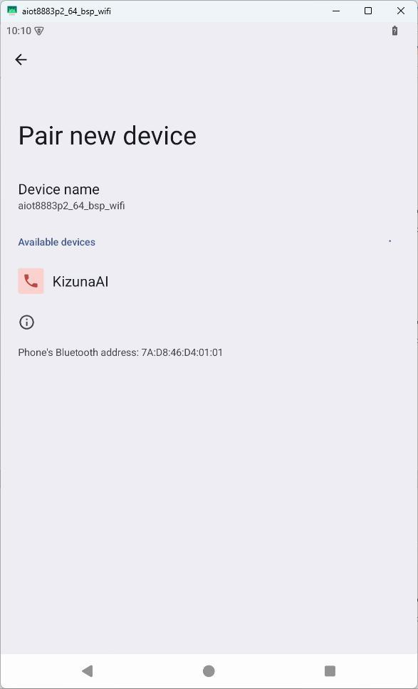

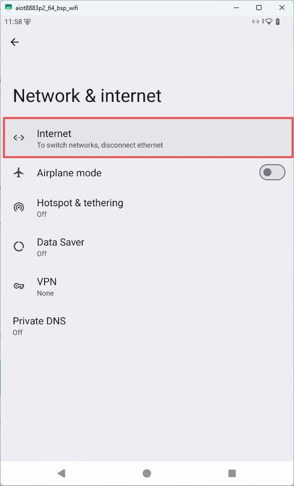

在已配置 ADB 的主机上，执行以下命令查看网络接口地址：

```bash
adb shell ifconfig
```

## U 盘与 TF 卡

插入 U 盘后，在 Files 中确认自动挂载及读写。TF 卡由 UUID 区分并挂载于 `/storage/`；如系统提示格式化，仅在确认卡内数据可清除后进行。检查文件读取、写入及重新插入后的识别情况。

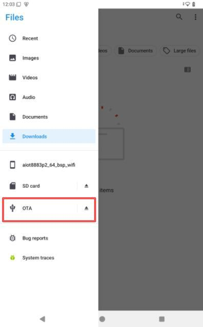

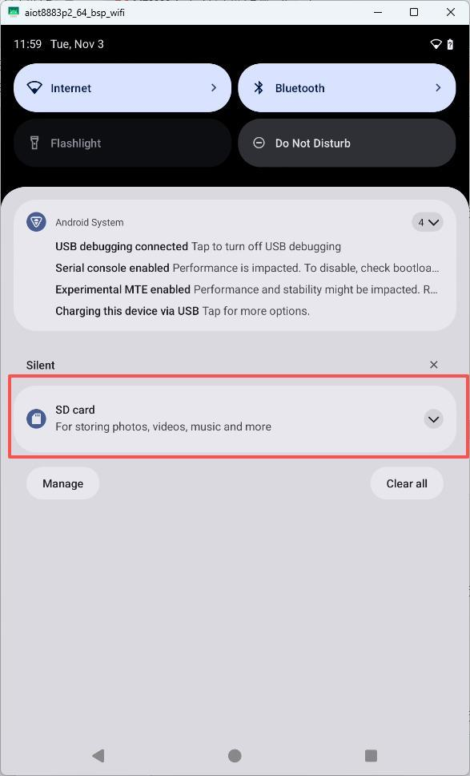

---

**参考资料**

网盘 `x8883-docs` → `X8883 Android平台用户手册-V1.0.pdf` → 第四章“Android 功能测试”。
