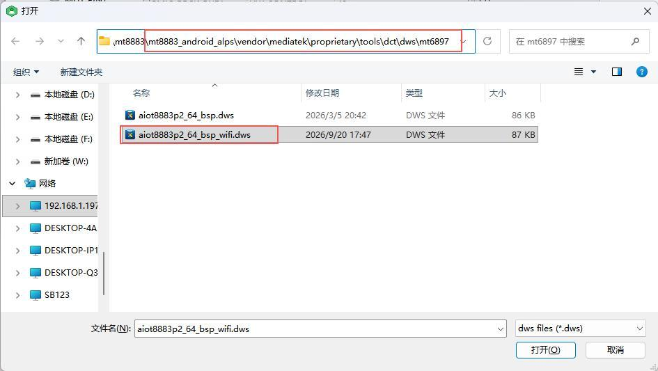
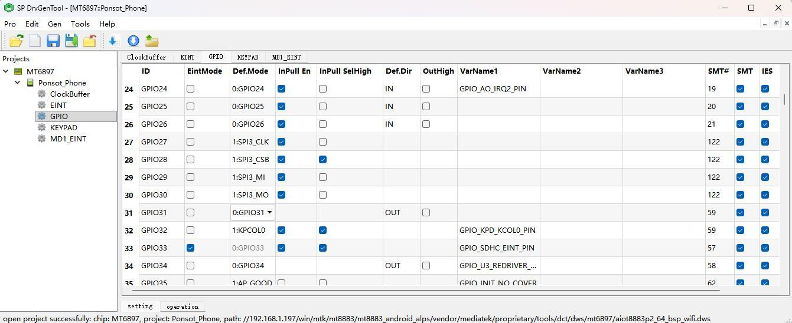

# DTS、GPIO 与总线

以下路径以 `mt8883_android_alps` 为基准，适用于 Kernel 6.1 SDK。保留路径中的 `mt6897` 名称，并确认项目与源码版本一致。

## 设备树与 GPIO 工具

```text
kernel/kernel_device_modules-6.1/arch/arm64/boot/dts/mediatek/mt6897.dts
kernel/kernel_device_modules-6.1/arch/arm64/boot/dts/mediatek/aiot8883p2_64_bsp_wifi.dts
vendor/mediatek/proprietary/tools/dct/dws/mt6897/aiot8883p2_64_bsp_wifi.dws
vendor/mediatek/proprietary/tools/dct/DrvGen.exe
```

将 DrvGen 工具及所需 DWS/配套文件复制到 Windows 环境，打开目标项目 DWS，按实际原理图设置 GPIO/复用后按工具流程生成配置。DCT 中的 GPIO 编号不是连接器物理脚号。





## I2C 与 PCIe

I2C 配置示例使用 `&i2c7`：在 DTS 中启用控制器并添加从设备地址。若固件带 `i2cdetect`，可在确认实际总线后扫描设备。PCIe 需同时启用 `&pcie`、`&pciephy`，并配置 pinctrl。

```dts
&pio {
    pcie_pins_default: pcie-default {
        pins-cmd-dat {
            pinmux = <PINMUX_GPIO174__FUNC_PCIE_WAKEN>,
                     <PINMUX_GPIO173__FUNC_PCIE_PERSTN>,
                     <PINMUX_GPIO175__FUNC_PCIE_CLKREQN>;
            bias-pull-up;
        };
    };
};

&pcie {
    pinctrl-names = "default";
    pinctrl-0 = <&pcie_pins_default>;
    l2,bypass;
    status = "okay";
};

&pciephy {
    status = "okay";
};
```

将以上配置合入对应 DTS，并核对当前源码中的节点、宏定义和属性。

---

**参考资料**

网盘 `x8883-docs` → `X8883 Android平台用户手册-V1.0.pdf` → 第五章第 5.1 至 5.2 节。
