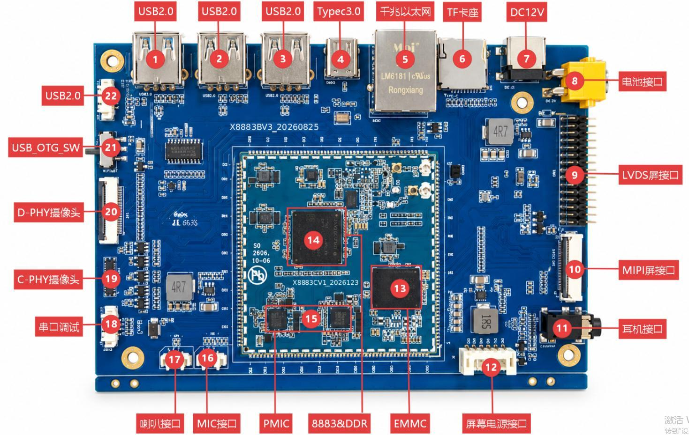

# 硬件资源

下表按图中编号列出接口功能和连接器位置。接线前核对板卡版本与对应原理图。

| 图号 | 功能 | 连接器/说明 |
| --- | --- | --- |
| 1/2/3 | USB 2.0 Host | J22 / J9506 / J9507 |
| 4 | Type-C USB 3.0 OTG | J10 |
| 5 | 千兆以太网 | RTL8111H / RJ45 J3 |
| 6 | TF 卡座 | CN1 / MSDC1 |
| 7 | 12 V DC 输入 | J1 |
| 8 | 12 V 电池接口 | 与 DC 输入并联，不能同时接入 |
| 9 | LVDS 屏接口 | J17，30-pin，2.0 mm |
| 10 | MIPI 屏接口 | U39，30-pin，0.5 mm FPC |
| 11 | 耳机 | 3.5 mm |
| 12 | 屏幕电源 | CN2，6-pin，2.0 mm |
| 13 | 存储颗粒 | 按实际交付配置确认 |
| 14 | CPU + PoP 内存 | MT8883 / LPDDR |
| 15 | PMIC | 核心板电源管理 |
| 16 | MIC | MIC1，2-pin，1.25 mm |
| 17 | 喇叭 | AW8898；4 Ω / 3 W |
| 18 | UART 调试 | J21，4-pin，2.54 mm |
| 19 | C-PHY 摄像头 | CON3 |
| 20 | D-PHY 摄像头 | J16，26-pin，0.5 mm |
| 21 | USB_OTG_SW | ASW7227 通路选择 |
| 22 | USB 2.0 Host | J9505，Type-A |

---

**参考资料**

网盘 `x8883-docs` → `X8883开发板硬件手册.pdf` → 第二章“核心板连接器”和第三章“板载接口与连接器”。
