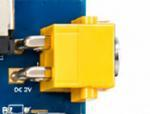
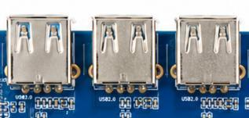
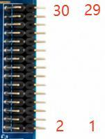

# 板载接口定义

以下为主板连接器定义。接线和底板改版时，请使用与板卡版本匹配的原理图核对引脚。

## 供电、USB、以太网与 TF

J1 为 2-pin 12 V DC 输入，建议适配器至少 12 V/2 A；图号 8 接口用于 12 V 电池组，直接与 J1 并联，**两路不能同时插入**。J22/J9506/J9507 为 USB 2.0 Host，单路负载建议不超过 500 mA；J9505 是额外 Host。J10 Type-C 用于 USB 3.0 OTG、烧录、ADB 与 DP Alt Mode。

RJ45 J3 由 PCIe 转 RTL8111H 实现 10/100/1000 M；MDI 差分按 100 Ω，核对变压器、屏蔽和端接。CN1 为 MSDC1 4-bit TF 卡座，支持 SD/SDHC/SDXC；CLK/DATA/CMD 按 50 Ω，并配置卡检测、去抖和 ESD。USB 2.0 按 90 Ω 差分，VBUS 应限流、防护。

## LVDS J17

| 引脚 | 信号 | 说明 |
| --- | --- | --- |
| 1 | LVDS_VCC | 面板电源 |
| 2 | LVDS_VCC | 面板电源 |
| 3 | GND | 地 |
| 4 | GND | 地 |
| 5 | GND | 地 |
| 6 | GND | 地 |
| 7 | LVDS_D0_A_N | A通道D0- |
| 8 | LVDS_D0_A_P | A通道D0+ |
| 9 | LVDS_D1_A_N | A通道D1- |
| 10 | LVDS_D1_A_P | A通道D1+ |
| 11 | LVDS_D2_A_N | A通道D2- |
| 12 | LVDS_D2_A_P | A通道D2+ |
| 13 | GND | 地 |
| 14 | GND | 地 |
| 15 | LVDS_CLK_A_N | A通道时钟- |
| 16 | LVDS_CLK_A_P | A通道时钟+ |
| 17 | LVDS_D3_A_N | A通道D3- |
| 18 | LVDS_D3_A_P | A通道D3+ |
| 19 | LVDS_D0_B_N | B通道D0- |
| 20 | LVDS_D0_B_P | B通道D0+ |
| 21 | LVDS_D1_B_N | B通道D1- |
| 22 | LVDS_D1_B_P | B通道D1+ |
| 23 | LVDS_D2_B_N | B通道D2- |
| 24 | LVDS_D2_B_P | B通道D2+ |
| 25 | GND | 地 |
| 26 | GND | 地 |
| 27 | LVDS_CLK_B_N | B通道时钟- |
| 28 | LVDS_CLK_B_P | B通道时钟+ |
| 29 | LVDS_D3_B_N | B通道D3- |
| 30 | LVDS_D3_B_P | B通道D3+ |

30-pin、2.0 mm，双通道 LVDS，差分 100 Ω；背光与信号分开布线。

## MIPI 显示 U39

| 引脚 | 信号 | 说明 |
| --- | --- | --- |
| 1 | VDD_5V0 | 屏5V电源 |
| 2 | VDD_5V0 | 屏5V电源 |
| 3 | VDD_5V0 | 屏5V电源 |
| 4 | EXT_3V3 | 屏3.3V电源 |
| 5 | EXT_3V3 | 屏3.3V电源 |
| 6 | I2C4_SCL_M3_TP | 触摸I2C时钟 |
| 7 | I2C4_SDA_M3_TP | 触摸I2C数据 |
| 8 | TP_INT_L | 触摸中断 |
| 9 | TP_RST_L | 触摸复位 |
| 10 | GND | 地 |
| 11 | EXT_3V3 | 屏3.3V电源 |
| 12 | GND | 地 |
| 13 | CD_RESET | 屏复位 |
| 14 | GND | 地 |
| 15 | LCD_PWREN | 屏电源使能 |
| 16 | GND | 地 |
| 17 | MIPI_DPHY0_TX_3N | MIPIlane3- |
| 18 | MIPI_DPHY0_TX_3P | MIPIlane3+ |
| 19 | GND | 地 |
| 20 | MIPI_DPHY0_TX_2N | MIPIlane2- |
| 21 | MIPI_DPHY0_TX_2P | MIPIlane2+ |
| 22 | GND | 地 |
| 23 | MIPI_DPHY0_TX_CLKN | MIPI时钟- |
| 24 | MIPI_DPHY0_TX_CLKP | MIPI时钟+ |
| 25 | GND | 地 |
| 26 | MIPI_DPHY0_TX_1N | MIPIlane1- |
| 27 | MIPI_DPHY0_TX_1P | MIPIlane1+ |
| 28 | GND | 地 |
| 29 | MIPI_DPHY0_TX_0N | MIPIlane0- |
| 30 | MIPI_DPHY0_TX_0P | MIPIlane0+ |
| 31/32 | GND | FPC屏蔽/固定脚 |

30-pin、0.5 mm FPC；31/32 为屏蔽/固定脚。包含 4-lane D-PHY、触摸、控制及屏电源，按 100 Ω 差分布线。

## 屏幕电源 CN2

| 引脚 | 信号 | 说明 |
| --- | --- | --- |
| 1 | GND | 地 |
| 2 | LCD-PWM | 背光PWM |
| 3 | LCD_EN | 屏使能 |
| 4 | VCC12V_DCIN | 12V屏电源 |
| 5 | VCC12V_DCIN | 12V屏电源 |
| 6 | VCC12V_DCIN | 12V屏电源 |

## MIC1

| 引脚 | 信号 | 说明 |
| --- | --- | --- |
| 1 | MIC_N | 麦克风负端 |
| 2 | MIC_P | 麦克风正端 |

2-pin、1.25 mm 模拟麦克风，远离电感与高速噪声，偏置/滤波靠近 MIC。

## 喇叭

| 引脚 | 信号 | 说明 |
| --- | --- | --- |
| 1 | SPK- | 喇叭负端 |
| 2 | SPK+ | 喇叭正端 |

2-pin、1.25 mm，经 AW8898 功放输出，支持 4 Ω/3 W 喇叭。

## 调试 UART J21

| 引脚 | 信号 | 说明 |
| --- | --- | --- |
| 1 | GND | 地 |
| 2 | UART_RX | 核心板RX |
| 3 | UART_TX | 核心板TX |
| 4 | 3V3 | 3.3V参考 |

4-pin、2.54 mm；主板接口为 3.3 V TTL，默认 115200-8-N-1，TX/RX 交叉。

## C-PHY 摄像头 CON3

| 引脚 | 信号 | 说明 |
| --- | --- | --- |
| 1 | AF_GND | 对焦地 |
| 2 | AGND | 模拟地 |
| 3 | AGND | 模拟地 |
| 4 | DGND | 数字地 |
| 5 | DGND | 数字地 |
| 6 | DGND | 数字地 |
| 7 | DGND | 数字地 |
| 8 | MCP-C1 | CSI0A_L2N |
| 9 | MCN-B1 | CSI0A_L2P |
| 10 | MDP1-A1 | CSI0A_L1N |
| 11 | DGND | 数字地 |
| 12 | DGND | 数字地 |
| 13 | NC | 保留 |
| 14 | DGND | 数字地 |
| 15 | PWDN_NC | 摄像头PWDN |
| 16 | RESET | 摄像头复位 |
| 17 | VSYNC | 场同步 |
| 18 | MCLK | 摄像头主时钟 |
| 19 | DGND | 数字地 |
| 20 | DGND | 数字地 |
| 21 | DVDD1V1 | 1.1V数字电源 |
| 22 | DVDD1V1 | 1.1V数字电源 |
| 23 | DOVDD1V8 | 1.8VIO电源 |
| 24 | SCL | I2C时钟 |
| 25 | SDA | I2C数据 |
| 26 | DGND | 数字地 |
| 27 | DGND | 数字地 |
| 28 | MDN2-A2 | CSI0B_L0P |
| 29 | MDP2-B2 | CSI0B_L0N |
| 30 | MDN3-C2 | CSI0B_L1P |
| 31 | DGND | 数字地 |
| 32 | DGND | 数字地 |
| 33 | DGND | 数字地 |
| 34 | MDN0-A0 | CSI0A_L0P |
| 35 | MDP0-B0 | CSI0A_L0N |
| 36 | MDN1-C0 | CSI0A_L1P |
| 37 | DGND | 数字地 |
| 38 | AVDD1V8 | 1.8V模拟电源 |
| 39 | AVDD2V8 | 2.8V模拟电源 |
| 40 | AF_VDD2V8 | 对焦2.8V |

CON3 为 44-pin 连接器，下表列出 1 至 40 脚；41 至 44 脚接线前需查阅对应原理图。摄像头由底板 LDO 供电，按模组要求配置上电时序。

## D-PHY 摄像头 J16

| 引脚 | 信号 | 说明 |
| --- | --- | --- |
| 1 | GND | 地 |
| 2 | MIPI_CLKP | MIPI时钟+ |
| 3 | MIPI_CLKN | MIPI时钟- |
| 4 | GND | 地 |
| 5 | MIPI_D0P | MIPIlane0+ |
| 6 | MIPI_D0N | MIPIlane0- |
| 7 | GND | 地 |
| 8 | MIPI_D1P | MIPIlane1+ |
| 9 | MIPI_D1N | MIPIlane1- |
| 10 | GND | 地 |
| 11 | MIPI_D2P | MIPIlane2+ |
| 12 | MIPI_D2N | MIPIlane2- |
| 13 | GND | 地 |
| 14 | MIPI_D3P | MIPIlane3+ |
| 15 | MIPI_D3N | MIPIlane3- |
| 16 | GND | 地 |
| 17 | SDA | 摄像头I2C数据 |
| 18 | SCL | 摄像头I2C时钟 |
| 19 | RESET | 摄像头复位 |
| 20 | PWDN | 摄像头PWDN |
| 21 | XCLK | 摄像头主时钟 |
| 22 | DOVDD1.8 | 1.8VIO电源 |
| 23 | AVDD2.8 | 2.8V模拟电源 |
| 24 | AF_VDD | 对焦电源 |
| 25 | DVDD1.2 | 1.2V数字电源 |
| 26 | GND | 地 |

26-pin、0.5 mm FPC，4-lane MIPI，包含时钟、控制与多路摄像头供电。

## USB_OTG_SW

| 引脚 | 信号 | 说明 |
| --- | --- | --- |
| 1 | USB_SW | OTG/HOST选择 |
| 2 | GND | 地 |

USB_SW 接地或悬空，控制 ASW7227 的 OTG/HOST 通路；烧录时按配套说明切换。

## USB 2.0 J9505

| 引脚 | 信号 | 说明 |
| --- | --- | --- |
| 1 | VBUS | 5V输出 |
| 2 | D- | USB2.0负端 |
| 3 | D+ | USB2.0正端 |
| 4 | GND | 地 |

5/6 为屏蔽/固定脚。

---

**参考资料**

网盘 `x8883-docs` → `X8883开发板硬件手册.pdf` → 第三章“板载接口与连接器”。
