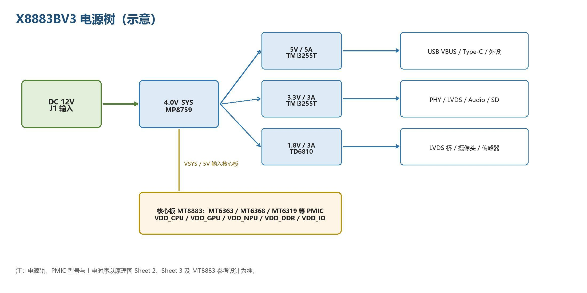

# 电源与调试

主板输入 12 V，经输入保护形成 VCC12V_DCIN；MP8759 产生 4.0V_SYS，TMI3255T 产生 5 V/3.3 V，TD6810 产生 1.8 V。核心板内部 PMIC 再产生 CPU/GPU/NPU/DDR/IO 电源。主板 12 V 输入不能直接接核心板 VSYS。

| 电源轨 | 典型值 | 用途 |
| --- | --- | --- |
| VCC12V_DCIN | 12V | 输入 |
| 4.0V_SYS | 4.0V | 系统总电源 |
| 5V | 5V | USB、LVDS、音频 |
| 3.3V | 3.3V | PHY、外设、连接器 |
| 1.8V | 1.8V | LVDS桥、摄像头、传感器 |

## 时钟、复位与热设计

核心板提供 26/52 MHz 参考时钟，RTL8111H 使用 25 MHz 晶体，LVDS 桥使用 12 MHz 晶体。按以下顺序检查上电：12 V → 4.0V_SYS → 5V/3.3V/1.8V → VSYS → PMIC → 复位释放。掉电时避免 IO 倒灌。高负载下配置散热片或合适金属结构，天线远离电源与高速线路，并进行满载与温度测试。

## 串口日志

使用 J21（3.3 V TTL），GND/RX/TX/3V3 顺序见接口表；PC TX 接板端 RX，PC RX 接板端 TX，默认 115200-8-N-1。该参数针对主板 J21，不能替代核心板裸 IO 的电压要求。优先采集完整启动日志，再排查外设。

---

**参考资料**

网盘 `x8883-docs` → `X8883开发板硬件手册.pdf` → 第四章“电源、时钟与复位”和第五章“软件资源”。
