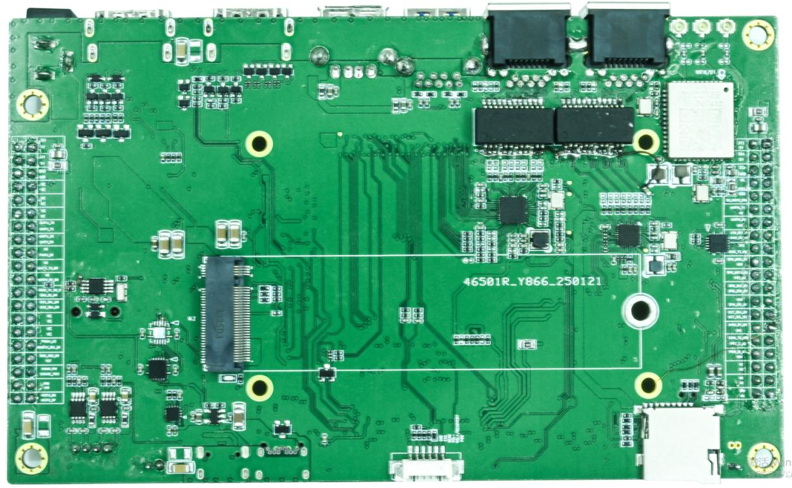
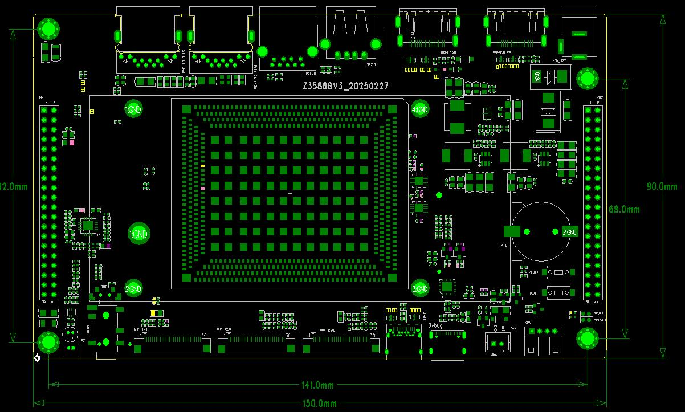

# 硬件资源

## 板卡正反面

背面可见 Wi-Fi/BT 模组、TF 卡座、6-pin 外接按键接口及 M.2 接口。

## 主要硬件资源

| 功能 | 硬件资源 | 说明 |
| --- | --- | --- |
| 处理器 | RK3588 | 八核 CPU，集成 GPU 与 NPU |
| 电源管理 | RK806-2 | 支持动态调频；主板 DC 输入为 12 V |
| 显示 | HDMI IN、HDMI OUT、MIPI DSI | MIPI DSI 与 LVDS 复用，配置前核对屏幕接口 |
| 摄像头 | 2 路 MIPI CSI | 用于连接 MIPI 摄像头模组 |
| 网络 | RTL8211F、RTL8111 | 两路千兆以太网，第二路经 PCIe |
| 无线 | VS2275P | 手册标注 Wi-Fi 6、Bluetooth 5.3 |
| 存储 | eMMC、TF、M.2 | eMMC 板载；TF 可用于启动或存储；M.2 用作存储扩展 |
| USB | USB2.0、USB3.0、Type-C OTG | OTG Type-C 用于下载及 ADB 调试 |
| 音频 | MIC、耳机、扬声器 | 扬声器接口定义见接口页；功放规格存在冲突 |
| 调试 | Type-C DEBUG | 用于串口日志和调试 |
| 散热 | 12 V 风扇接口 | 2-pin，GND / 12 V |
| RTC | 3 V 纽扣电池座 | 用于断电后维持 RTC 计时 |

## 板卡接口位置

正面接口标号与背面接口标号参见《硬件接口定义》页面。不要仅凭外观推断连接器的电压或 pin 1 方向，接线前应核对板上丝印和接口表。
