# 硬件接口定义

## 正面接口布局

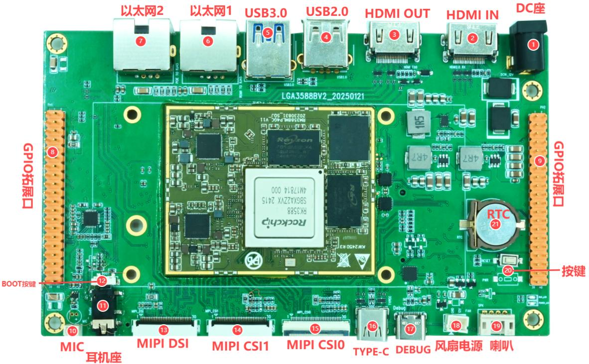

| 标号 | 接口 | 说明 |
| --- | --- | --- |
| 1 | DC 座 | 12 V 直流输入 |
| 2 | HDMI IN | HDMI 输入 |
| 3 | HDMI OUT | HDMI 输出 |
| 4 | USB2.0 | Type-A Host |
| 5 | USB3.0 | Type-A Host |
| 6 | 以太网 1 | 千兆以太网，RGMII，RTL8211F |
| 7 | 以太网 2 | 千兆以太网，PCIe，RTL8111 |
| 8 | GPIO 排针 1 | 正面总览图左侧，2×20、2.54 mm |
| 9 | GPIO 排针 2 | 正面总览图右侧，2×20、2.54 mm |
| 10 | MIC | 2-pin 1.25 mm，录音输入 |
| 11 | 耳机座 | 耳机/耳麦接口 |
| 12 | BOOT | 下载按键 |
| 13 | MIPI DSI | MIPI 显示接口 |
| 14 | MIPI CSI1 | 摄像头接口，位于 DSI 与 CSI0 之间 |
| 15 | MIPI CSI0 | 摄像头接口，靠近 Type-C OTG |
| 16 | TYPE-C | OTG、程序下载与 ADB 调试 |
| 17 | DEBUG | Type-C 串口调试接口 |
| 18 | 风扇 | 12 V 风扇接口 |
| 19 | 喇叭 | 4-pin、2.0 mm 卧式 PH 座 |
| 20 | 按键 | 复位与电源按键 |
| 21 | RTC | RTC 电池接口 |

## 背面接口布局

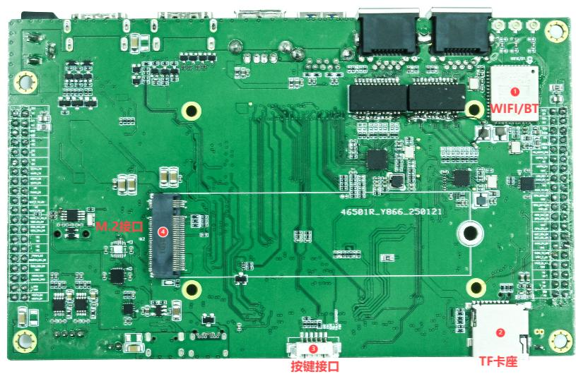

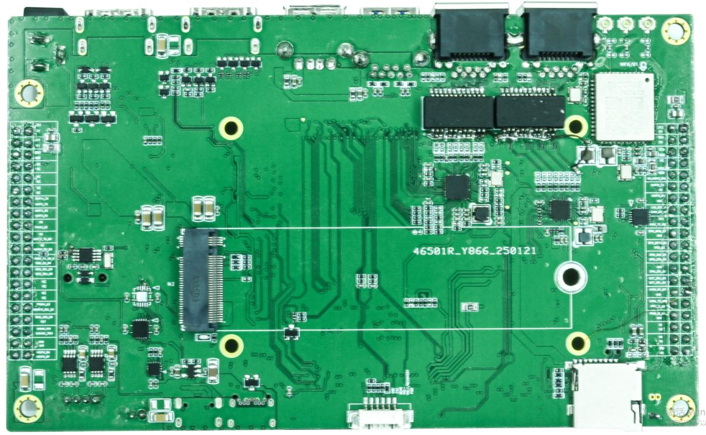

| 标号 | 接口 | 说明 |
| --- | --- | --- |
| 1 | WIFI/BT | 板载无线模块 |
| 2 | TF 卡座 | TF 卡 |
| 3 | 按键接口 | 6-pin、1.25 mm 外接按键座 |
| 4 | M.2 | M.2 存储接口 |

## 电源输入

主板采用 12 V DC 输入。硬件接口章节建议使用 12 V/3 A 适配器。标配清单却写为 12 V/2 A，两个数值不一致；在厂商确认前，按 12 V/3 A 作为接口章节的建议值，不应将 12 V/2 A 视为已确认的充分供电规格。

## HDMI

HDMI IN 和 HDMI OUT 均为标准 Type-A 接口。手册称 HDMI IN 与 HDMI OUT 均由 RK3588 原生接口引出。系统侧的实际显示/采集能力仍取决于对应 SDK、设备树和驱动配置。

## USB

- USB 3.0：1 路 Type-A，可连接 U 盘、鼠标等外设。
- USB 2.0：1 路 Type-A Host。
- Type-C：OTG 接口，主要用于程序下载和 ADB 调试。

## 以太网与无线

- Ethernet 1：RTL8211F，GMAC/RGMII 千兆以太网。
- Ethernet 2：RTL8111，PCIe 千兆以太网。
- Wi-Fi/BT：硬件手册标注 VS2275P，支持 Wi-Fi 6 与 Bluetooth 5.3。

## GPIO 扩展排针

两组 2×20、2.54 mm 排针。下表保留手册定义；`NC` 表示手册未定义/未连接，不应自行补配信号。

### GPIO 排针 1（正面 8 号）

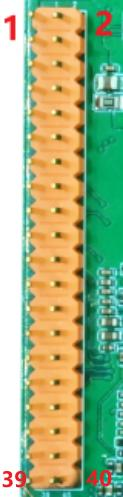

| Pin | Signal | Pin | Signal |
| ---: | --- | ---: | --- |
| 1 | 3.3V | 2 | 5V |
| 3 | I2C4_SDA_M1 (3.3V) | 4 | 5V |
| 5 | I2C4_SCL_M1 (3.3V) | 6 | GND |
| 7 | NC | 8 | UART2_RX_M0 (3.3V) |
| 9 | GND | 10 | UART2_TX_M0 (3.3V) |
| 11 | UART6_TX_M1 (3.3V) | 12 | NC |
| 13 | UART6_RX_M1 (3.3V) | 14 | GND |
| 15 | GPIO4_B0_D (3.3V) | 16 | CAN2_RX_M0 (3.3V) |
| 17 | 3.3V | 18 | CAN2_TX_M0 (3.3V) |
| 19 | SPI0_MOSI_M2 (1.8V) | 20 | GND |
| 21 | SPI0_MISO_M2 (1.8V) | 22 | GPIO4_C2_D (3.3V) |
| 23 | SPI0_CLK_M2 (1.8V) | 24 | SPI0_CS0_M2 (1.8V) |
| 25 | GND | 26 | SPI0_CS1_M2 (3.3V) |
| 27 | I2C7_SDA_M0 (3.3V) | 28 | I2C7_SCL_M0 (3.3V) |
| 29 | NC | 30 | GND |
| 31 | NC | 32 | GPIO1_A7_U (3.3V) |
| 33 | GPIO1_D7_U (3.3V) | 34 | GND |
| 35 | NC | 36 | NC |
| 37 | NC | 38 | NC |
| 39 | GND | 40 | NC |

### GPIO 排针 2（正面 9 号）

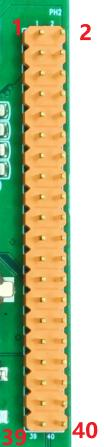

| Pin | Signal | Pin | Signal |
| ---: | --- | ---: | --- |
| 1 | 5V | 2 | 12V |
| 3 | 5V | 4 | 12V |
| 5 | GND | 6 | GND |
| 7 | NC | 8 | NC |
| 9 | NC | 10 | NC |
| 11 | NC | 12 | NC |
| 13 | UART1_TX_M1 (3.3V) | 14 | UART4_TX_M0 (3.3V) |
| 15 | UART1_RX_M1 (3.3V) | 16 | UART4_RX_M0 (3.3V) |
| 17 | GPIO4_B6_D (3.3V) | 18 | NC |
| 19 | UART6_TX_M0 (3.3V) | 20 | NC |
| 21 | UART6_RX_M0 (3.3V) | 22 | NC |
| 23 | GPIO2_B0_U (3.3V) | 24 | GPIO4_B2_U (3.3V) |
| 25 | I2C6_SDA_M0 (3.3V) | 26 | I2C6_SCL_M0 (3.3V) |
| 27 | NC | 28 | NC |
| 29 | NC | 30 | NC |
| 31 | GPIO3_C6_U (3.3V) | 32 | GPIO1_D6_U (3.3V) |
| 33 | RESET_L | 34 | GPIO2_B2_U (3.3V) |
| 35 | SARADC_VIN3 (1.8V) | 36 | SARADC_VIN2 (1.8V) |
| 37 | GND | 38 | GND |
| 39 | USB20_HOST0_DP | 40 | USB20_HOST0_DM |

**电平注意：** GPIO 表中同时存在 1.8 V 与 3.3 V 信号。SPI0_MOSI/MISO/CLK/CS0 标注为 1.8 V，SARADC_VIN2/VIN3 标注为 1.8 V；不得直接按 3.3 V GPIO 连接。接入外设前应确认该信号的实际 IO 电压及复用配置。

## MIC、耳机与扬声器

### MIC（正面 10 号）

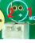

2-pin、1.25 mm，Pin 1 = MIC，Pin 2 = GND。

### 耳机（正面 11 号）

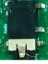

板载耳机和耳麦接口。

### 扬声器（正面 19 号）

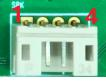

4-pin、2.0 mm PH 座，Pin 1 = OUT1A，Pin 2 = OUT1B，Pin 3 = OUT2A，Pin 4 = OUT2B。扬声器额定功率按实际功放配置确认。输出为功放差分端，OUTxA 和 OUTxB 均不能直接接地。

## MIPI DSI（正面 13 号）

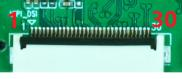

手册定义 30-pin MIPI DSI 连接器，并说明与 LVDS 复用。两者只能使用一路。手册引脚如下：

| Pin | Signal | Pin | Signal |
| ---: | --- | ---: | --- |
| 1 | VCC_5V0 | 16 | GND |
| 2 | VCC_5V0 | 17 | MIPI_DPHY0_TX_D3N |
| 3 | VCC_5V0 | 18 | MIPI_DPHY0_TX_D3P |
| 4 | VCC3V3_S3 | 19 | GND |
| 5 | VCC3V3_S3 | 20 | MIPI_DPHY0_TX_D2N |
| 6 | I2C4_SCL_M1 | 21 | MIPI_DPHY0_TX_D2P |
| 7 | I2C4_SDA_M1 | 22 | GND |
| 8 | TP_INT_L | 23 | MIPI_DPHY0_TX_CLKN |
| 9 | TP_RST_L | 24 | MIPI_DPHY0_TX_CLKP |
| 10 | VCC3V3_S3 | 25 | GND |
| 11 | VCC3V3_S3 | 26 | MIPI_DPHY0_TX_D1N |
| 12 | PWM15_M2 | 27 | MIPI_DPHY0_TX_D1P |
| 13 | LCD_RST_H | 28 | GND |
| 14 | NC | 29 | MIPI_DPHY0_TX_D0N |
| 15 | LCD_BL_EN_H | 30 | MIPI_DPHY0_TX_D0P |

## MIPI CSI

### MIPI CSI1（正面 14 号）

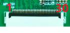

### MIPI CSI0（正面 15 号）

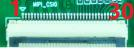

### 30-pin 信号定义

现有资料仅列出一张 CSI 引脚表。连接 CSI1 或 CSI0 前，请按对应连接器的原理图核对线序、电源及信号。

| Pin | Signal | Pin | Signal |
| ---: | --- | ---: | --- |
| 1 | GND | 16 | GND |
| 2 | MIPI_CSI_RX_CLK0P | 17 | MIPI_CSI_RX_CLK1P |
| 3 | MIPI_CSI_RX_CLK0N | 18 | MIPI_CSI_RX_CLK1N |
| 4 | GND | 19 | MIPI_AF |
| 5 | MIPI_CSI_RX_D0P | 20 | I2C3_SCL_M0_MIPI |
| 6 | MIPI_CSI_RX_D0N | 21 | I2C3_SDA_M0_MIPI |
| 7 | GND | 22 | MIPI_CAM3_CLKOUT |
| 8 | MIPI_CSI_RX_D1P | 23 | SDIO_CLK_M0_WIFI |
| 9 | MIPI_CSI_RX_D1N | 24 | SDIO_D3_M0_WIFI |
| 10 | GND | 25 | MIPI_CAM3_PDN_L |
| 11 | MIPI_CSI_RX_D2P | 26 | CAM_RST |
| 12 | MIPI_CSI_RX_D2N | 27 | CAM_RST |
| 13 | GND | 28 | VCC1V8_CAM |
| 14 | MIPI_CSI_RX_D3P | 29 | VCC2V8_CAM |
| 15 | MIPI_CSI_RX_D3N | 30 | MIPI_1.2V_CAM |

## Type-C、DEBUG 与按键

Type-C OTG 用于程序下载和 ADB 调试；另一个 Type-C 连接器为 DEBUG 串口。手册没有给出 DEBUG 的串口电平、波特率或针脚定义，需使用配套线材/实际板卡说明，不可将其当作普通 USB 数据口。

### 外接按键座（背面 3 号）

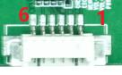

外接按键座为 6-pin、1.25 mm。

| Pin | Signal |
| ---: | --- |
| 1 | PWRON_L |
| 2 | VOL+/RECOVERY |
| 3 | VOL- |
| 4 | MENU_KEY |
| 5 | ESC_KEY |
| 6 | GND |

## 风扇、TF、M.2 与 RTC

### 风扇（正面 18 号）

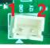

2-pin，Pin 1 = GND，Pin 2 = 12V。

### TF 卡座（背面 2 号）

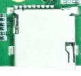

TF 卡可用于启动或文件存储，具体取决于固件。Android 启动后，已识别的存储可在 `/storage/` 查看。

### M.2 与 RTC

- M.2：手册仅称为 M.2 硬盘接口，未注明 Key 类型、支持协议、尺寸和供电能力，选型前需确认。
- RTC：3 V 纽扣电池座，维持断电后的 RTC 计时。
