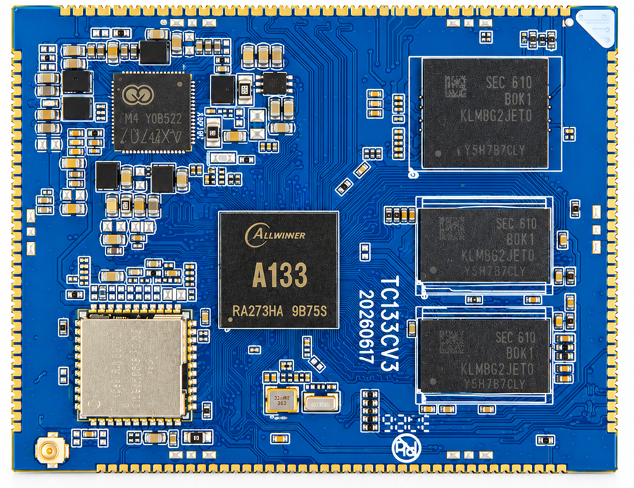

# Product Introduction

The td133, model td133cv4, is based on the Allwinner A133. It integrates DDR3, eMMC, a dual-band Wi-Fi 6 module and an AXP707 power management IC. Its 155 castellated pads connect the module to displays, cameras and other peripherals through a carrier board.

## Specifications

| Item | Specification |
| --- | --- |
| Processor | Allwinner A133, quad-core Cortex-A53, 1.7 GHz |
| GPU | PowerVR GE8300 |
| Memory | DDR3, 512 MB to 2 GB, standard 1 GB |
| Storage | Onboard eMMC in 4, 8, 16, 32 or 64 GB, standard 8 GB |
| Display | One 4-lane MIPI DSI and two LVDS interfaces with shared pins |
| Cameras | Two MIPI CSI interfaces |
| USB | Two USB 2.0 interfaces |
| Networking | Onboard dual-band Wi-Fi 6 and support for an external Gigabit Ethernet PHY |
| Power | AXP707, 5 V / 2 A main supply |
| Operating systems | Android / Linux |
| Temperature | Operating 0 to 70 °C, storage −10 to 50 °C |

## Package and Dimensions

The eight-layer PCB measures 64 × 50 mm and is 1.2 mm thick. The castellated pad pitch is 1.2 mm. See [Pin Definitions](./td133-pin-definition.md) for the carrier footprint orientation.

## Board Photo

## Documentation

- [Pin Definitions](./td133-pin-definition.md)
- [Interface Resources](./td133-interface-resources.md)
- [Hardware Design and Debugging](./td133-hardware-design.md)
