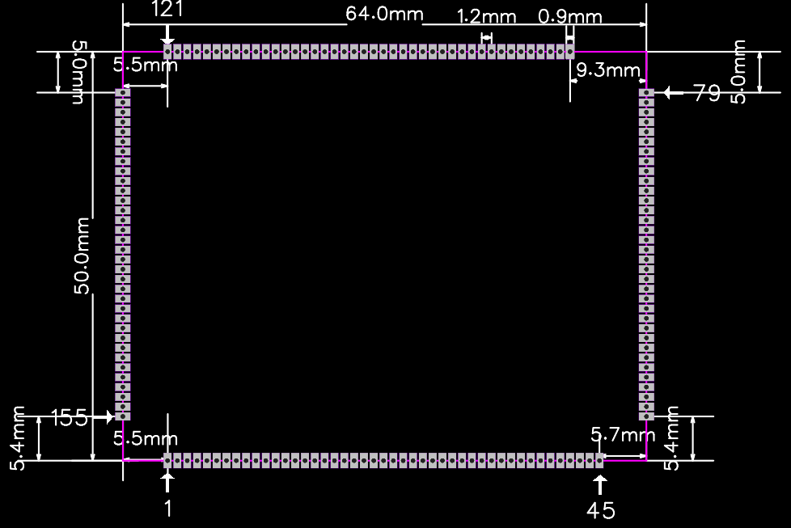

# Pin Definitions

The layout marks pins 1, 45, 79, 121 and 155. Slashes separate the signal labels listed for one pad. The active function depends on pin multiplexing. Check pad numbering and signal levels against the carrier schematic before wiring.

## Pins 1–45

| Pin | Signal | Type | Description |
| --- | --- | --- | --- |
| 1 | `NMI` | Non-maskable interrupt | Pull up or pull down |
| 2 | `PWRON` | System power-on | Active low |
| 3 | `RESET` | SoC reset | Active low |
| 4 | `FEL` | Flashing mode entry | Active low |
| 5 | `DCDCE` / `VCC3V3` | Power output | PMIC DLDO3 |
| 6 | `ALDO3` | Power output | 3.3 V |
| 7 | `PC7` | I/O | 1.8 V |
| 8 | `PC12` | I/O | 1.8 V |
| 9 | `BLDO4` / `DVDD-CSI` | Power output | 2.8 V |
| 10 | `AVDD-CSI` | Power output | PMIC DLDO3 |
| 11 | `VCC-CSI` | Power output | 1.8 V |
| 12 | `PD19` / `LCD0_DE` / `LVDS1_D3N` / `UART4_RX` / `EINK_STH` / `PD_EINT19` | I/O | 3.3 V in I/O mode, 1.8 V in LVDS mode where supported |
| 13 | `PD18` / `LCD0_CLK` / `LVDS1_D3P` / `UART4_TX` / `EINK_CKH` / `PD_EINT18` | I/O | 3.3 V in I/O mode, 1.8 V in LVDS mode where supported |
| 14 | `PD23` / `PWM0` / `TWI0_SDA` / `PD_EINT23` | I/O | 3.3 V in I/O mode, 1.8 V in LVDS mode where supported |
| 15 | `PD21` / `LCD0_VSYNC` / `PWM3` / `UART4_CTS` / `EINK_MODE` / `PD_EINT21` | I/O | 3.3 V in I/O mode, 1.8 V in LVDS mode where supported |
| 16 | `PD20` / `LCD0_HSYNC` / `PWM2` / `UART4_RTS` / `EINK_CKV` / `PD_EINT20` | I/O | 3.3 V in I/O mode, 1.8 V in LVDS mode where supported |
| 17 | `PD22` / `PWM1` / `TWI0_SCK` / `EINK_STV` / `PD_EINT22` | I/O | 3.3 V in I/O mode, 1.8 V in LVDS mode where supported |
| 18 | `PD16` / `LCD0_D22` / `LVDS1_CKP` / `UART3_RTS` / `EINK_OEH` / `PD_EINT16` | I/O | 3.3 V in I/O mode, 1.8 V in LVDS mode where supported |
| 19 | `PD17` / `LCD0_D23` / `LVDS1_CKN` / `UART3_CTS` / `EINK_LEH` / `PD_EINT17` | I/O | 3.3 V in I/O mode, 1.8 V in LVDS mode where supported |
| 20 | `PD8` / `LCD0_D12` / `LVDS0_D3P` / `DSI_DP3` / `EINK0_D8` / `PD_EINT8` | I/O | 3.3 V in I/O mode, 1.8 V in LVDS mode where supported |
| 21 | `PD9` / `LCD0_D13` / `LVDS0_D3N` / `DSI_DM3` / `EINK0_D9` / `PD_EINT9` | I/O | 3.3 V in I/O mode, 1.8 V in LVDS mode where supported |
| 22 | `PD4` / `LCD0_D6` / `LVDS0_D2P` / `DSI_CKP` / `EINK0_D4` / `PD_EINT4` | I/O | 3.3 V in I/O mode, 1.8 V in LVDS mode where supported |
| 23 | `PD5` / `LCD0_D7` / `LVDS0_D2N` / `DSI_CKM` / `EINK0_D5` / `PD_EINT5` | I/O | 3.3 V in I/O mode, 1.8 V in LVDS mode where supported |
| 24 | `PD6` / `LCD0_D10` / `LVDS0_CKP` / `DSI_DP2` / `EINK0_D6` / `PD_EINT6` | I/O | 3.3 V in I/O mode, 1.8 V in LVDS mode where supported |
| 25 | `PD7` / `LCD0_D11` / `LVDS0_CKN` / `DSI_DM2` / `EINK0_D7` / `PD_EINT7` | I/O | 3.3 V in I/O mode, 1.8 V in LVDS mode where supported |
| 26 | `PD2` / `LCD0_D4` / `LVDS0_D1P` / `DSI_DP1` / `EINK0_D2` / `PD_EINT2` | I/O | 3.3 V in I/O mode, 1.8 V in LVDS mode where supported |
| 27 | `PD3` / `LCD0_D5` / `LVDS0_D1N` / `DSI_DM1` / `EINK0_D3` / `PD_EINT3` | I/O | 3.3 V in I/O mode, 1.8 V in LVDS mode where supported |
| 28 | `PD0` / `LCD0_D2` / `LVDS0_D0P` / `DSI_DP0` / `EINK0_D0` / `PD_EINT0` | I/O | 3.3 V in I/O mode, 1.8 V in LVDS mode where supported |
| 29 | `PD1` / `LCD0_D3` / `LVDS0_D0N` / `DSI_DM0` / `EINK0_D1` / `PD_EINT1` | I/O | 3.3 V in I/O mode, 1.8 V in LVDS mode where supported |
| 30 | `PD14` / `LCD0_D20` / `LVDS1_D2P` / `UART3_TX` / `EINK0_D14` / `PD_EINT14` | I/O | 3.3 V in I/O mode, 1.8 V in LVDS mode where supported |
| 31 | `PD15` / `LCD0_D21` / `LVDS1_D2N` / `UART3_RX` / `EINK0_D15` / `PD_EINT15` | I/O | 3.3 V in I/O mode, 1.8 V in LVDS mode where supported |
| 32 | `PD12` / `LCD0_D18` / `LVDS1_D1P` / `SPI1_MOSI` / `EINK0_D12` / `PD_EINT12` | I/O | 3.3 V in I/O mode, 1.8 V in LVDS mode where supported |
| 33 | `PD13` / `LCD0_D19` / `LVDS1_D1N` / `SPI1_MISO` / `EINK0_D13` / `PD_EINT13` | I/O | 3.3 V in I/O mode, 1.8 V in LVDS mode where supported |
| 34 | `PD10` / `LCD0_D14` / `LVDS1_D0P` / `SPI1_CS` / `EINK0_D10` / `PD_EINT10` | I/O | 3.3 V in I/O mode, 1.8 V in LVDS mode where supported |
| 35 | `PD11` / `LCD0_D15` / `LVDS1_D0N` / `SPI1_CLK` / `EINK0_D11` / `PD_EINT11` | I/O | 3.3 V in I/O mode, 1.8 V in LVDS mode where supported |
| 36 | `GND` | Ground |  |
| 37 | `USB1-DM` | USB signal | Unavailable as GPIO |
| 38 | `USB1-DP` | USB signal | Unavailable as GPIO |
| 39 | `GND` | Ground |  |
| 40 | `USB0-DM` | USB signal | Unavailable as GPIO |
| 41 | `USB0-DP` | USB signal | Unavailable as GPIO |
| 42 | `GND` | Ground |  |
| 43 | `MCSIA-RST` / `PE9` / `BIST_RESULT3` / `I2S2_DIN0` / `PE_EINT9` | I/O | 1.8 V |
| 44 | `MCSIA-STBY` / `PE8` / `BIST_RESULT2` / `I2S2_DOUT0` / `PE_EINT8` | I/O | 1.8 V |
| 45 | `MCSIB-STBY` / `PE6` / `BIST_RESULT0` / `I2S2_BCLK` / `PE_EINT6` | I/O | 1.8 V |

## Pins 46–79

| Pin | Signal | Type | Description |
| --- | --- | --- | --- |
| 46 | `PE7` / `I2S2_LRCK` / `TCON_TRIG` / `PE_EINT7` | I/O | 1.8 V |
| 47 | `PE0` / `MIPI_MCLK0` / `PE_EINT0` | I/O | 1.8 V |
| 48 | `PE1` / `TWI2_SCK` / `PE_EINT1` | I/O | 1.8 V |
| 49 | `PE2` / `TWI2_SDA` / `PE_EINT2` | I/O | 1.8 V |
| 50 | `PE3` / `TWI3_SCK` / `PE_EINT3` | I/O | 1.8 V |
| 51 | `PE4` / `TWI3_SDA` / `PE_EINT4` | I/O | 1.8 V |
| 52 | `MCSIA-D0N` | MIPI CSI signal | Unavailable as GPIO |
| 53 | `MCSIA-D0P` | MIPI CSI signal | Unavailable as GPIO |
| 54 | `MCSIA-D1N` | MIPI CSI signal | Unavailable as GPIO |
| 55 | `MCSIA-D1P` | MIPI CSI signal | Unavailable as GPIO |
| 56 | `MCSIA-D3N` | MIPI CSI signal | Unavailable as GPIO |
| 57 | `MCSIA-D3P` | MIPI CSI signal | Unavailable as GPIO |
| 58 | `MCSIA-CLKN` | MIPI CSI signal | Unavailable as GPIO |
| 59 | `MCSIA-CLKP` | MIPI CSI signal | Unavailable as GPIO |
| 60 | `MCSIA-D2N` | MIPI CSI signal | Unavailable as GPIO |
| 61 | `MCSIA-D2P` | MIPI CSI signal | Unavailable as GPIO |
| 62 | `MCSIB-D0N` | MIPI CSI signal | Unavailable as GPIO |
| 63 | `MCSIB-D0P` | MIPI CSI signal | Unavailable as GPIO |
| 64 | `MCSIB-CLKN` | MIPI CSI signal | Unavailable as GPIO |
| 65 | `MCSIB-CLKP` | MIPI CSI signal | Unavailable as GPIO |
| 66 | `MCSIB-D1N` | MIPI CSI signal | Unavailable as GPIO |
| 67 | `MCSIB-D1P` | MIPI CSI signal | Unavailable as GPIO |
| 68 | `HPOUTL` | Left headphone output | 1.8 V, unavailable as GPIO |
| 69 | `HPOUTR` | Right headphone output | 1.8 V, unavailable as GPIO |
| 70 | `MBIAS` | Primary microphone bias output | 1.8 V, unavailable as GPIO |
| 71 | `HSOMIC` | Headset microphone detect | 1.8 V, unavailable as GPIO |
| 72 | `HBIAS` | Secondary microphone bias output | 1.8 V, unavailable as GPIO |
| 73 | `LINEOUTP` | Audio output | Unavailable as GPIO |
| 74 | `LINEOUTN` | Audio output | Unavailable as GPIO |
| 75 | `MICIN1N` | Microphone input | Unavailable as GPIO |
| 76 | `MICIN1P` | Microphone input | Unavailable as GPIO |
| 77 | `MICIN2N` | Microphone input | Unavailable as GPIO |
| 78 | `MICIN2P` | Microphone input | Unavailable as GPIO |
| 79 | `GND` | Ground |  |

## Pins 80–121

| Pin | Signal | Type | Description |
| --- | --- | --- | --- |
| 80 | `HP-DET` | I/O | 1.8 V |
| 81 | `PC2` | I/O | 1.8 V |
| 82 | `PC3` | I/O | 1.8 V |
| 83 | `PF0` / `SDC0_D1` / `JTAG_MS` / `JTAG_MS_GPU` / `PF_EINT0` | I/O | 1.8 V |
| 84 | `PF6` / `PF_EINT6` | I/O | 1.8 V |
| 85 | `PF5` / `SDC0_D2` / `JTAG_CK` / `JTAG_CK_GPU` / `PF_EINT5` | I/O | 1.8 V |
| 86 | `PF4` / `SDC0_D3` / `UART0_RX` / `PF_EINT4` | I/O | 1.8 V |
| 87 | `PF1` / `SDC0_D0` / `JTAG_DI` / `JTAG_DI_GPU` / `PF_EINT1` | I/O | 1.8 V |
| 88 | `PF3` / `SDC0_CMD` / `JTAG_DO` / `JTAG_DO_GPU` / `PF_EINT3` | I/O | 1.8 V |
| 89 | `PF2` / `SDC0_CLK` / `UART0_TX` / `PF_EINT2` | I/O | 1.8 V |
| 90 | `PH9` / `DMIC_DATA0` / `SPI2_CLK` / `I2S2_BCLK` / `MDC0` / `PH_EINT9` | I/O | 3.3 V |
| 91 | `PH8` / `DMIC_CLK` / `SPI2_CS` / `I2S2_MCLK` / `I2S2_DIN2` / `PH_EINT8` | I/O | 3.3 V |
| 92 | `PH11` / `DMIC_DATA2` / `SPI2_MISO` / `I2S2_DOUT0` / `I2S2_DIN1` / `PH_EINT11` | I/O | 3.3 V |
| 93 | `PH10` / `DMIC_DATA1` / `SPI2_MOSI` / `I2S2_LRCK` / `MDIO0` / `PH_EINT10` | I/O | 3.3 V |
| 94 | `PH12` / `DMIC_DATA3` / `TWI3_SCK` / `I2S2_DIN0` / `I2S2_DOUT1` / `PH_EINT12` | I/O | 3.3 V |
| 95 | `PB3` / `UART2_CTS` / `SPI2_MISO` / `JTAG_DI` / `PB_EINT3` | I/O | 3.3 V |
| 96 | `PB0` / `UART2_TX` / `SPI2_CS` / `JTAG_MS` / `PB_EINT0` | I/O | 3.3 V |
| 97 | `PB1` / `UART2_RX` / `SPI2_CLK` / `JTAG_CK` / `PB_EINT1` | I/O | 3.3 V |
| 98 | `PB2` / `UART2_RTS` / `SPI2_MOSI` / `JTAG_DO` / `PB_EINT2` | I/O | 3.3 V |
| 99 | `PH19` / `CIR_IN` / `I2S3_DOUT3` / `I2S3_DIN3` / `LEDC` / `PH_EINT19` | I/O | 3.3 V |
| 100 | `PH18` / `CIR_OUT` / `I2S3_DOUT2` / `I2S3_DIN2` / `RGMII0_TXD2` / `PH_EINT18` | I/O | 3.3 V |
| 101 | `PL10` / `S_PWM` / `S_PL_EINT10` | I/O | 3.3 V |
| 102 | `PH14` / `I2S3_BCLK` / `RGMII0_RXD3` / `RMII0_NULL` / `PH_EINT14` | I/O | 3.3 V |
| 103 | `GND` | Ground |  |
| 104 | `PB4` / `TWI1_SCK` / `I2S0_MCLK` / `JTAG_MS_GPU` / `PB_EINT4` | I/O | 3.3 V |
| 105 | `GND` | Ground |  |
| 106 | `PB5` / `TWI1_SDA` / `I2S0_BCLK` / `JTAG_CK_GPU` / `PB_EINT5` | I/O | 3.3 V |
| 107 | `PB6` / `I2S0_LRCK` / `JTAG_DO_GPU` / `PB_EINT6` | I/O | 3.3 V |
| 108 | `PB7` / `I2S0_DOUT0` / `I2S0_DIN1` / `PB_EINT7` | I/O | 3.3 V |
| 109 | `PB8` / `SPDIF_OUT` / `I2S0_DIN0` / `I2S0_DOUT1` / `PB_EINT8` | I/O | 3.3 V |
| 110 | `PB10` / `UART0_RX` / `TWI0_SDA` / `PWM1` / `PB_EINT10` | I/O | 3.3 V |
| 111 | `PB9` / `UART0_TX` / `TWI0_SCK` / `JTAG_DI_GPU` / `PB_EINT9` | I/O | 3.3 V |
| 112 | `PL7` / `S_JTAG_DI` / `S_PL_EINT7` | I/O | 3.3 V |
| 113 | `PL8` / `S_TWI1_SCK` / `S_PL_EINT8` | I/O | 3.3 V |
| 114 | `PL9` / `S_TWI1_SDA` / `S_PL_EINT9` | I/O | 3.3 V |
| 115 | `PL11` / `S_CPU_CUR_W` / `S_CIR_IN` / `S_PL_EINT11` | I/O | 3.3 V |
| 116 | `PH0` / `TWI0_SCK` / `RGMII0_RXD1` / `RMII0_RXD1` / `PH_EINT0` | I/O | 3.3 V |
| 117 | `PH1` / `TWI0_SDA` / `RGMII0_RXD0` / `RMII0_RXD0` / `PH_EINT1` | I/O | 3.3 V |
| 118 | `PH2` / `TWI1_SCK` / `CPU_CUR_W` / `RGMII0_RXCTL` / `PH_EINT2` | I/O | 3.3 V |
| 119 | `PH3` / `TWI1_SDA` / `CIR_OUT` / `RGMII0_CLKIN` / `RMII0_RXER` / `PH_EINT3` | I/O | 3.3 V |
| 120 | `LRADC` | Low-speed ADC | 1.8 V |
| 121 | `GND` | Ground |  |

## Pins 122–155

| Pin | Signal | Type | Description |
| --- | --- | --- | --- |
| 122 | `PH4` / `UART3_TX` / `SPI1_CS` | I/O | 3.3 V |
| 123 | `PH5` / `UART3_RX` / `SPI1_CLK` | I/O | 3.3 V |
| 124 | `PH6` / `UART3_RTS` / `SPI1_MOSI` | I/O | 3.3 V |
| 125 | `PH7` / `UART3_CTS` / `SPI1_MISO` | I/O | 3.3 V |
| 126 | `GND` | Ground |  |
| 127 | `PH15` / `I2S3_LRCK` | I/O | 3.3 V |
| 128 | `GND` | Ground |  |
| 129 | `PH17` / `I2S3_DOUT1` / `I2S3_DIN0` | I/O | 3.3 V |
| 130 | `GND` | Ground |  |
| 131 | `PH13` / `TWI3_SDA` / `I2S3_MCLK` | I/O | 3.3 V |
| 132 | `GND` | Ground |  |
| 133 | `PH16` / `I2S3_DOUT0` / `I2S3_DIN1` | I/O | 3.3 V |
| 134 | `GND` | Ground |  |
| 135 | `GND` | Ground |  |
| 136 | `GND` | Ground |  |
| 137 | `GND` | Ground |  |
| 138 | `GND` | Ground |  |
| 139 | `NC` / `GND` | Analog input | Pseudo-differential headphone ground reference |
| 140 | `USB0-DRVVBUS` | I/O | PMIC VBUS mode selection and control |
| 141 | `TS` | ADC input | PMIC temperature sensing |
| 142 | `VBUS` | Power input | 5 V / 2 A |
| 143 | `PMU-SDA` | I2C0 data | Connected to the onboard PMIC |
| 144 | `PUM-SCK` | I2C0 clock | Connected to the onboard PMIC |
| 145 | `AVCC` | Power output | 1.8 V / 0.5 A |
| 146 | `GND` | Ground |  |
| 147 | `GND` | Ground |  |
| 148 | `GND` | Ground |  |
| 149 | `PS` | Power input | 5 V / 2 A |
| 150 | `PS` | Power input | 5 V / 2 A |
| 151 | `PS` | Power input | 5 V / 2 A |
| 152 | `ACIN` | Power input | 5 V / 2 A |
| 153 | `ACIN` | Power input | 5 V / 2 A |
| 154 | `VBAT` | Battery input | Single-cell battery, 4.2 V |
| 155 | `VBAT` | Battery input | Single-cell battery, 4.2 V |
