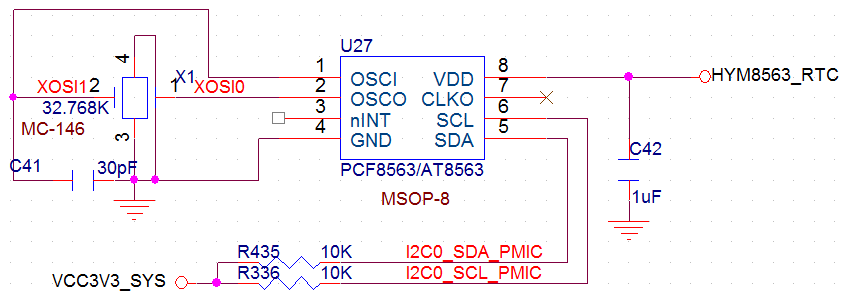

# Hardware design

The PX30 has a relatively small pin count but a comprehensive set of peripherals. Allocate the multiplexed signals carefully when designing the circuit.

## DDR selection

PX30 supports DDR3 and DDR4. X30CV1 uses DDR3 for cost efficiency; a future change to DDR4 may depend on market conditions. X30CV2 uses LPDDR3 and supports up to 2 GB with one device, which is more cost efficient than two 1 GB DDR3 devices.

## Flash selection

PX30 supports both NAND flash and eMMC. eMMC offers better stability and operating efficiency, at a slightly higher cost. X30CV1 uses an external 8 GB eMMC device by default instead of NAND flash.

## Camera interface

PX30 supports MIPI and parallel cameras. The parallel camera interface uses many I/O pins, and many of these pins are shared with Ethernet. The X30 evaluation board provides only a MIPI camera connector and assigns the parallel camera signals to 100 Mbps Ethernet. A custom carrier board can allocate these signals differently if Ethernet is not required.

## Display interfaces

PX30 supports MIPI, LVDS and RGB displays. MIPI and LVDS share one group of pins and cannot be used simultaneously; RGB uses a separate group. The X30 evaluation board provides one connector for MIPI or LVDS and another for RGB. PX30 has no native HDMI output; an external bridge is required for HDMI.

## Audio interface

PX30 provides a standard I2S audio interface. The RK809 PMU includes an audio codec, so an additional external audio codec is unnecessary.

## SDIO interfaces

PX30 provides three SDIO interfaces. The X30 design assigns one to the onboard eMMC, one to a Wi-Fi/Bluetooth module such as AP6212, and one to a TF card for storage expansion.

SDMMC0 data lines D0 and D1 are multiplexed with UART2, which is used for debug output. UART2 also has an alternative mapping on other GPIOs. Only one UART2 mapping may be active at a time; software selects the mapping.

## Power supply design

Supply 5 V/1 A to pins 109 and 110 and 5 V RTC power to pin 115. The power pins are defined below:

- Pin 95: PMU LDO7 output, programmable voltage, up to 400 mA.

- Pin 96: PMU LDO8 output, programmable voltage, up to 400 mA.

- Pins 109 and 110: main 5 V/1 A power inputs.

- Pins 111 and 112: common ground.

- Pin 113: PMU control output, usable to enable an external power supply.

- Pin 114: PMU power output, 5 V/1.5 A.

- Pin 115: RTC power input, normally 5 V.

- Pin 116: PMU DC output, programmable from 1.5 to 3.6 V, up to 2.5 A.

- Pin 117: PMU LDO4 output, programmable voltage, up to 400 mA.

- Pin 118: PMU LDO2 output, programmable voltage, up to 400 mA.

:::danger RTC power sequencing

Warning: RTC power on pin 115 must not be applied later than power on pin 110. Otherwise the PMU, CPU and other core components may be damaged. The RTC supply voltage must not be lower than the voltage on pin 110. The RK809 RTC typically draws about 38 µA in standby. For applications requiring a clock, a separate RTC on the carrier board is recommended. The manual recommends AT8563, with approximately 0.6 µA standby current. The reference circuit is shown below.

:::

## USB design

PX30 provides one USB HOST port and one USB OTG port, operating at up to 480 Mbps under USB 2.0. Route these high-speed signals as length-matched differential pairs with 90 Ω impedance and a continuous reference plane. The differential pairs are listed below.

| Differential pin numbers | Differential signal names |
| --- | --- |
| 119、120 | OTG_DP、OTG_DM |
| 123、124 | USB_HOST_DM、USB_HOST_DP |

## MIPI design

The MIPI Alliance was founded in 2003 by companies including ARM, Nokia, ST and TI to standardize interfaces such as cameras, displays and RF/baseband connections, reducing design complexity and improving flexibility. Common interfaces include DSI for displays and CSI for cameras.

PX30 supports DSI and CSI. DSI uses core board pins 7–16 for MIPI displays, while CSI uses pins 81–90 for MIPI cameras. MIPI operates at higher data rates than LVDS; route the signals as length-matched differential pairs with 100 Ω impedance.
