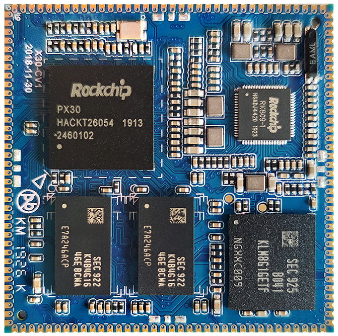
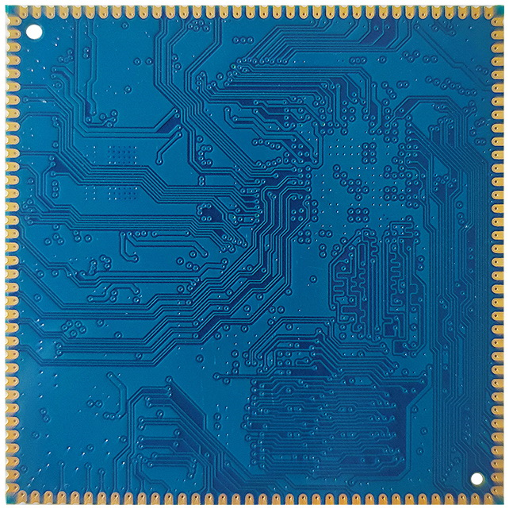
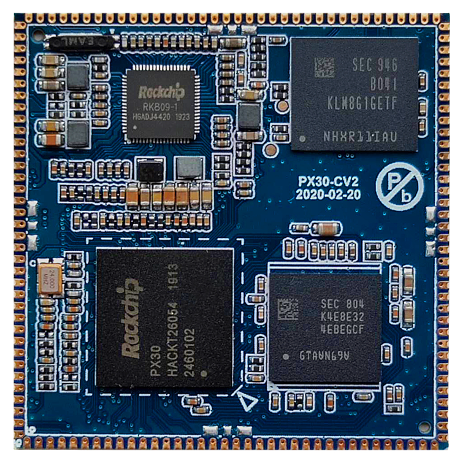
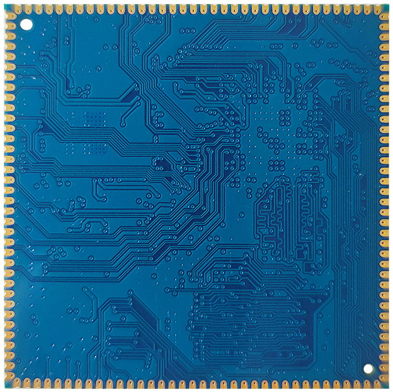
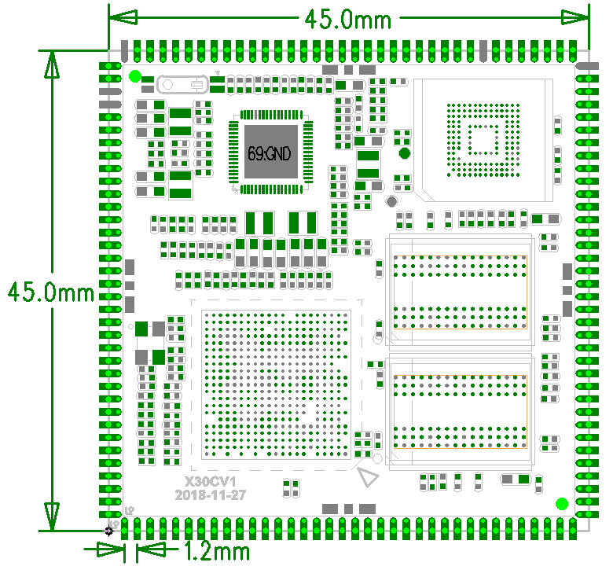

# Dimensions and structure

## X30CV1 appearance

### X30CV1 front view

### X30CV1 rear view

## X30CV2 appearance

### X30CV2 front view

### X30CV2 rear view

## Mechanical drawing

Core board dimensions and pin arrangement:

## Mechanical specifications

| Item | Value |
| --- | --- |
| Package | Castellated edge pads |
| Dimensions | 45mm*45mm*2.6mm |
| Pin pitch | 1.2mm |
| Pad dimensions | 2.0mm*0.7mm |
| Pin count | 144PIN |
| PCB layers | 8 layers |
| Warpage | Less than 0.5% |
