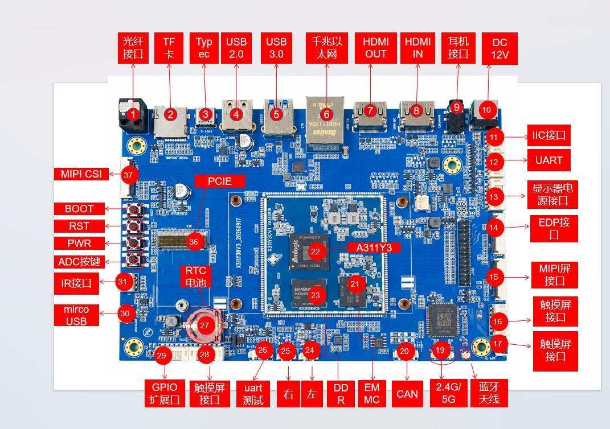

# Evaluation board and connector reference

## 6.1 Evaluation board interface map

Figure 6-1 identifies connectors on the X311Y3CV1 evaluation carrier board. It is a carrier board, not the core board itself. Use chapters 1 and 3 for core board dimensions, pads and pin definitions.

**Figure 6-1 A311Y3 evaluation carrier board interface map**

The evaluation board covers HDMI TX/RX, MIPI DSI/eDP, MIPI CSI, USB 3.0/2.0, PCIe, Gigabit Ethernet, Wi-Fi/Bluetooth, audio, TF cards, RTC, infrared, buttons, GPIO and debug UART. Adapt the reference to product mechanical, certification and cost requirements.

## 6.2 Connector number reference

The entries in Table 6-1 correspond to the red numbers in Figure 6-1 for hardware debugging and production testing. The source image retains its original Chinese labels; the English table identifies every numbered connection.

**Table 6-1 Evaluation board connector numbers**

| Number | Name | Number | Name |
| --- | --- | --- | --- |
| 1 | Optical audio | 20 | CAN connector |
| 2 | TF card | 21 | EMMC |
| 3 | TypeC | 22 | A311Y3 |
| 4 | USB2.0 | 23 | DDR |
| 5 | USB3.0 | 24 | Left speaker |
| 6 | Gigabit Ethernet | 25 | Right speaker |
| 7 | HDMIOUT | 26 | Debug UART |
| 8 | HDMIIN | 27 | RTC battery |
| 9 | Headphone connector | 28 | Touch panel |
| 10 | DC12V | 29 | GPIO expansion |
| 11 | I2C connector | 30 | microUSB |
| 12 | UART connector | 31 | Infrared connector |
| 13 | Display power | 32 | ADC buttons |
| 14 | eDP panel | 33 | Power button |
| 15 | MIPI panel | 34 | Reset button |
| 16 | Touch panel | 35 | BOOT button |
| 17 | Touch panel | 36 | PCIe connector |
| 18 | Bluetooth antenna | 37 | MIPI camera |
| 19 | 2.4/5 GHz antenna |  |  |

## 6.3 Application design recommendations

Retain debug UART, BOOT, RESET, Type-C OTG and test points when adapting the evaluation board. Select audio, infrared, CAN, TF and GPIO resources for the product. Reassess antenna keep-outs and cooling for metal enclosures.

For dual displays, verify DSI/eDP/LVDS and HDMI clocks, power and backlight controls. For multiple cameras, verify CSI_A/B and CSI_C/D lane allocation, MCLK and I2C addresses. For PCIe, verify the PCIe 2.0 x1/USB 3.0 Host selection.
