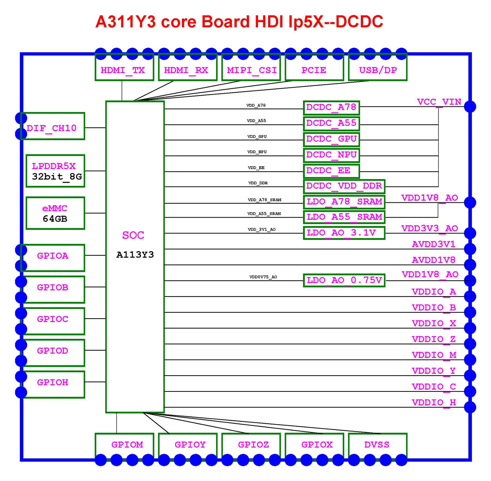
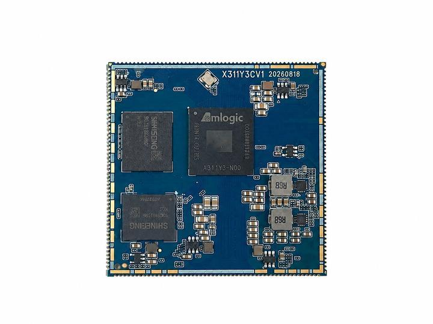
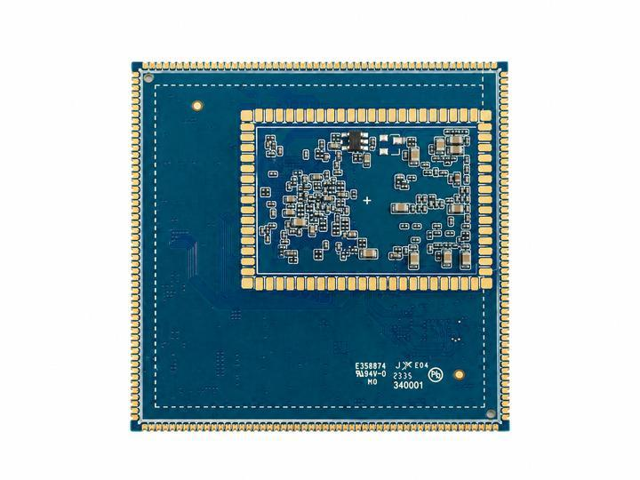
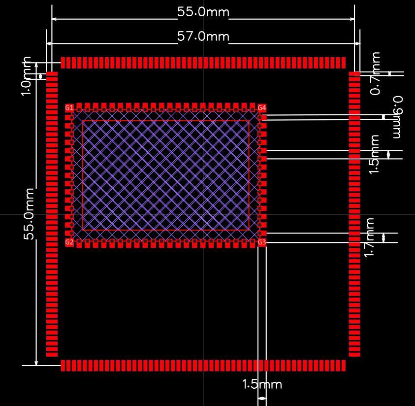

# Product introduction

Model: **X311Y3CV1**. Source manual: **V1.1**, October 2026.

## 1.1 Product overview

The X311Y3 core board (model X311Y3CV1), developed by Shenzhen JiuDing ChuangZhan Technology Co., Ltd., is based on the Amlogic A311Y3 processor. It measures 55 mm × 55 mm × 3.0 mm and uses a 286-pin LGA pad array. Onboard LPDDR5X, eMMC 5.1 and DC/DC converters are connected to display, camera, USB, PCIe, Ethernet, SDIO, audio, debug and GPIO resources exposed through the bottom pads.

A311Y3 combines two Cortex-A78 cores at up to 2.4 GHz and six Cortex-A55 cores at up to 2.0 GHz. It integrates an 8 TOPS NPU and Mali-G625 MC1 GPU, supports video capability up to 4K at 120 fps, and runs Android 16 and Linux 6.12. Applications include edge computing, industrial control, commercial displays, smart retail, machine vision and intelligent terminals.

## 1.2 Key features

- Heterogeneous octa-core CPU: 2 × Cortex-A78 at 2.4 GHz + 6 × Cortex-A55 at 2.0 GHz, balancing performance and efficiency.

- 8 TOPS NPU: INT4, INT8 and FP16 inference for visual inspection, edge AI and intelligent interaction.

- Mali-G625 MC1 GPU: OpenGL ES 3.2, Vulkan 1.4 and OpenCL 3.0 for graphical interfaces and lightweight 3D applications.

- LPDDR5X: 32-bit bus, 8 GB standard or 16 GB optional; onboard memory signals are not exposed.

- eMMC 5.1: 64 GB standard, 128 GB or 256 GB optional; eMMC boot supported.

- 286-pin LGA: 55 mm × 55 mm × 3.0 mm with bottom pads for reflow soldering. Refer to the mechanical drawing and PCB files for pad size and pitch.

- Displays: one HDMI 2.1a TX, one HDMI 2.1a RX with eARC, and one multiplexed 4-lane MIPI DSI/eDP/LVDS output.

- Cameras: two 4-lane MIPI CSI interfaces for high-resolution cameras and stereo/multiple-camera modules.

- High-speed interfaces: USB 3.0 OTG Type-C with DP Alt Mode, USB 3.0 Host, PCIe 3.0 x2, PCIe 2.0 x1 and RGMII Gigabit Ethernet.

- Expansion: six UARTs, nine I2C controllers, six SPI controllers, 14 PWM channels, five 10-bit ADC channels and GPIO banks A/B/C/D/H/M/X/Y/Z.

- Power and PCB: 12 V input, onboard discrete DC/DC converters, 10-layer Tg170 PCB, immersion-gold finish and plugged vias. Operating range: -10 to 70°C. The core board consumes power and does not supply power to the carrier board.

- Software: Android 16 and Linux 6.12, with driver resources for displays, touch, storage, USB, PCIe, Ethernet, Wi-Fi/Bluetooth, audio and cameras. See the software chapter for the support status of individual features.

## 1.3 System block diagram

Figure 1-1 shows the X311Y3CV1 system architecture: A311Y3 at the center, LPDDR5X/eMMC/GPIO on the left, DC/DC and LDO supplies on the right, and HDMI, MIPI CSI, PCIe and USB/DP interfaces above and below. Use the schematic for the actual connections.

**Figure 1-1 X311Y3CV1 system block diagram**

## 1.4 Mechanical construction

The 286-pin LGA bottom pads are reflow-soldered to the carrier board. Dimensions including components are 55 mm × 55 mm × 3.0 mm; PCB thickness is 1.6 mm. The 10-layer PCB uses an immersion-gold finish. Refer to the mechanical drawing and PCB files for pad dimensions, pitch and keep-out areas.

**Figure 1-2 X311Y3CV1 top view**

**Figure 1-3 X311Y3CV1 bottom view**

**Figure 1-4 Core board mechanical drawing**

## 1.5 Interface resources

Table 1-2 summarizes interface resources. Available resources have a corresponding SoC controller and are described as exposed in the manual. Simultaneous use depends on pin multiplexing, carrier board circuits and software configuration.

**Table 1-2 Core board interface resources**

| Interface category | Resources and notes |
| --- | --- |
| HDMI output | 1 HDMI 2.1a TX with video, audio, DDC/CEC/HPD and eARC. |
| HDMI input | 1 HDMI 2.1a RX with 4K input and eARC for capture, monitoring and conferencing. |
| MIPIDSI/eDP/LVDS | 2 multiplexed 4-lane DIF outputs configurable as MIPI DSI, eDP or LVDS (source table value; see discrepancy note). |
| MIPICSI | 2 four-lane MIPI CSI links (CSI_A/B and CSI_C/D) for high-resolution and multiple-camera configurations. |
| USB | 1 USB 3.0 OTG Type-C with DP Alt Mode, 1 USB 3.0 Host, 1 USB 2.0 Host and 1 USB 2.0 OTG. |
| PCIe | 1 PCIe 3.0 x2 and 1 PCIe 2.0 x1; the latter shares pins with USB 3.0 Host, so select one. |
| Ethernet | 1 RGMII Gigabit Ethernet interface |
| Wi-Fi/Bluetooth | 1 four-bit SDIO link, UART/PCM, 32K clock and controls for a carrier board Wi-Fi/Bluetooth module. |
| Audio | I2S/PCM/PDM, SPDIF, HDMI eARC, headphone detection and microphone input; requires carrier board audio codec. |
| Storage | Onboard eMMC 5.1; TF/SD expansion through carrier board SDIO. |
| Debug | 1 debug UART at 3.3 V (UART0), 1 UART_F; Type-C OTG flashing. |
| Expansion | 6 UARTs, 9 I2C, 6 SPI, 14 PWM, five 10-bit ADC channels and multiplexed GPIO banks. |

## 1.6 Configuration options

The standard configuration is 8 GB LPDDR5X and 64 GB eMMC 5.1. Larger memory and storage options are available by project. Confirm component availability, order quantity and lead time before ordering.

**Table 1-3 Configuration options**

| Configuration | Standard | Options | Notes |
| --- | --- | --- | --- |
| Memory | 8GBLPDDR5X | 16GBLPDDR5X | 32-bit bus; onboard, not exposed |
| Storage | 64GBeMMC5.1 | 128GB/256GB | eMMC boot with Boot Partition support |
| Power | 12 V input, discrete DC/DC | — | Carrier supply must provide at least 12 V / 2 A |
| Operating system | Android16/Linux6.12 | Project-specific customization | Subject to released firmware |
| Operating temperature | -10~70°C | — | Follow packaging labels for storage and transport |

## 1.7 Applications

X311Y3 targets embedded devices needing CPU/NPU performance and multiple display/camera interfaces within size and power constraints. Typical applications include:

- Industrial control and HMI: multiple UARTs, dual-Ethernet expansion, HDMI/LVDS displays, touch and GPIO control.

- Commercial displays and digital signage: HDMI, MIPI/eDP panels, independent dual displays, audio and network-delivered advertising.

- Machine vision and edge AI: two 4-lane MIPI CSI interfaces and an 8 TOPS NPU for defect detection, recognition and sorting.

- Smart retail and self-service terminals: Type-C/DP, USB peripherals, QR scanners, printing and payment modules.

- Video conferencing and medical displays: HDMI RX capture, HDMI TX output, eARC audio and camera input.

- Automotive and rail displays: wide-temperature project designs, HDMI/eDP display links and CAN/UART expansion. Confirm the required temperature grade for the project.

## 1.8 Pin definitions

The 286 LGA pads cover power, displays, cameras, USB/PCIe, Ethernet, SDIO, audio, debug and GPIO. Chapter 3 lists interface pin identifiers, multiplexed functions and supply domains. Appendix D provides the complete pin/network mapping.

If this manual differs from the latest schematic, pin-definition table or product specification, the latest controlled documentation takes precedence. Review power, sequencing, displays and high-speed interfaces before production introduction.

[SoC pin and net definitions](./x311y3-pin-definition.md) · [Interface resources](./x311y3-interface-resources.md)
