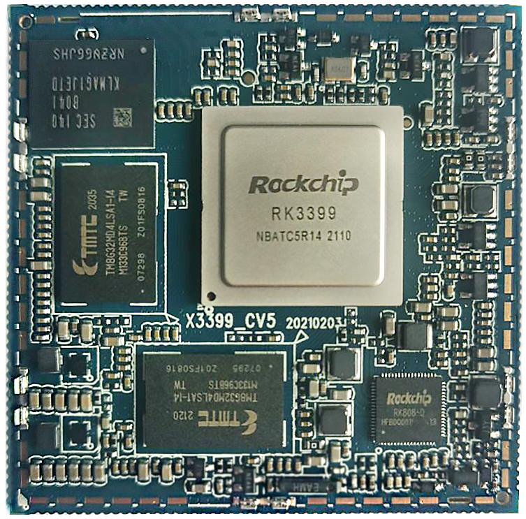
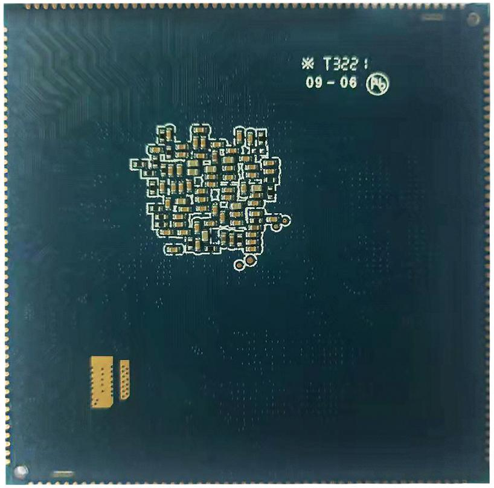

# Product Introduction

## Product Overview

X3399CV6 is a Rockchip RK3399 core board developed, manufactured and sold by Shenzhen JiuDing ChuangZhan Technology Co., Ltd. RK3399 combines four Cortex-A53 cores and two Cortex-A72 cores, with clocks up to 2 GHz. Its heterogeneous CPU design improves integer, floating-point and memory performance while balancing power consumption and die area. The quad-core Mali-T860 GPU incorporates bandwidth compression, ASTC and local pixel storage, supports graphics and compute interfaces, and is described in the source as offering a 45% performance improvement over the previous generation.

Type-C, integrated PCIe, dual-camera gesture-recognition capability and LPDDR4 support enable a wide range of products. Applications include tablets, VR, TV boxes, notebooks, smart appliances, advertising displays and all-in-one terminals, financial POS devices, vehicle controllers, thin clients, video conferencing, security, monitoring, public-safety terminals and IoT systems.

## Core Board Features

- Compact 55 mm × 55 mm footprint with extensive GPIO resources.
- Rockchip RK808 PMU for reliable operation and cost efficiency.
- Multiple eMMC brands and capacities; Toshiba 16 GB eMMC by default.
- Dual-channel LPDDR4, with 2 GB standard and a custom 4 GB option.
- Suspend and wake-up support.
- Android 6.0, Android 7.0, Linux, Debian 9 and Ubuntu are listed in the platform documentation, subject to the memory-version restriction below.
- Gigabit Ethernet.
- 200 external pins exposing nearly all CPU signals.
- Reliability testing includes temperature cycling, repeated rebooting, Android stability, AnTuTu and seven consecutive days of stress testing without a crash.

Compared with X3399CV3, X3399CV4/X3399CV6 change LPDDR3 to LPDDR4 while retaining pin compatibility. Software is compatible for Android 7.0 and later. The documented Android 6.0 version does not support LPDDR4; select the board and software combination accordingly.

## Appearance and Structure

## Specifications

### System Configuration

| Item | Specification |
| --- | --- |
| CPU | RK3399 |
| Clock | Four Cortex-A53 cores at 1.4 GHz + two Cortex-A72 cores at 2 GHz |
| Memory | 2 GB standard, compatible with 4 GB |
| Storage | 16 GB standard; other capacities optional |
| Power IC | RT808, with dynamic frequency scaling, as named in the source table |

### Interface Parameters

| Interface | Specification |
| --- | --- |
| LCD | Simultaneous MIPI, eDP and HDMI outputs |
| Touch | Capacitive touch; resistive touch can be added over USB or UART |
| Audio | AC97/IIS, playback and recording |
| SD card | Two SDIO output channels |
| eMMC | Onboard; signals are not exposed separately |
| Ethernet | Gigabit Ethernet |
| USB HOST 2.0 | Two HOST 2.0 ports |
| USB HOST 3.0 | Two TYPE 3.0 ports, as listed in the source |
| UART | Five UARTs, including flow-control support |
| PWM | Four outputs |
| I2C | Seven interfaces |
| SPI | One interface |
| ADC | One channel |
| Camera | One BT656/BT601 and one MIPI output, as listed in the source |
| HDMI | Synchronized high-definition audio/video output |

### Electrical Characteristics

| Item | Specification |
| --- | --- |
| Main 3.3 V input | 3.3 V / 4.3 A; 3.3 V / 5 A supply recommended |
| Auxiliary 3.3 V input | 3.3 V / 300 mA; must not be mixed with the main 3.3 V supply |
| RTC input | 2.5–3 V / 100 µA |
| Output | 1.8 V for carrier board use; becomes 0 V during suspend |
| Operating temperature | 0–70°C |
| Storage temperature | -10–50°C |

### Mechanical Parameters

| Item | Specification |
| --- | --- |
| Package | Castellated pads |
| Core board dimensions | 55 mm × 55 mm × 3 mm |
| Pin pitch | 1.0 mm |
| Pad dimensions | 0.5 mm × 1.8 mm; centrally symmetric footprint |
| Pin count | 200 |
| PCB layers | X3399CV3: 10; X3399CV4: 8; X3399CV5: 8 |
| Warpage | Less than 0.5% |
| Carrier cutout | Red regions in the drawing indicate the recommended carrier board cutout |

## Related Sections

- [Pin Definitions](./x3399cv5-pin-definition.md)
- [Hardware Design](./x3399cv5-hardware-design.md)
