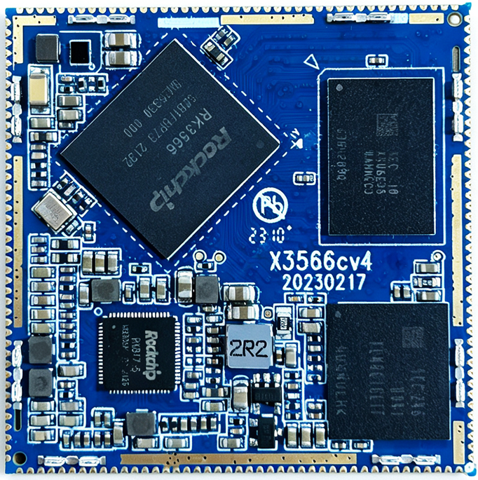
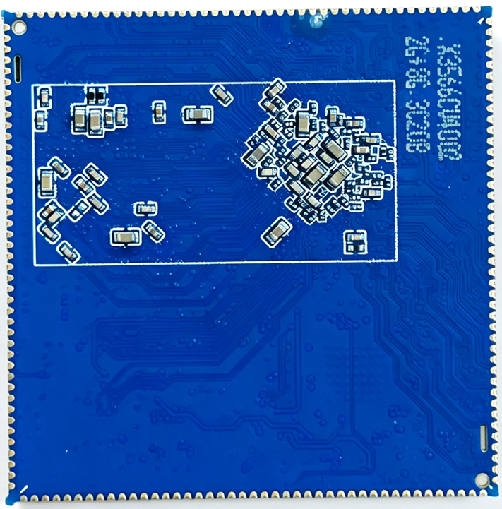

# Product Introduction

The x3566cv4 is a Rockchip RK3566 core board with an eight-layer PCB, an immersion gold finish and 172 castellated pads. It supports Android and Linux. The carrier board connects the module to displays, cameras, Ethernet and other peripherals.

The x3566cv4 is intended for carrier integration and embedded terminals, including industrial controllers, display terminals, POS systems, self-service ordering terminals, digital signage, vehicle devices and teaching platforms. The module integrates the processor, memory, storage and power management circuits. The carrier connects external devices.

The hardware supports software-controlled power on and off, suspend and wake-up. The companion evaluation carrier supports display, camera, network and audio validation. Available peripherals and functions depend on carrier wiring and system drivers.

## Specifications

| Item | Specification |
| --- | --- |
| Processor | RK3566, quad-core Cortex-A55 at 1.8 GHz |
| Memory and storage | LPDDR4, DDR4 or eMCP configurations. See the model table below for capacities |
| Power management | RK817 with VBUS or battery power |
| Display and touch | MIPI DSI, LVDS, eDP and HDMI, with capacitive touch support |
| Camera | MIPI CSI and parallel camera signals |
| Networking | Supports one Gigabit Ethernet interface with the physical port on the carrier |
| USB | USB 2.0 host, USB 3.0 host and USB OTG |
| Audio | Headphone output, speaker output and two microphone inputs |
| Expansion signals | SDMMC, UART, I2C, SPI, PWM, ADC and GPIO. See the pin tables for multiplexed functions |

## Functions and Interface Resources

| Interface | Resources and Uses |
| --- | --- |
| Display | MIPI DSI, LVDS, eDP and HDMI. DSI and LVDS share pins, with the mode selected in firmware |
| Touch | Capacitive touch support through the appropriate controller interface on the carrier |
| Camera | MIPI CSI and parallel inputs including BT.601, BT.656, BT.1120 and RAW. Some parallel signals share pins with Ethernet |
| Audio | Headphone and speaker outputs, microphone inputs, recording and playback |
| Ethernet | One Gigabit Ethernet interface, with external connections and circuitry on the carrier |
| Storage expansion | Two exposed SDIO channels for memory cards or SDIO peripherals. The onboard eMMC uses internal connections |
| USB | One USB 2.0 host, one USB 3.0 host and one USB OTG interface |
| UART | Multiple UART and flow-control alternate functions. UART2 is the default debug interface |
| I2C / SPI / PWM | Peripheral control, data communication and functions such as backlight control. Select alternate functions using the pin tables |
| ADC | The pin tables list ADC0, ADC1 and ADC2 on pins 7, 6 and 5 respectively |

Select alternate functions for each shared pad through pin multiplexing. Use [Pin Definitions](./x3566cv4-pin-definition.md) to check available signals, conflicting assignments and carrier logic levels.

## Electrical and Mechanical Specifications

| Item | Specification |
| --- | --- |
| Adapter input | VBUS, 5 V / 2 A |
| Battery input | 3.5–4.2 V, typical 3.7 V |
| Operating temperature | −10 to 70 °C |
| Storage temperature | −10 to 40 °C |
| Module dimensions | 45 × 45 mm, 3 mm thick |
| PCB construction | Eight layers, immersion gold finish |
| Pads | 172 castellated pads, 1.0 mm pitch, 1.3 × 0.6 mm pad dimensions |
| Warpage | Up to 0.5% |

See [Hardware Design and Soldering](./x3566cv4-hardware-design.md) for supply pins, footprint orientation and the reference reflow profile.

## Models and Capacities

| Model | Memory Type | Memory Capacity | eMMC Capacity |
| --- | --- | --- | --- |
| x3566cv4001 | LPDDR4 | 2 GB | 16 GB |
| x3566cv4002 | LPDDR4 | 2 GB | 8 GB |
| x3566cv4101 | DDR4 | 2 GB | 16 GB |
| x3566cv4102 | DDR4 | 2 GB | 8 GB |
| x3566cv4103 | DDR4 | 4 GB | 16 GB |
| `x3566cv42**` | eMCP | Default 2 GB | Default 32 GB |

Use the full model number to identify the fitted memory and eMMC capacities. The `x3566cv40**` series uses one LPDDR4 device, `x3566cv41**` uses two DDR4 devices, and `x3566cv42**` uses eMCP. The three series are pin-compatible and software-compatible. The two digits after `42` identify the capacity configuration.

## Model Changes and Version Differences

### x3566cv4 Series

| Model Series | Memory Configuration | Capacity Options | Version Relationship |
| --- | --- | --- | --- |
| `x3566cv40**` | One LPDDR4 device | Listed models have 2 GB memory and 8 GB or 16 GB eMMC | `x3566cv4001` and `x3566cv4002` replaced the earlier `i3566cv1` designation to standardize model names |
| `x3566cv41**` | Two DDR4 devices | Listed models include 2 GB / 4 GB memory and 8 GB / 16 GB eMMC | DDR4 configuration. The full model number identifies capacities |
| `x3566cv42**` | eMCP | Default 2 GB memory and 32 GB storage. Other configurations depend on the full model number | Memory and storage use an eMCP configuration |

All three series use a 172-pad, 45 × 45 mm package. The manual specifies pin and software compatibility across these series. Memory configuration and storage capacity are the main differences. The two digits after `42` identify the capacity configuration. Confirm the mapping using the full model number.

### Earlier x3566cv2 and x3566cv3 Versions

| Model | Package | Memory Type | Memory / eMMC |
| --- | --- | --- | --- |
| x3566cv2001 | 200 pads, 55 × 55 mm | DDR4 | 2 GB / 16 GB |
| x3566cv2002 | 200 pads, 55 × 55 mm | DDR4 | 4 GB / 16 GB |
| x3566cv3001 | 200 pads, 55 × 55 mm | LPDDR4 | 2 GB / 16 GB |
| x3566cv3002 | 200 pads, 55 × 55 mm | LPDDR4 | 4 GB / 16 GB |

The manual specifies two DDR4 devices for x3566cv2 and one LPDDR4 device for x3566cv3, with pin and software compatibility between them. Its version table also lists x3566cv3 as pin-compatible and software-compatible with x3568cv2 for cost-optimized RK3566 designs. The x3566cv4 uses a 172-pad, 45 × 45 mm package. Check the dimensions and pin definitions for the selected series when choosing a carrier.

## Board Photos

## Documentation

- [Pin Definitions](./x3566cv4-pin-definition.md)
- [Hardware Design and Soldering](./x3566cv4-hardware-design.md)
