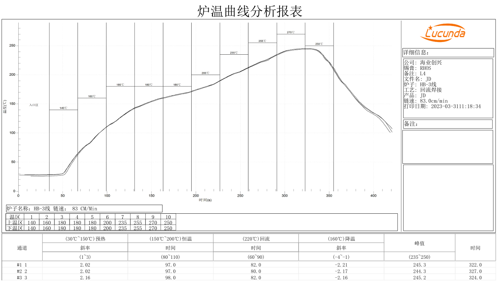

# Hardware Design and Soldering

## Power and Control

The core board uses an RK817 power management IC. Adapter power enters through `VBUS` on pins 146 and 147, specified as 5 V / 2 A in the manual. The battery input range is 3.5–4.2 V, with a typical voltage of 3.7 V. See [Pin Definitions](./x3566cv4-pin-definition.md) for battery terminals, sense and ground.

Pin 156, `PMIC_PWRON`, is active low. Pin 157, `PMIC_RESET_KEY`, is the reset input.

## Interface Assignments

| Interface | Pins | Description |
| --- | --- | --- |
| MIPI CSI | 70–81 | Camera differential signals |
| MIPI DSI / LVDS | 83–92 | Shared differential pins. Select the interface mode in firmware |
| HDMI | 93–104 | Includes DDC, CEC, hot-plug detect and differential signals |
| eDP | 120–129 | AUX and data differential pairs |
| USB 2.0 Host | 49–50 | USB 2.0 host differential pair |
| USB 3.0 Host | 110–115 | USB 2.0 and SuperSpeed differential pairs |
| USB OTG | 116–119 | VBUS detect, ID and USB differential pair |
| UART2 | 105–106 | Default debug UART, RX and TX respectively |

Some parallel camera signals share pins with GMAC. Some SDMMC0 data pins can also serve as UART signals. Check the pin tables for conflicting assignments when designing the carrier.

## Assembly Dimensions

| Item | Value |
| --- | --- |
| Module dimensions | 45 × 45 × 3 mm |
| Castellated pads | 172 |
| Pad pitch | 1.0 mm |
| Pad dimensions | 1.3 × 0.6 mm |
| Warpage | ≤ 0.5% |

Use the drawing in [Pin Definitions](./x3566cv4-pin-definition.md) to check the carrier footprint orientation. The manual specifies an operating temperature of −10 to 70 °C and a storage temperature of −10 to 40 °C.

## Reference Reflow Profile

Profile the oven for the solder paste and assembly conditions before reflowing the module and carrier together. The chart below is the oven test record from the original manual.

