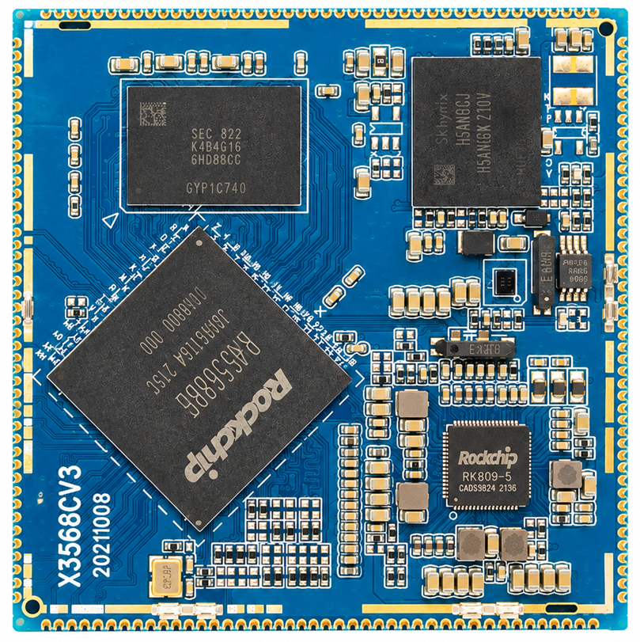
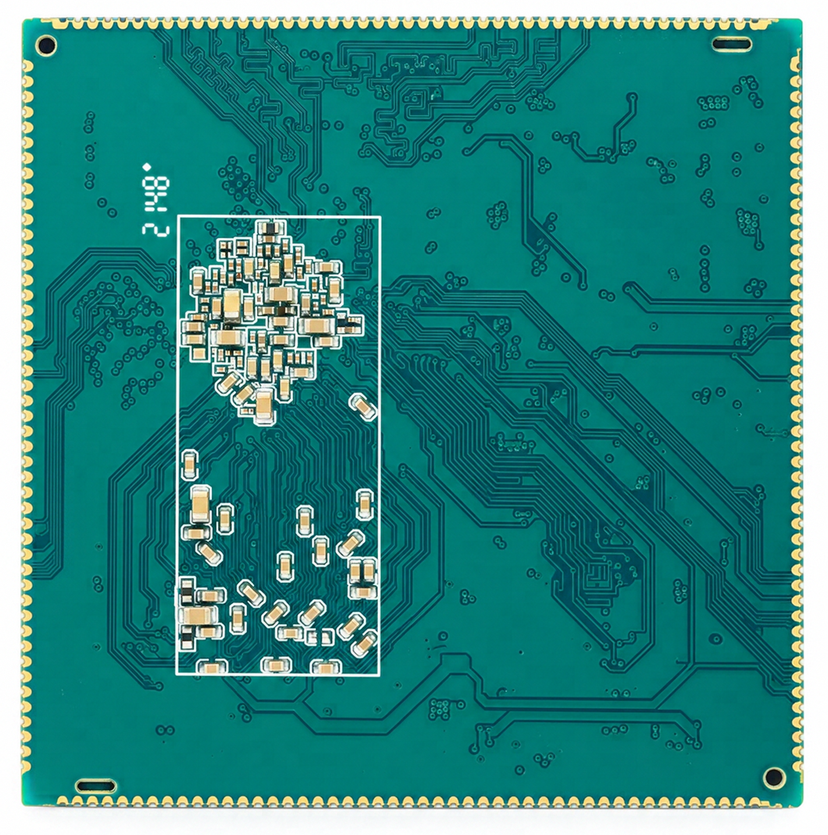
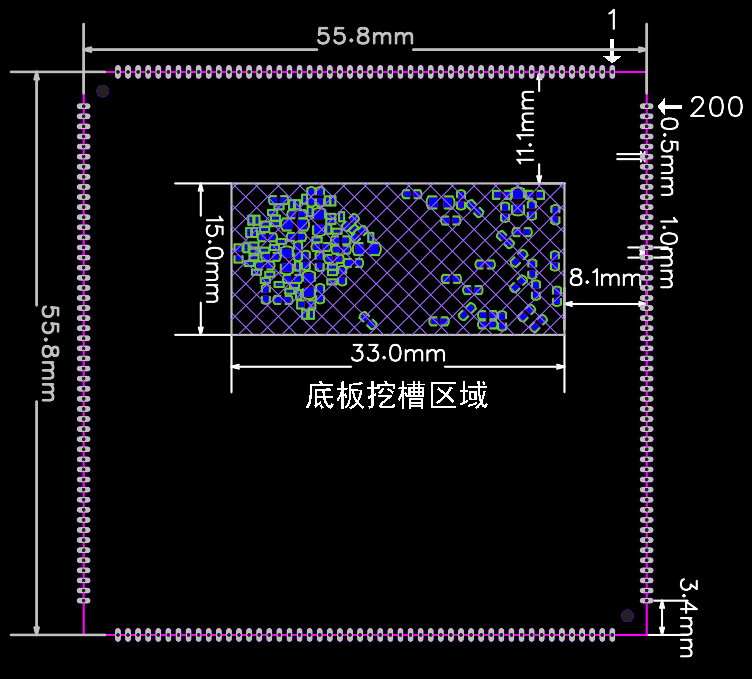
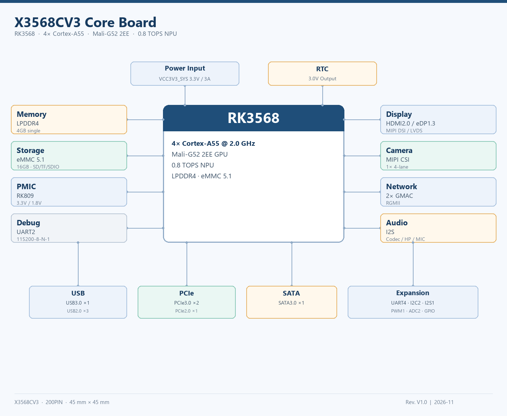

# X3568CV3 Core Board

The X3568CV3 is a JDCZ core board based on the Rockchip RK3568 for industrial control, commercial displays, and embedded terminals.

## Specifications

| Item | Specification |
| --- | --- |
| Processor | RK3568, quad-core Arm Cortex-A55 |
| GPU / NPU | Arm Mali-G52 2EE / 0.8 TOPS |
| Memory | 4 GB LPDDR4 |
| eMMC | 16 GB standard configuration |
| Dimensions | 55 mm × 55 mm |
| Package | 200 castellated pins, 1.0 mm pitch |
| System power input | VCC3V3_SYS: 3.3 V / 3 A |
| Interfaces | HDMI 2.0, eDP, MIPI DSI, LVDS, MIPI CSI, USB 3.0/2.0, PCIe 3.0, SATA 3.0, dual Gigabit Ethernet |

## Revision Notes

CV2 uses two DDR4 chips; CV3 uses one LPDDR4 chip. Pin connections, power supplies, and carrier boards must match the board revision.

## Mechanical and Interface Specifications

| System configuration |  |
| --- | --- |
| CPU | RK3568 (Cortex-A55) |
| Clock frequency | 2.0GHz |
| RAM | 4GB LPDDR4 (single chip) |
| ROM | 16GB eMMC (standard)，optional4GB/8GB |
| Power management IC | Onboard PMIC (RK809/RK817) |
| Interfaces |  |
| USB  interface | 1 channel(s) USB3.0 Host + 1 channel(s) USB3.0 OTG + 2 channel(s) USB2.0 Host |
| LCD  interface | 1 channel(s) HDMI2.0/1 channel(s) eDP/1 channel(s) MIPI DSI/1 channel(s) LVDS |
| Camera  interface | 1 channel(s) MIPI CSI |
| SPI  interface | Not separately exposed |
| I2C interface | 2 channel(s) I2C interface |
| UART interface | 4 channel(s) UART interface |
| SDIO interface | 1 channel(s) SDMMC0 |
| I2S interface | 1 channel(s) I2S interface |
| Ethernet interface | 2 channel(s) Gigabit Ethernet interface (GMAC0/GMAC1) |
| PWM interface | 1 channel(s) PWM |
| PCIe interface | 1 channel(s) PCIe3.0 x2 + 1 channel(s) PCIe2.0 |
| SATA interface | 1 channel(s) SATA3.0 |
| ADC interface | 2 channel(s) ADC |
| Electrical specifications |  |
| Power input | 3.3V/3A |
| Power output | VCC_RTC 3.0Voutput |
| Operating temperature | 0~70 °C |
| Storage temperature | -10~50 °C |

| Mechanical specifications |  |
| --- | --- |
| Package | Castellated pins |
| PCB dimensions | 55.8mm*55.8mm*1.6mm |
| Pin pitch | 1.0mm |
| Pin count | 200PIN |
| PCB layers | 8 layers |
| Warpage | Less than 0.5% |

| Interface | Resources and description |
| --- | --- |
| Display | 1 channel(s) HDMI2.0, 1 channel(s) eDP, 1 channel(s) MIPI DSI, 1 channel(s) LVDS |
| Camera | 1 channel(s) MIPI CSI |
| USB | 1 channel(s) USB3.0 Host, 1 channel(s) USB3.0 OTG, 2 channel(s) USB2.0 Host |
| Ethernet | 2 channel(s) RGMIIGigabit Ethernet (GMAC0/GMAC1) |
| PCIe | 1 channel(s) PCIe3.0 x2, 1 channel(s) PCIe2.0 |
| Storage | 1 channel(s) SDMMC0 (TF) |
| Audio | Headphones, speaker, MIC |
| Low-speed | 4 channel(s) UART, 2 channel(s) I2C, 1 channel(s) I2S, 1 channel(s) PWM, 2 channel(s) ADC, GPIO |
| Power | 3.3V/3Ainput; VCC_RTC 3.0Voutput |

## Board Views

## Mechanical Drawing

## System Block Diagram

