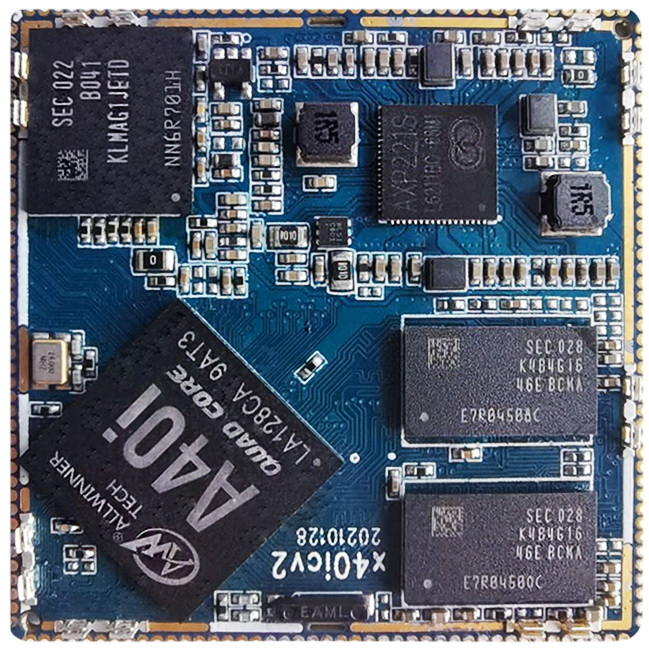
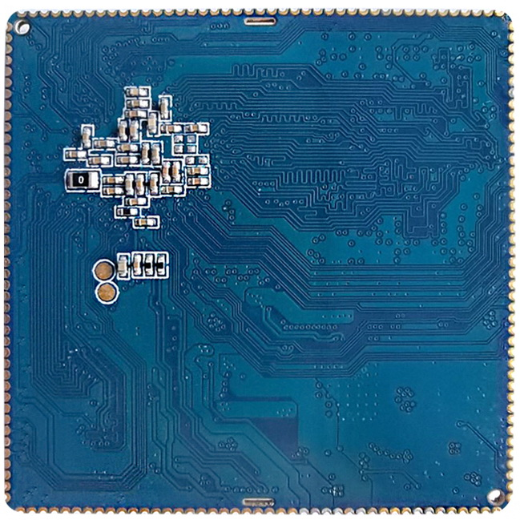
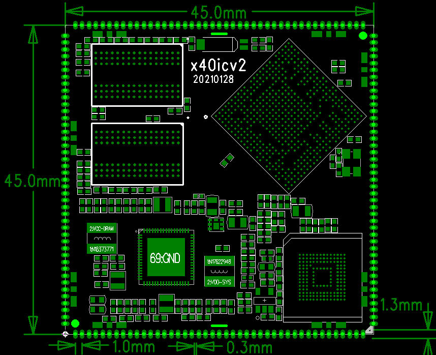

# Dimensions and structure

## Core board appearance

Core board front view

Core board rear view

## Mechanical drawing

Core board dimensions and pin arrangement:

## Mechanical specifications

## Mechanical specifications

| Item | Value |
| --- | --- |
| Package | Castellated edge pads |
| Dimensions | 45mm*45mm*3mm |
| Pin pitch | 1.0mm |
| Pad dimensions | 1.3mm*0.7mm |
| Pin count | 172PIN |
| Warpage | Less than 0.5% |
| PCB layers | 8 layers |
