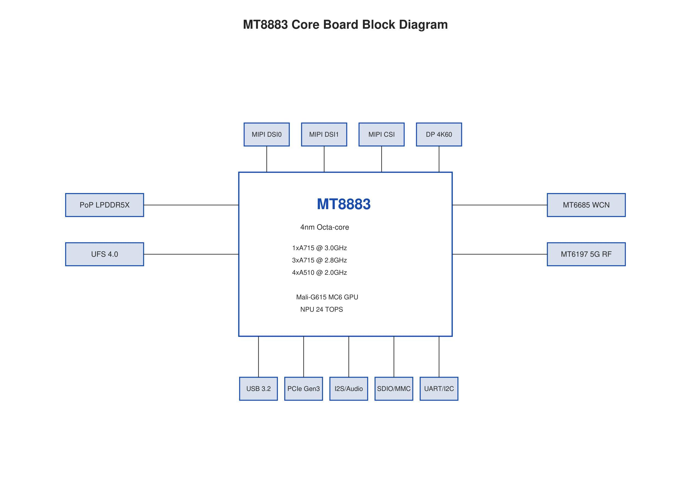
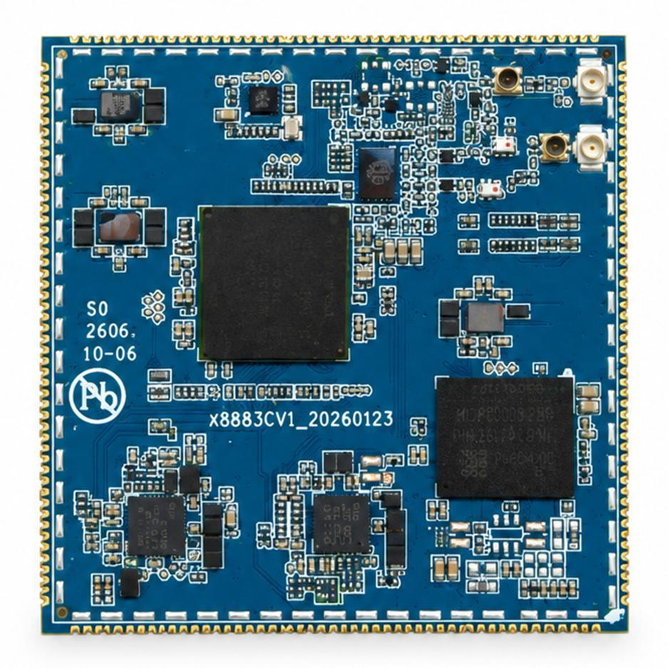
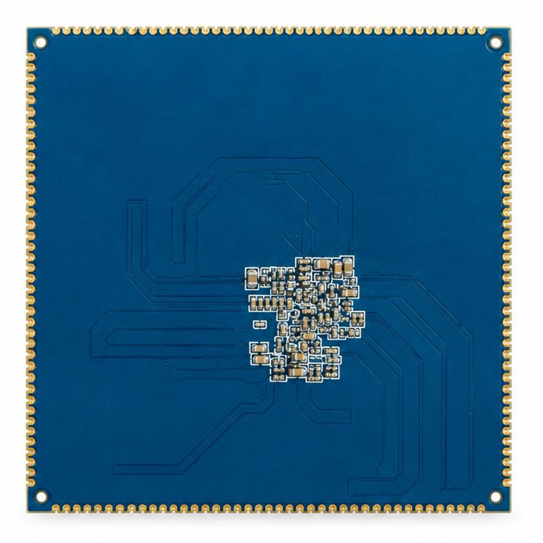
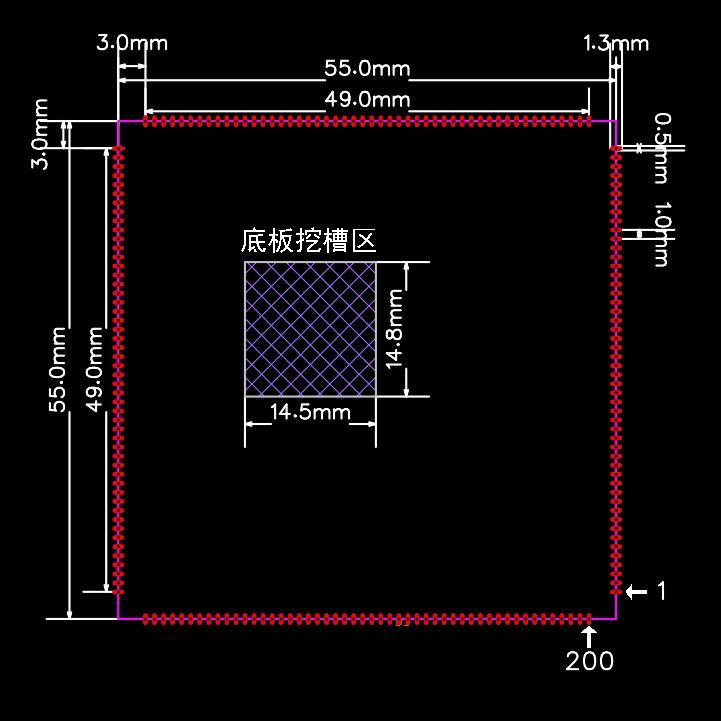

# Product Introduction

The X8883 core board is designated **X8883CV1**. This documentation is organized from the V1.0 development manual dated October 2026. The source cover and some sections use MT8883/MT8883CV1; these pages use X8883CV1 for the board and retain MT8883 as the processor name stated in the manual.

## Processor and Onboard Resources

The board is based on the MediaTek MT8883, described as a 4 nm processor, with PoP LPDDR5/LPDDR5X, UFS storage, MT6363/MT6368 PMICs, three MT6319 multiphase buck devices, MT6375 charging management and MT6685 wireless connectivity. Target applications include edge AI, robotics, industrial IoT, smart displays and mobile terminals.

| Item | Manual Specification |
| --- | --- |
| CPU | 4× Cortex-A715 (1×3.0 GHz + 3×2.8 GHz) + 4× Cortex-A510 @2.0 GHz |
| GPU | Mali-G615 MC6 @900 MHz; Vulkan / OpenCL |
| NPU | 7th-generation APU, 24 TOPS; INT4 / INT8 / FP16 |
| Memory | PoP LPDDR5/5X, 4×16 bit @8533 Mbps; 8 GB, with 12/16/24 GB options |
| Display | Two MIPI DSI outputs, up to 3200×2000 @144 Hz; DP 4K60 |
| Camera | Multiple MIPI CSI-2 interfaces; up to 200 MP ISP |
| High-speed expansion | USB 3.2 Gen1 DRD / DP Alt Mode; PCIe Gen3 ×1 |
| Wireless capabilities | 5G Rel.16 Sub-6 GHz, 4G Cat.18, dual SIM; Wi-Fi 6E, BT 5.3, GNSS L1+L5 |

These are platform capabilities described in the manual. Consult Interface Resources and Pin Definitions for signals actually exposed through the 200 pins. Wireless, cellular and peripheral availability depends on the fitted components, carrier and firmware. Platform controller totals differ from the exposed low-speed interfaces; allocate resources from the pin tables.

## Storage and Operating Conditions

The narrative and ordering sections list 8 GB RAM + 128 GB UFS 3.0, while the configuration table lists 64 GB UFS 4.0 with 128/256 GB options. Temperature entries state both -20 to 75°C and 0 to 60°C. Confirm memory, UFS generation/capacity and operating temperature against the specification for the actual board batch.

## System Block Diagram

## Board Appearance and Structure

The board exposes 200 castellated pins. The mechanical drawing shows a 55 mm × 55 mm outline, a 49 mm pin span, 1.0 mm pitch and an approximately 14.5 mm × 14.8 mm carrier cutout. Use controlled PCB and mechanical files for production footprints, pads and keepout areas.

## Documentation

- [Hardware Architecture](./x8883-hardware-architecture.md)

- [Interface Resources](./x8883-interface-resources.md)

- [PCB Design](./x8883-pcb-design.md)

- [Pin Definitions](./x8883-pin-definition.md)
