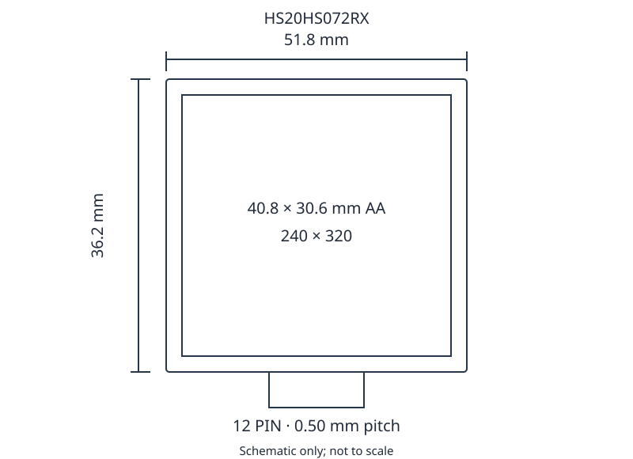
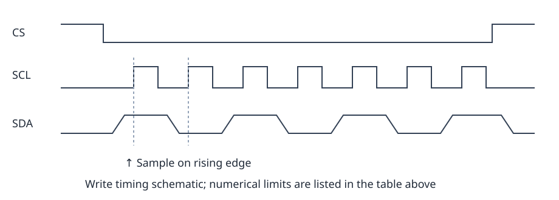

# 2-inch 240 × 320 Display Module

HS20HS072RX is a transmissive a-Si TFT color LCD module integrating a display panel, controller, FPC, and edge-lit LED backlight, with a 4-wire SPI interface.

## Product Parameters

| Item | Value |
| --- | --- |
| Resolution | 240 (RGB) × 320 |
| Display mode | a-Si TFT, transmissive |
| Outline dimensions | 51.80 × 36.20 mm |
| Active area | 40.80 × 30.60 mm |
| Pixel arrangement | RGB stripe |
| Pixel pitch | 0.151 × 0.153 (unit to be confirmed) |
| Colors | 262K |
| Viewing direction | ALL |
| Controller | ST7789T3 |
| Interface | SPI 4W |
| Backlight | 4 white LEDs in parallel |
| Weight | TBD |

Size requires confirmation: the product description states 2.4 inches, while the mechanical drawing states 2.0 inches. The pixel-pitch value and unit are also inconsistent; verify the physical dimensions before selection or assembly.

## Absolute Maximum Ratings

Absolute maximum ratings are not normal operating conditions. Exceeding these limits or applying reverse voltage may cause permanent damage. Response slows at low temperatures; prolonged heat may damage the polarizer.

| Item | Symbol | Min. | Typ. | Max. | Unit |
| --- | --- | --- | --- | --- | --- |
| Interface supply | IOVCC | −0.3 | — | 4.6 | V |
| Analog supply | VCI | −0.3 | — | 4.6 | V |
| TFT gate-on voltage | VGH | −0.3 | — | 30 | V |
| TFT gate-off voltage | VGL | −0.3 | — | 30 | V |
| Backlight forward current | IF | — | — | 80 | mA |
| Operating temperature | TOPR | −20 | — | 70 | °C |
| Storage temperature | TSTG | −30 | — | 80 | °C |
| Humidity | RH | — | — | 90 (≤60 °C) | %RH |

## Electrical Characteristics

Test temperature: 25 ± 2 °C. TBD identifies an unspecified value.

| Item | Symbol | Min. | Typ. | Max. | Unit |
| --- | --- | --- | --- | --- | --- |
| Interface supply | IOVCC | 1.65 | 1.8 | 3.3 | V |
| Analog supply | VCI | 2.4 | 2.75 | 3.3 | V |
| Normal-mode current | IDD | — | TBD | — | mA |
| Sleep current | IDD-SLEEP | — | TBD | — | µA |
| Input low | VIL | GND | — | 0.3 × IOVCC | V |
| Input high | VIH | 0.7 × IOVCC | — | IOVCC | V |
| Output low (IOL = 1 mA) | VOL | GND | — | 0.2 × IOVCC | V |
| Output high (IOH = −1 mA) | VOH | 0.8 × IOVCC | — | IOVCC | V |

## Backlight Characteristics

| Item | Symbol | Min. | Typ. | Max. | Unit |
| --- | --- | --- | --- | --- | --- |
| Forward voltage (IL = 80 mA) | Vf | 2.8 | 3.0 | 3.2 | V |
| Forward current | IL | — | 80 | — | mA |
| Luminance | Lv | TBD | TBD | — | cd/m² |
| LED lifetime (IL = 80 mA) | — | 20000 | 25000 | — | h |

The backlight uses four parallel LEDs.

Lifetime is the time until brightness falls to 50% of its initial value at IL = 80 mA. Higher current reduces lifetime.

## Mechanical Dimensions

| Item | Value |
| --- | --- |
| LCM outline | 51.8 × 36.2 mm |
| Active area | 40.8 × 30.6 mm |
| LCD dimensions | 46.6 × 33.6 mm |
| Main module thickness | 2.05 ± 0.05 mm |
| FPC thickness | 0.3 mm |
| FPC interface | 12 pins, 0.50 mm pitch |
| General tolerance | ±0.2 mm |



## Pin Definitions

| Pin | Signal | Function |
| --- | --- | --- |
| 1 | GND | Power ground |
| 2 | CS | Chip-select input |
| 3 | RS | Command/parameter select |
| 4 | SCL | Serial clock |
| 5 | SDA | Data input, sampled on the rising edge of SCL |
| 6 | RST | Reset input |
| 7 | NC | Not connected |
| 8 | I/O-VCC | Interface logic supply, 2.8 V |
| 9 | VCC | Logic supply, 2.8 V |
| 10 | A | Backlight anode |
| 11 | K | Backlight cathode |
| 12 | GND | Power ground |

## Optical Characteristics

| Item | Symbol | Value |
| --- | --- | --- |
| Center contrast ratio | C/R | Min. 280, typ. 300 |
| Luminance uniformity | UW | ≥80 % |
| Response time | Tr + Tf | 30 ms |
| Top viewing angle | θT | 45° |
| Bottom viewing angle | θB | 20° |
| Left viewing angle | θL | 45° |
| Right viewing angle | θR | 20° |

| Chromaticity | Min. | Typ. | Max. |
| --- | --- | --- | --- |
| White x | 0.288 | 0.308 | 0.328 |
| White y | 0.305 | 0.325 | 0.345 |
| Red x | 0.592 | 0.612 | 0.632 |
| Red y | 0.309 | 0.329 | 0.349 |
| Green x | 0.279 | 0.299 | 0.319 |
| Green y | 0.547 | 0.567 | 0.587 |
| Blue x | 0.124 | 0.144 | 0.164 |
| Blue y | 0.090 | 0.110 | 0.130 |

Center white luminance is unspecified; ±15% entries do not define an absolute luminance. Viewing angles are defined at CR ≥10.

- Contrast ratio CR = center luminance with all-white pixels / center luminance with all-black pixels.
- Response time is the sum of white-to-black and black-to-white transitions.
- Measure in a dark, temperature-stable room without airflow.

- Measure at the screen center after 30 minutes of backlight stabilization.
- Uniformity = minimum / maximum white luminance across nine points ×100%. Points lie at the centers of a 3×3 grid.

## SPI Timing

4-wire serial interface; SDA is sampled on the rising edge of SCL. All timing values below are in ns.

| Signal | Symbol | Parameter | Min. | Max. |
| --- | --- | --- | --- | --- |
| CSX | TCSS (write) | Chip-select setup (write) | 15 | — |
| CSX | TCSH (write) | Chip-select hold (write) | 15 | — |
| CSX | TCSS (read) | Chip-select setup (read) | 60 | — |
| CSX | TCSH (read) | Chip-select hold (read) | 65 | — |
| CSX | TCHW | Chip-select high pulse | 40 | — |
| SCL | TSCYCW | Write clock cycle | 66 | — |
| SCL | TSHW | Write clock high | 15 | — |
| SCL | TSLW | Write clock low | 15 | — |
| SCL | TSCYCR | Read clock cycle | 150 | — |
| SCL | TSHR | Read clock high | 60 | — |
| SCL | TSLR | Read clock low | 60 | — |
| D/CX | TDCS | Command/data setup | 10 | — |
| D/CX | TDCH | Command/data hold | 10 | — |
| SDA | TSDS | Data setup | 10 | — |
| SDA | TSDH | Data hold | 10 | — |
| DOUT | TACC | Read access | 10 | 50 |
| DOUT | TOH | Output disable | 15 | 50 |



## Reliability Tests

| Test | Conditions |
| --- | --- |
| High-temperature storage | 80 °C / 240 h |
| Low-temperature storage | −30 °C / 240 h |
| High-temperature operation | 70 °C / 240 h |
| Low-temperature operation | −20 °C / 240 h |
| Temperature cycling | −10 °C → 25 °C → 50 °C, 30 min per stage, 10 cycles |
| High-temperature/high-humidity storage | 60 °C / 90%RH / 120 h |
| Vibration | 10 → 55 → 10 Hz, 1.5 mm amplitude, 2 h per X/Y/Z axis |
| Packaged drop | 1 m height; 1 corner, 3 edges, 6 faces |
| ESD | ±8 kV air discharge, 330 Ω / 150 pF, 3 or 5 discharges |

Use 5–10 samples per test, with each sample subjected to only one test. After 2–4 h at room temperature, inspect for bubbles, seal leakage, missing display/segments, glass cracks, surface damage and electrical compliance. Use pure water with resistance >10 MΩ for humidity testing. ESD failures that fully recover after reset may be accepted.

## Appearance and Display Inspection

Point, pixel, line and polarizer defect counts below apply to zone A; these cosmetic defects are ignored in zone B. Bubbles inside the LCD cell are rejected in both zones.

Lengths below are in mm. Equivalent spot diameter is the average of the long and short dimensions; W denotes width and L denotes length.

| Item | Requirements |
| --- | --- |
| Particle/black/white spot/bubble | Φ ≤ 0.10 mm ignored; 0.10 &lt; Φ ≤ 0.20 mm: 2 allowed; Φ &gt; 0.20 mm rejected; total B/C defects ≤3. |
| Pixel defects | For 0.15 &lt; Φ ≤ 0.20 mm, bright/dark/adjacent two-pixel defects and total count must each satisfy N ≤2. |
| Line defects | W ≤0.03 mm and L ≤3.0 mm ignored; 0.03 &lt; W ≤0.05 mm and L ≤3.0 mm: 2 allowed; W &gt;0.05 mm rejected. |
| Contrast variation | Φ ≤0.10 mm ignored; 0.10 &lt; Φ ≤0.30 mm: 2; Φ &gt;0.30 mm rejected; total ≤2. |
| Bubbles inside cell | Not allowed at any size. |
| Polarizer bubbles/dents/protrusions | Φ ≤0.30 mm ignored; 0.30 &lt; Φ ≤0.50 mm: 2; Φ &gt;0.50 mm rejected; total ≤2. |
| Surplus glass | Step surplus glass b ≤0.3 mm; peripheral surplus must not affect outline dimensions or assembly. |
| MURA | No visible MURA on red/green/blue screens; black-screen MURA must not be obvious, assessed with 6% ND and limit samples. On black/gray screens: D ≤0.10 mm ignored; 0.10 &lt; D ≤0.30 mm, N ≤2; D &gt;0.30 mm rejected. |
| Terminal-side glass chips | For a ≤t and b ≤1.0 mm, c unrestricted; for a ≤t and 1 ≤b ≤2 mm, c ≤3 mm. At alignment marks, b ≤0.5 mm; patterns and marks must remain exposed. |
| Peripheral/corner glass chips | Non-contact-side chips must remain outside the seal inner boundary; contact-side chips outside the seal outer boundary. Corner limits: a ≤t, b ≤3.0 mm, c ≤3.0 mm; no pattern damage. |
| FPC and soldering | No cold joints, shorts, opens, burrs or solder balls. Component offset &lt;1/2 pin width; conductor notch &lt;1/2 conductor width; burr &lt;1/2 clearance. No solder or severe deformation on connector contacts. |

## Handling and Storage

- Secure the module without twisting, bending, strong impact or localized pressure.
- Avoid touching terminals or exposed circuitry; ground operators and tools. Wear gloves/finger cots and peel protective film slowly.
- Avoid prolonged static images to reduce image retention.
- Avoid temperatures below the storage range to prevent solidification, bubbles and display defects.
- Use sealed antistatic packaging and keep the polarizer surface from contacting other objects.
- Store in the dark, away from direct sunlight and strong UV.

Recommended storage: 0–35 °C and &lt;60%RH. Remove water/oil immediately. Use a soft dry cloth for light contamination and an IPA/ethanol-moistened cloth for heavier contamination; avoid water, acetone, toluene and unsuitable solvents. Keep leaked liquid crystal away from eyes/mouth; wash contaminated skin or clothing thoroughly with soap.

## Soldering

| Product | Temperature | Time |
| --- | --- | --- |
| Non-RoHS | 290–350 °C | 3–5 s |
| RoHS | 340–370 °C | 3–5 s |

Use a grounded, leakage-free soldering iron. Remove residual flux after soldering; follow process requirements for halogen-free flux.

## Initialization Code

The command/data values and call order are retained below. Implement delay() for the target platform. The code uses the ST7789V name while the parameter table lists ST7789T3; verify controller compatibility when porting.

```c
void ST7789V_INITIAL(void)
{
RES =1;
delay(100);
RES =0;
delay(200);
RES =1;
delay(500);
LCD_WriteCommand(0x11);
delay(120);
LCD_WriteCommand(0x36);
LCD_WriteData(0x00); // Portrait
LCD_WriteCommand(0x3a);
LCD_WriteData(0x05);
LCD_WriteCommand(0xb2);
LCD_WriteData(0x0c);
LCD_WriteData(0x0c);
LCD_WriteData(0x00);
LCD_WriteData(0x33);
LCD_WriteData(0x33);
LCD_WriteCommand(0xb7);
LCD_WriteData(0x35);
LCD_WriteCommand(0xbb);
LCD_WriteData(0x20);
LCD_WriteCommand(0xc0);
LCD_WriteData(0x2c);
LCD_WriteCommand(0xc2);
LCD_WriteData(0x01);
LCD_WriteCommand(0xc3);
LCD_WriteData(0x0b);
LCD_WriteCommand(0xc4);
LCD_WriteData(0x20);
LCD_WriteCommand(0xc6);
LCD_WriteData(0x0f);
LCD_WriteCommand(0xd0);
LCD_WriteData(0xa4);
LCD_WriteData(0xa1);
LCD_WriteCommand(0xe0);
LCD_WriteData(0xd0);
LCD_WriteData(0x03);
LCD_WriteData(0x09);
LCD_WriteData(0x0e);
LCD_WriteData(0x11);
LCD_WriteData(0x3d);
LCD_WriteData(0x47);
LCD_WriteData(0x55);
LCD_WriteData(0x53);
LCD_WriteData(0x1a);
LCD_WriteData(0x16);
LCD_WriteData(0x14);
LCD_WriteData(0x1f);
LCD_WriteData(0x22);
LCD_WriteCommand(0xe1);
LCD_WriteData(0xd0);
LCD_WriteData(0x02);
LCD_WriteData(0x08);
LCD_WriteData(0x0d);
LCD_WriteData(0x12);
LCD_WriteData(0x2c);
LCD_WriteData(0x43);
LCD_WriteData(0x55);
LCD_WriteData(0x53);
LCD_WriteData(0x1e);
LCD_WriteData(0x1b);
LCD_WriteData(0x19);
LCD_WriteData(0x20);
LCD_WriteData(0x22);
LCD_WriteCommand(0x29);
}
```
