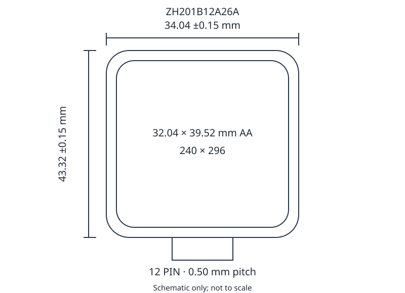

# 2-inch 240 × 296 Display Module

ZH201B12A26A is a transmissive TFT LCD module with a JD9853 controller, a 4-wire SPI interface, and four parallel backlight LEDs.

## Product Parameters

| Item | Value |
| --- | --- |
| Display size | 2.01 inch |
| Resolution | 240 (RGB) × 296 |
| Display mode | TFT, transmissive |
| Viewing direction | All directions |
| Outline dimensions | 34.04 × 43.32 × 1.86 mm |
| Active area | 32.04 × 39.52 mm |
| Controller | JD9853 |
| Colors | 65K |
| Interface | 4-wire SPI |
| Input voltage | 2.8 / 3.3 V |

## Absolute Maximum Ratings

Absolute maximum ratings are not normal operating conditions. Exceeding these limits or applying reverse voltage may cause permanent damage. Response slows at low temperatures; prolonged heat may damage the polarizer.

| Item | Symbol | Min. | Typ. | Max. | Unit |
| --- | --- | --- | --- | --- | --- |
| Logic supply | Vdd | −0.3 | — | 3.3 | V |
| Input voltage | Vin | −0.3 | — | Vdd + 0.3 | V |
| Operating temperature | Top | −20 | — | 70 | °C |
| Storage temperature | Tst | −30 | — | 80 | °C |
| Humidity | RH | — | — | 90 (≤60 °C) | %RH |

## Electrical Characteristics

Test temperature: 25 ± 2 °C. TBD identifies an unspecified value.

| Item | Symbol | Min. | Typ. | Max. | Unit |
| --- | --- | --- | --- | --- | --- |
| Logic supply | Vdd − Vss | 2.6 | 2.8 | 3.3 | V |
| Input current | Idd | — | TBD | TBD | mA |
| Input high | VIH | 0.8 × IOVCC | — | IOVCC | V |
| Input low | VIL | — | — | 0.2 × IOVCC | V |
| Output high | VOH | 0.8 × IOVCC | — | IOVCC | V |
| Output low | VOL | — | — | 0.2 × IOVCC | V |

## Backlight Characteristics

| Item | Symbol | Min. | Typ. | Max. | Unit |
| --- | --- | --- | --- | --- | --- |
| Forward voltage | Vf | 2.8 | 3.2 | 3.3 | V |
| Luminance (IF = 80 mA) | Lv | 300 | — | — | cd/m² |
| Uniformity (20 mA/LED) | Avg | 80 | — | — | % |

The backlight uses four parallel LEDs.

## Mechanical Dimensions

| Item | Value |
| --- | --- |
| LCM outline | 34.04 ± 0.15 × 43.32 ± 0.15 mm |
| LCD dimensions | 33.84 ± 0.10 × 43.12 ± 0.10 mm |
| CF dimensions | 33.44 × 41.52 mm |
| Polarizer dimensions | 33.04 × 41.12 mm |
| Active area | 32.04 × 39.52 mm |
| Thickness | 1.86 mm |
| FPC interface | 12 pins, 0.50 mm pitch |

## Pin Definitions

| Pin | Signal | Function |
| --- | --- | --- |
| 1 | GND | Analog ground |
| 2 | K | Backlight cathode |
| 3 | A | Backlight anode |
| 4 | VCC | Interface logic supply |
| 5 | GND | Analog ground |
| 6 | GND | Analog ground |
| 7 | RS | Register select |
| 8 | CS | Chip select |
| 9 | SCL | Serial clock |
| 10 | SDA | SPI data input/output |
| 11 | RESET | Reset, required during initialization |
| 12 | GND | Analog ground |

Confirm the backlight pin polarity before wiring: the interface table assigns pin 2 = K and pin 3 = A, while the mechanical drawing assigns pin 2 = LEDA and pin 3 = LEDK.

## Optical Characteristics

| Item | Symbol | Value |
| --- | --- | --- |
| Transmittance | T | 4.5 % |
| Contrast ratio | CR | 800 |
| Response time | Ton + Toff | 30 (unit to be confirmed) |
| Red chromaticity | x / y | x to be confirmed / 0.322 |
| Green chromaticity | x / y | 0.290 / 0.588 |
| Blue chromaticity | x / y | 0.134 / 0.124 |
| White chromaticity | x / y | 0.298 / 0.328 |

- Contrast ratio CR = center luminance with all-white pixels / center luminance with all-black pixels.
- Response time is the sum of white-to-black and black-to-white transitions.
- Measure in a dark, temperature-stable room without airflow.

## Reliability Tests

| Test | Conditions |
| --- | --- |
| High-temperature storage | 80 °C / 48 h |
| Low-temperature storage | −30 °C / 240 h; −40 °C / 8 h |
| High-temperature operation | 70 °C / 48 h |
| Low-temperature operation | −20 °C / 48 h |
| High-temperature/high-humidity operation | 60 °C / 95%RH / 48 h |
| Thermal shock | −40 °C (30 min) ↔ 80 °C (30 min), 48 cycles |

After testing, allow 4 h at room temperature, then inspect appearance, display operation and connections. No visible degradation or functional abnormalities are allowed; connections must remain secure; contrast must be at least 30% of its initial value.

## Appearance and Display Inspection

Lengths below are in mm. Equivalent spot diameter is the average of the long and short dimensions; W denotes width and L denotes length.

| Item | Requirements |
| --- | --- |
| Backlight | No missing backlight; luminance, uniformity, power and chromaticity must meet requirements. |
| Metal frame | No visible damage, deformation or solder debris. |
| FPC | No visible contact scratches, contamination, oxidation, plating defects or detached/broken pads; damaged or bubbled stiffener area must not exceed 1/5. |
| Line defects/scratches | W ≤ 0.05 mm acceptable; 0.05 &lt; W ≤ 0.10 mm with L ≤ 5 mm: 1 allowed. |
| Point defects | D ≤ 0.10 mm acceptable; 0.10 &lt; D ≤ 0.20 mm: 2; 0.20 &lt; D ≤ 0.25 mm: 1; D &gt; 0.25 mm: none. |
| TP fisheyes/dents/bubbles | D ≤ 0.20 mm acceptable; 0.20 &lt; D ≤ 0.30 mm: 6; 0.30 &lt; D ≤ 0.50 mm: 2; D &gt; 0.50 mm: none. |
| Defect counts | D = (long dimension X + short dimension Y)/2; point spacing &gt; 5 mm; total allowed point/line defects: 5. |
| Newton rings | Uniform rings exceeding 1/4 of TP area are rejected; smaller rings are acceptable if text is unaffected. Non-uniform rings &gt;7 mm without fluorescent light are rejected; any text/line distortion under fluorescent light is rejected. |
| Cracks | Any propagating crack is rejected. |
| Display offset/skew | S &lt; 0.3 mm acceptable; 0.3 ≤ S &lt; 0.5 mm: Minor; S ≥ 0.5 mm: Major. |
| Display function | No missing rows/columns, crosstalk, corrupted display, incorrect viewing direction, ripples, flicker, leakage or bubbles in the active area. |
| Polarizer/reflector | No reversed, missing or incorrect films; protective film required. Judge scratches and contamination using point/line criteria. |
| COG area | No IC damage/scratches; sealant must not enter the viewing area; coating must cover terminal ITO and remain below the top polarizer. |

Glass-chip limits: X = chip length, Y = width, Z = depth, a = glass side length, t = glass thickness. Surface/intermediate chips: Z ≤t/2, X ≤a; corner chips: Z ≤t/2, X ≤a/8. Chips must not cross the inner seal boundary, with half the seal width retained where applicable. Terminal-side front chips: X ≤a/5, Y ≤0.5 mm, Z ≤t; rear chips: Z ≤t/2. For multiple chips, X is their combined length; chips must not enter the viewing area. Individual electrode chip width must not exceed 1/4 of electrode width.

## Handling and Storage

- Secure the module without twisting, bending, strong impact or localized pressure.
- Avoid touching terminals or exposed circuitry; ground operators and tools. Wear gloves/finger cots and peel protective film slowly.
- Avoid prolonged static images to reduce image retention.
- Avoid temperatures below the storage range to prevent solidification, bubbles and display defects.
- Use sealed antistatic packaging and keep the polarizer surface from contacting other objects.
- Store in the dark, away from direct sunlight and strong UV.

Recommended long-term storage: 0–35 °C, 40–60%RH. Remove moisture and contamination promptly.
