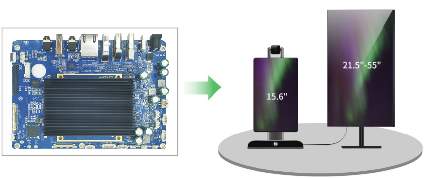
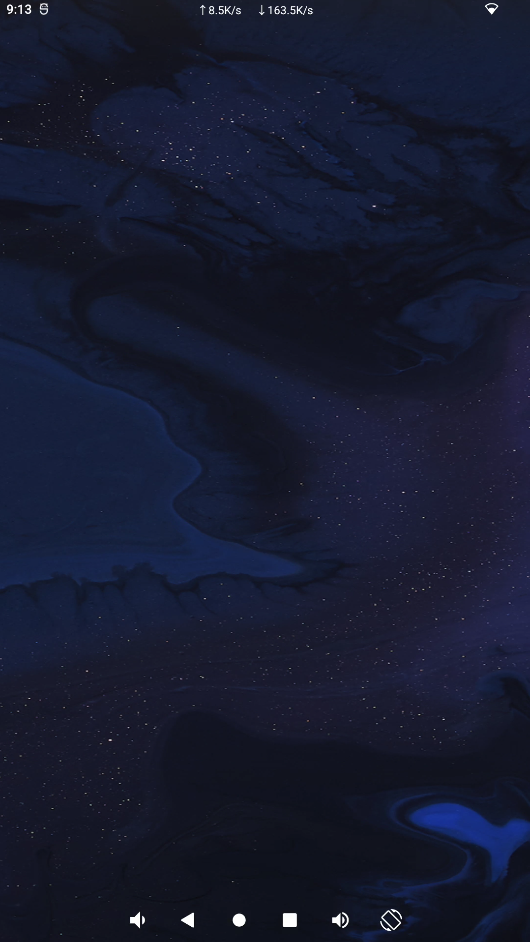
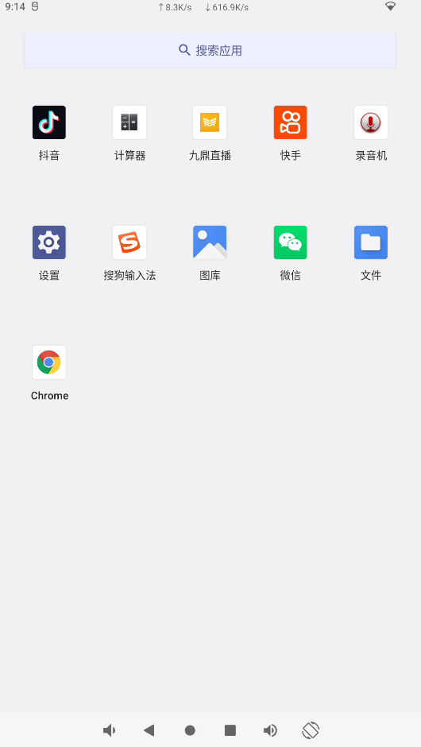
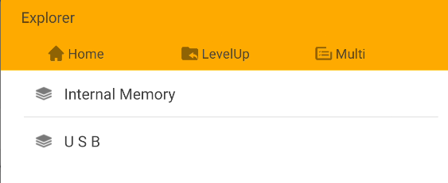
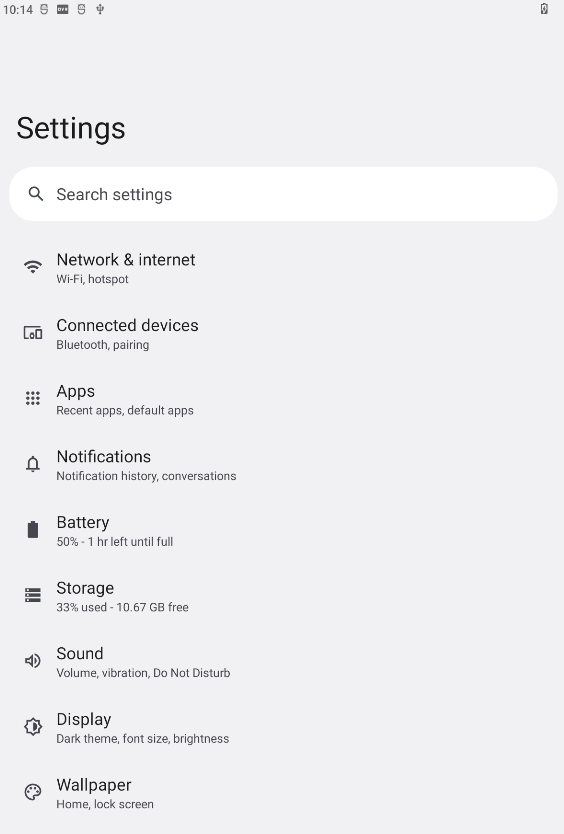
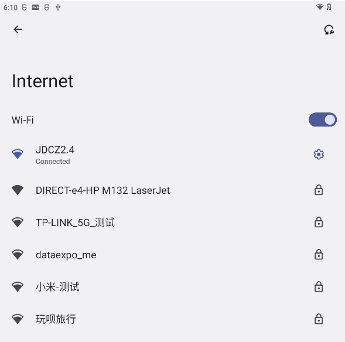

# live3588 Live Streaming Mainboard

This page describes the live3588 mainboard. Hardware configuration depends on the revision and fitted components.

The board uses a Rockchip RK3588 with eight 64-bit CPU cores, four Cortex-A76 and four Cortex-A55, and supports Android 12.0.

## Documentation

- [Hardware Resources](./live3588-hardware-resources.md)
- [Hardware Interface Definitions](./live3588-interface-details.md)
- [Android User Guide](./android/live3588-android-guide.md)

## Product Images

