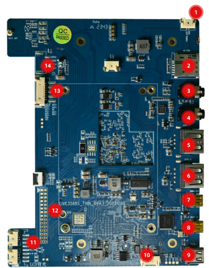
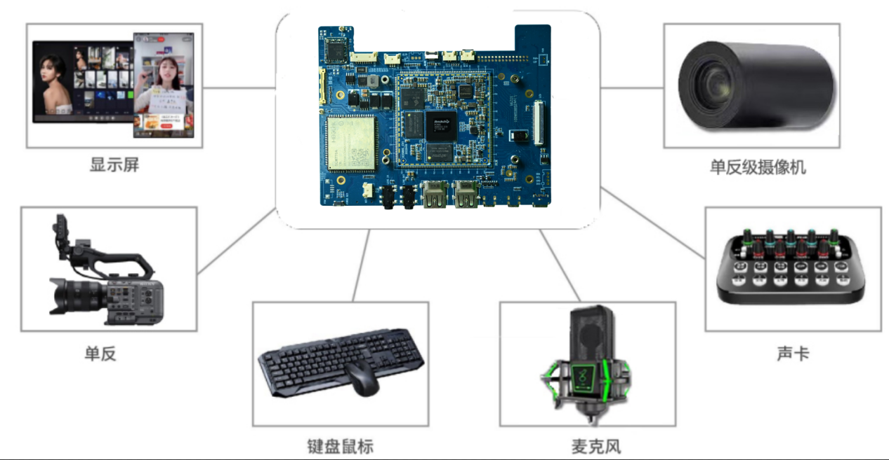
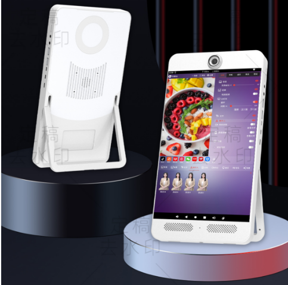
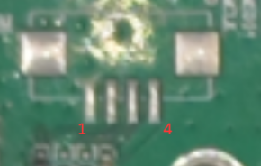
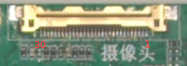
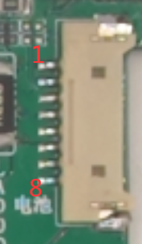
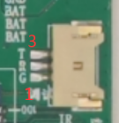
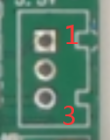

# live3588sv4 Live Streaming Mainboard

This page describes the live3588sv4 mainboard. Hardware configuration depends on the revision and fitted components.

The live3588v4 and live3588sv4 use different SoC variants and board layouts. Use the specifications and pinouts for your exact model.

## Documentation

- [Hardware Resources](./live3588sv4-hardware-resources.md)
- [Hardware Interface Definitions](./live3588sv4-interface-details.md)
- [Android User Guide](./android/live3588sv4-android-guide.md)

## Product Images

