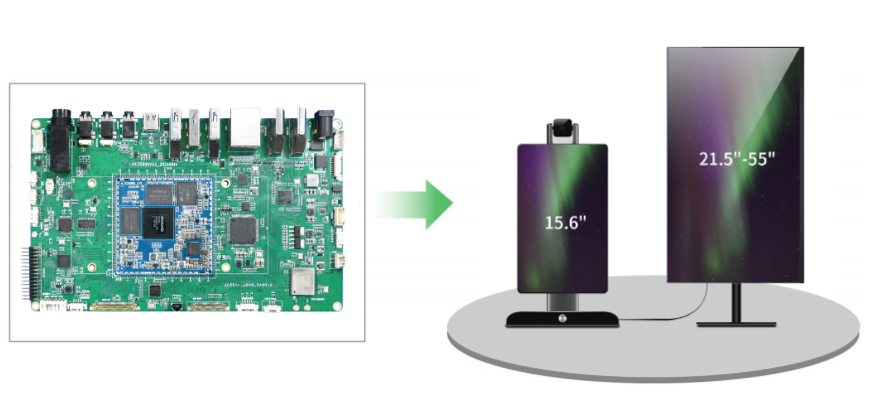
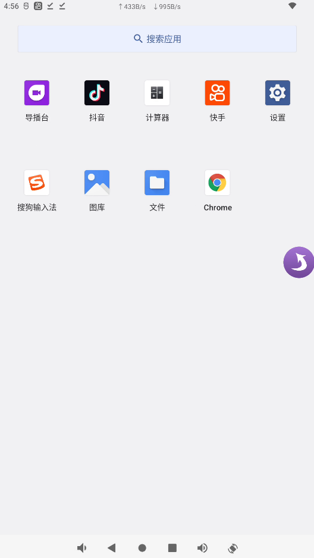
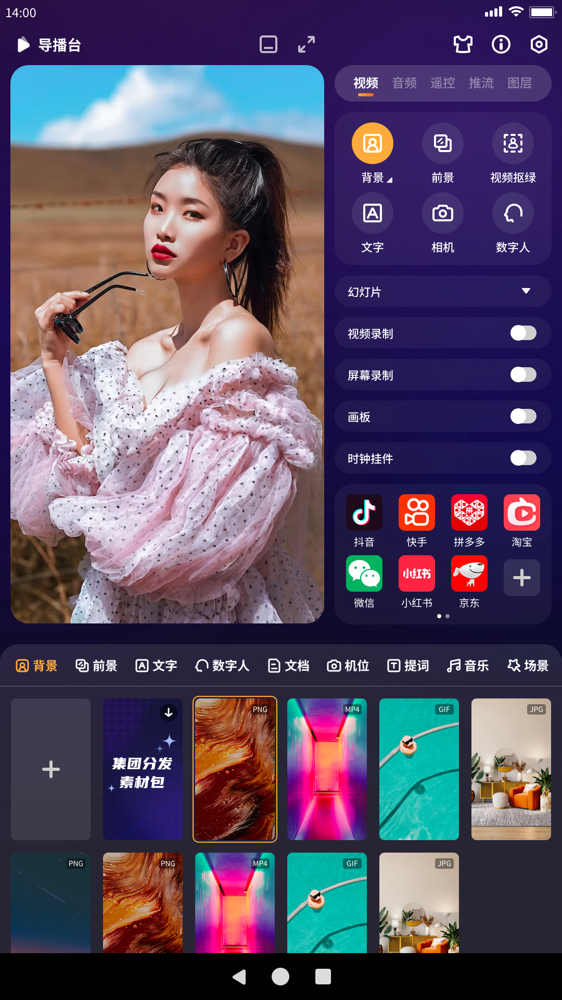
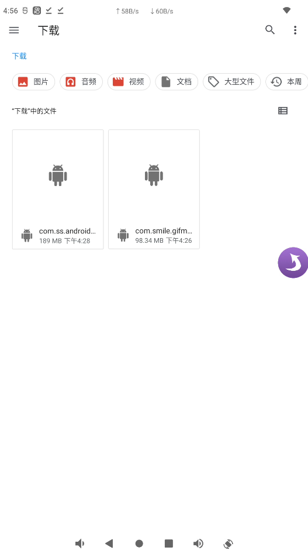
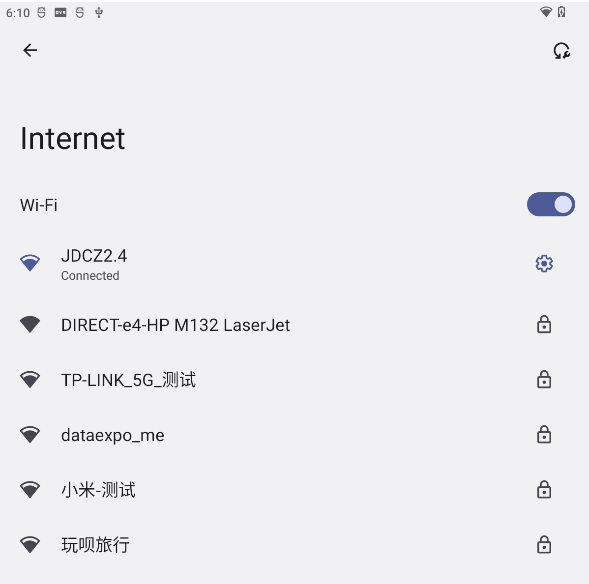
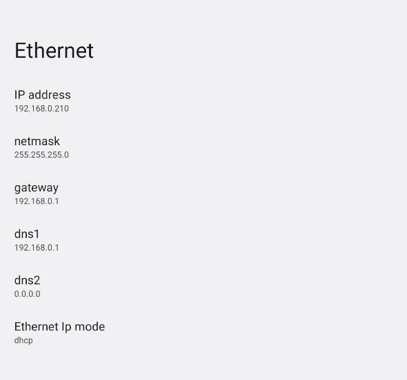
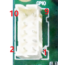
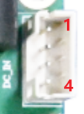

# live3588sv53 Live Streaming Mainboard

This page describes the live3588sv53 mainboard. Hardware configuration depends on the revision and fitted components.

The live3588sv53 is a V5.3 revision for live streaming. Its video capture and audio processing combine camera footage, presenter audio and HDMI input in a broadcast.

## Documentation

- [Hardware Resources](./live3588sv53-hardware-resources.md)
- [Hardware Interface Definitions](./live3588sv53-interface-details.md)
- [Android User Guide](./android/live3588sv53-android-guide.md)

## Product Images

