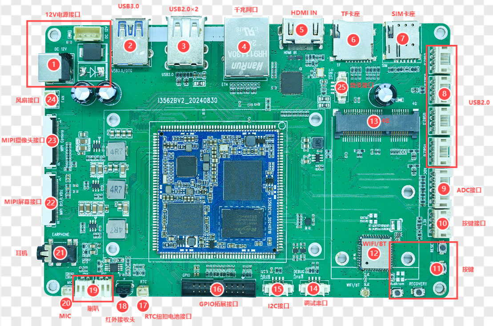

# Hardware Resources

## 1. System Configuration

| Resource | Specification |
|---|---|
| SoC | Rockchip RK3562 |
| CPU | Quad-core ARM Cortex-A53, up to 2.0 GHz |
| NPU | Integrated NPU for lightweight AI workloads |
| RAM | 2 GB / 4 GB / 8 GB |
| eMMC | 4 GB / 8 GB / 16 GB / 32 GB / 64 GB |
| PMIC | RK809-5A, dynamic frequency scaling |

RAM and eMMC capacities are SKU options, not a guarantee that every capacity is populated on one board.

## 2. Mechanical and Environmental Data

| Item | Value |
|---|---|
| PCB dimensions | 150 mm × 99 mm × 1.6 mm |
| Operating temperature | 0 to 70 °C |
| Storage temperature | -10 to 50 °C |
| Recommended input supply | 12 V / 3 A |

## 3. Interface Summary

| Interface | Quantity / Specification | Notes |
|---|---|---|
| Display | 1 × MIPI-DSI / LVDS multiplexed | One mode at a time |
| Touch | I2C capacitive touch | Display-module dependent |
| Camera | 1 × MIPI-CSI | 30-pin |
| HDMI | 1 × HDMI 2.0 IN | LT6911C converts HDMI to MIPI |
| Ethernet | 1 × Gigabit Ethernet | RGMII, RTL8211F |
| USB 2.0 | 6 × host | Includes four HUB-expanded 4-pin headers |
| USB 3.0 | 1 × OTG | Host / Device role; firmware flashing |
| SD | 1 × SDIO / TF card | Boot or removable storage |
| eMMC | On-board | Pins are not separately exposed |
| PCIe | 1 × expansion | Can be used with a 4G module |
| UART | UART0 | TTL debug console |
| I2C | I2C5 expansion | 4-pin |
| GPIO | 2×10-pin header | 20-pin |
| ADC | 5 signal inputs | 6-pin connector including GND |
| Audio | IIS / PCM / PDM / SPDIF | Stereo speaker, headphone and MIC |
| Other | RTC, IR and fan | Fan supply is 12 V |

## 4. Connector Locations

The numbering corresponds to pages 9–10 of the hardware manual:

1. 12 V power input
2. USB 3.0
3. Dual USB 2.0 Type-A
4. Gigabit Ethernet
5. HDMI IN
6. TF card slot
7. SIM card slot
8. Four USB 2.0 4-pin headers
9. ADC expansion
10. Key expansion
11. BOOT / RESET / POWER / RECOVERY keys
12. Wi-Fi / BT module
13. 4G module interface
14. UART0 debug
15. I2C5 expansion
16. GPIO expansion
17. RTC battery connector
18. IR receiver
19. Stereo speaker
20. MIC
21. Headphone
22. MIPI-DSI / LVDS
23. MIPI-CSI
24. 12 V fan
25. LT6911C programming connector

## 5. Power Notes

- DC input: 12 V; the manual recommends a 12 V / 3 A adapter.
- 4-pin power header: pins 1 and 2 are 12 V; pins 3 and 4 are GND.
- Fan header: pin 1 GND, pin 2 12 V.
- Check total load and supply margin when adding displays, USB peripherals, 4G modules or speakers.

## 6. Included and Optional Accessories

The manual lists the board, 12 V / 3 A adapter, USB-A data cable, USB-to-UART adapter and documentation as standard items. Optional items include a speaker, 8 GB TF card and a 7-inch 1024×600 MIPI capacitive-touch display module.
