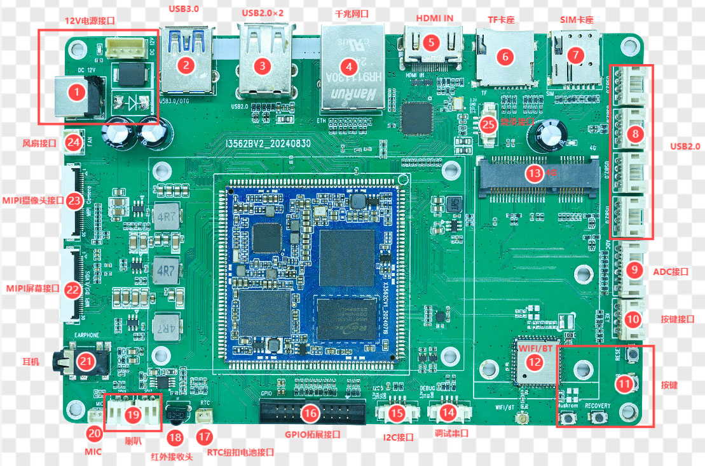

# Connector Pinouts

The pin tables below are transcribed from the I3562 hardware manual. Verify connector orientation, pin 1 location and the actual PCB revision before wiring. Do not infer pinout from cable colors.

## 1. Power Input

- DC input: 12 V
- Recommended adapter: 12 V / 3 A

| Pin | Signal |
|---:|---|
| 1 | 12 V |
| 2 | 12 V |
| 3 | GND |
| 4 | GND |

## 2. UART0 Debug Header

| Pin | Signal |
|---:|---|
| 1 | GND |
| 2 | UART0_RX_DEBUG |
| 3 | UART0_TX_DEBUG |
| 4 | 3.3 V |

UART0 is the default debug console and uses 3.3 V TTL. The baud rate must be verified against the active U-Boot / kernel configuration. The supplied Linux and Android manuals show different example rates; neither should be treated as universal.

## 3. USB 2.0 4-pin Header

| Pin | Signal |
|---:|---|
| 1 | 5 V |
| 2 | DM |
| 3 | DP |
| 4 | GND |

The board provides one dual USB 2.0 Type-A connector and four HUB-expanded 4-pin USB 2.0 headers.

## 4. MIPI-DSI / LVDS Multiplexed Header (30-pin)

| Pin | Signal | Pin | Signal |
|---:|---|---:|---|
| 1 | VCC_5V0 | 16 | GND |
| 2 | VCC_5V0 | 17 | D3N |
| 3 | VCC_5V0 | 18 | D3P |
| 4 | VCC3V3_S3 | 19 | GND |
| 5 | VCC3V3_S3 | 20 | D2N |
| 6 | I2C2_SCL_TP | 21 | D2P |
| 7 | I2C2_SDA_TP | 22 | GND |
| 8 | TP_INT_L | 23 | CLK N |
| 9 | TP_RST_L | 24 | CLK P |
| 10 | VCC3V3_S3 | 25 | GND |
| 11 | VCC3V3_S3 | 26 | D1N |
| 12 | LCD_BL_PWM | 27 | D1P |
| 13 | LCD_RST | 28 | GND |
| 14 | NC | 29 | D0N |
| 15 | LCD_PWREN_H | 30 | D0P |

The original manual names the differential lanes as multiplexed `MIPI_DSI_TX_* / LVDS_TX_*` signals. Select either MIPI or LVDS; they cannot operate simultaneously.

## 5. MIPI-CSI Header (30-pin)

| Pin | Signal | Pin | Signal |
|---:|---|---:|---|
| 1 | GND | 16 | GND |
| 2 | MIPI_CSI_RX0_CLK0P | 17 | NC |
| 3 | MIPI_CSI_RX0_CLK0N | 18 | NC |
| 4 | GND | 19 | MIPI_AF |
| 5 | MIPI_CSI_RX0_D0P | 20 | I2C4_SCL_M0 |
| 6 | MIPI_CSI_RX0_D0N | 21 | I2C4_SDA_M0 |
| 7 | GND | 22 | CAM_CLK0_OUT |
| 8 | MIPI_CSI_RX0_D1P | 23 | CAM_CLK1_OUT |
| 9 | MIPI_CSI_RX0_D1N | 24 | CAM_PDN1_L |
| 10 | GND | 25 | CAM_PDN0_L |
| 11 | MIPI_CSI_RX0_D2P | 26 | CAM_RST1_L |
| 12 | MIPI_CSI_RX0_D2N | 27 | CAM_RST0_L |
| 13 | GND | 28 | VCC1V8_CAM3 |
| 14 | MIPI_CSI_RX0_D3P | 29 | VCC2V8_CAM3 |
| 15 | MIPI_CSI_RX0_D3N | 30 | MIPI_1.2V_CAM3 |

## 6. Key Header

| Pin | Signal |
|---:|---|
| 1 | BOOT_KEY |
| 2 | RESET_KEY |
| 3 | PWRON_KEY |
| 4 | GND |

## 7. Fan Header

| Pin | Signal |
|---:|---|
| 1 | GND |
| 2 | 12 V |

## 8. IR Receiver Header

| Pin | Signal |
|---:|---|
| 1 | PWM0_CH0_M0_IR |
| 2 | GND |
| 3 | 3.3 V |

## 9. ADC Expansion (6-pin)

| Pin | Signal |
|---:|---|
| 1 | SARADC0_IN1 |
| 2 | SARADC0_IN3 |
| 3 | SARADC0_IN5 |
| 4 | SARADC0_IN6 |
| 5 | SARADC0_IN7 |
| 6 | GND |

## 10. I2C5 Expansion (4-pin)

| Pin | Signal |
|---:|---|
| 1 | 3.3 V |
| 2 | I2C5_SDA |
| 3 | I2C5_SCL |
| 4 | GND |

## 11. GPIO Expansion (2×10-pin)

| Pin | Signal | Pin | Signal |
|---:|---|---:|---|
| 1 | GND | 2 | GPIO3_B1 |
| 3 | GND | 4 | GPIO4_B0 |
| 5 | GPIO0_C0 | 6 | GPIO3_A2 |
| 7 | GPIO0_C4 | 8 | GPIO3_A3 |
| 9 | GPIO2_A1 | 10 | GPIO3_A4 |
| 11 | GPIO3_A6 | 12 | GPIO3_A5 |
| 13 | GPIO3_A7 | 14 | GND |
| 15 | GPIO3_B0 | 16 | VCC_5V0 |
| 17 | GND | 18 | VCC_3V3 |
| 19 | GND | 20 | GND |

## 12. Other Interfaces

- **PCIe + SIM:** The SIM slot is used together with a PCIe 4G module.
- **HDMI IN:** Standard Type-A HDMI input; LT6911C converts HDMI to MIPI.
- **LT6911C programming header:** Pin 1 3.3 V, pin 2 GND, pin 3 CSCL, pin 4 CSDA.
- **Audio:** On-board headphone, MIC and stereo speaker connectors.
- **RTC:** The coin-cell battery maintains RTC time while main power is off.
- **Wi-Fi / BT:** The hardware manual lists BL-M8821CSI; verify the actual BOM before procurement or production.
