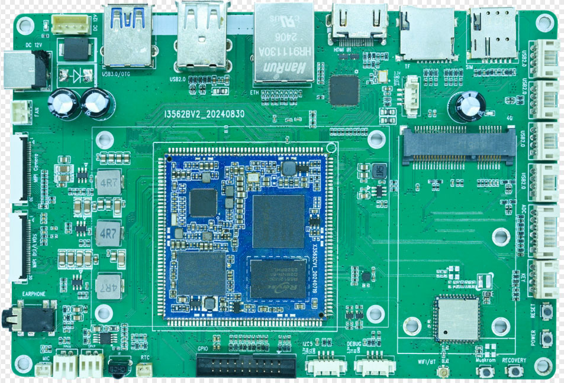

# i3562bv2 Mainboard Overview

## Product Overview

The I3562BV2 is a Rockchip RK3562-based development board designed by Shenzhen Ninetripod Technology Co., Ltd. It uses a quad-core 64-bit ARM Cortex-A53 processor running up to 2.0 GHz and integrates an NPU for lightweight edge-AI workloads.

> Source: *I3562 Development Board Hardware Manual*, Rev.02, 2024-11-09. The PCB marking visible in the photo reads `I3562BV2_20240830`.

## Key Specifications

| Item | Specification |
|---|---|
| SoC | Rockchip RK3562 |
| CPU | Quad-core ARM Cortex-A53 |
| CPU frequency | Up to 2.0 GHz |
| RAM | 2 GB / 4 GB / 8 GB, depending on SKU |
| eMMC | 4 GB / 8 GB / 16 GB / 32 GB / 64 GB, depending on SKU |
| PMIC | RK809-5A |
| Power input | 12 V DC, recommended 12 V / 3 A |
| PCB dimensions | 150 mm × 99 mm × 1.6 mm |
| Operating temperature | 0 to 70 °C |
| Storage temperature | -10 to 50 °C |

## Main Interfaces

- One multiplexed MIPI-DSI / LVDS display interface (select one mode only)
- One MIPI-CSI camera input
- One HDMI 2.0 input via LT6911C-to-MIPI conversion
- One Gigabit Ethernet interface (RGMII)
- One USB 3.0 OTG interface
- Six USB 2.0 host ports, including four HUB-expanded 4-pin headers
- TF card, SIM card and PCIe expansion
- Wi-Fi / Bluetooth module (manual lists BL-M8821CSI)
- UART0 debug, I2C5, ADC and GPIO expansion
- Stereo speaker, headphone, MIC, IR receiver and 12 V fan connectors

## Documentation

- [Hardware Resources](./hardware-resources.md)
- [Connector Pinouts](./interfaces.md)
- [Linux Build and Flash](./linux/build-and-flash.md)
- [Linux Drivers and Debugging](./linux/drivers-debug.md)
- [Android Build and Flash](./android/build-and-flash.md)
- [Android Usage and Debugging](./android/usage-debug.md)

## Source Documents

- *I3562 Development Board Hardware Manual*, Rev.02, 2024-11-09
- *RK3562 Linux Platform User Manual*, Rev.01, 2024-11-08
- *RK3562 Android Platform User Manual* (provided with this documentation set)

Confirm the actual SDK branch, BOM, wireless module part number and UART baud rate against the project release.
