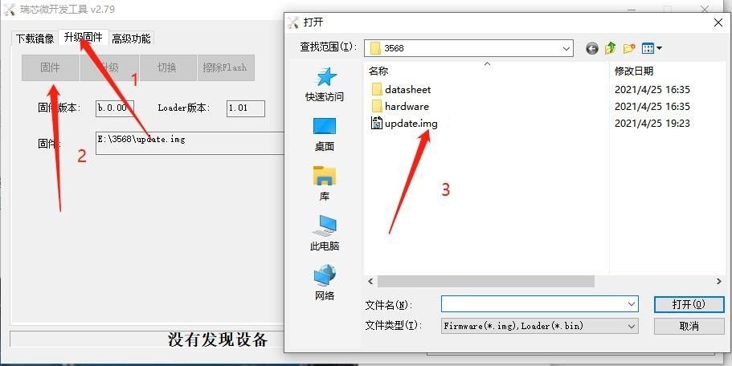
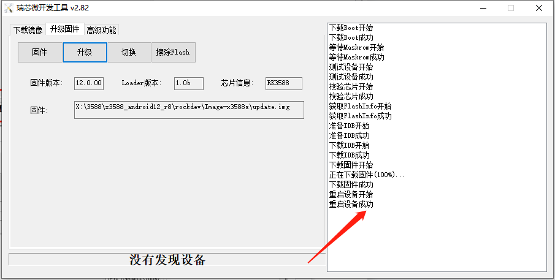

# Android Firmware Flashing

## Flash One Board over USB

1. Back up data and select the matching Android `update.img` from `rockdev/Image-rk3568_r/`.
2. Install the supplied DriverAssitant v5.1.1 on Windows and open AndroidTool v2.79 from the SDK.
3. Select the image on the Upgrade Firmware tab and set OTG to Device.
4. Hold VOL+/RECOVERY while connecting the Micro USB data cable and 12 V supply. Wait for the tool to detect the board, then start the upgrade.
5. Wait for writing to finish, boot and verify display, touch, networking and peripherals.

## Batch Flashing

Extract `RKTools/windows/FactoryTool_v1.66.zip` from the SDK. In FactoryTool, select the matching image, select Upgrade and click Start. Put each board in download mode as above. Verify each port’s result before disconnecting a board or attaching another.

Android TF-card upgrades are unverified for this board. Use USB upgrades. If the tool does not detect the board, check OTG position, power, data cable and driver version.
