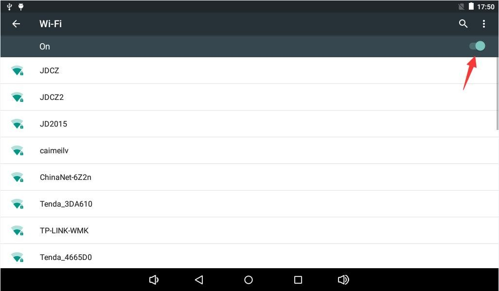
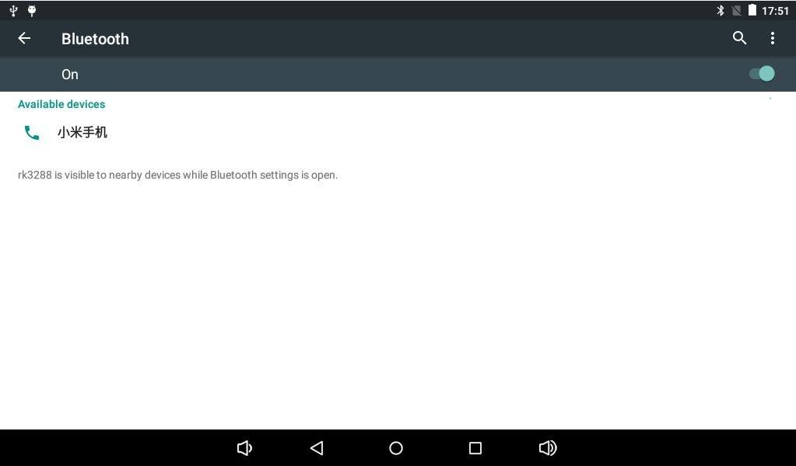
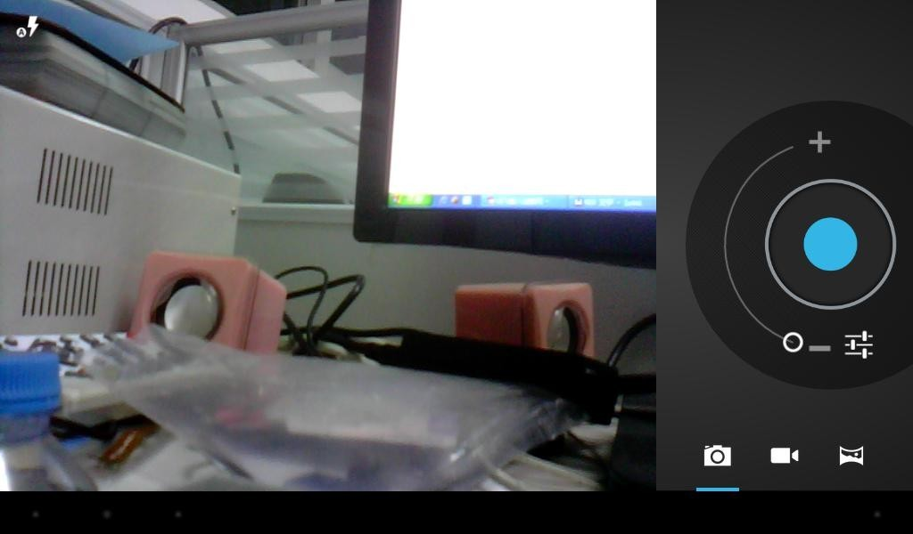

# Android User Guide

## UART and ADB

Connect UART2, select its serial port and configure 115200 baud, 8 data bits, no parity and 1 stop bit, with flow control off. Use the actual firmware baud rate if it differs. For ADB, enable USB debugging in Developer options, set OTG to Device and authorize the host.

```bash
adb devices
adb shell
```

With multiple devices connected, select the target with `adb -s <serial> shell`.

## Networking and Bluetooth

In Settings, open Network & Internet and connect to a Wi-Fi access point, or attach Ethernet and check the link LEDs and IP address. In Connected devices, discover Bluetooth devices and confirm pairing on both ends. Share files via Bluetooth or play media through a paired speaker.





## Display, Media and Storage

HDMI carries audio and video. Choose a resolution supported by both firmware and display. After connecting a camera, check its preview, then switch between photo and video modes. Media applications can play files on TF or USB storage. Use a Host port for USB storage, mice and keyboards. Detected storage appears under `/storage/` by UUID.



## Power, Rotation and Remote Control

Hold POWER to open shutdown controls, or press it briefly to suspend or wake. With a fitted orientation sensor, compatible applications rotate with the board. Attach a compatible IR receiver and use a matching remote for supported functions.
