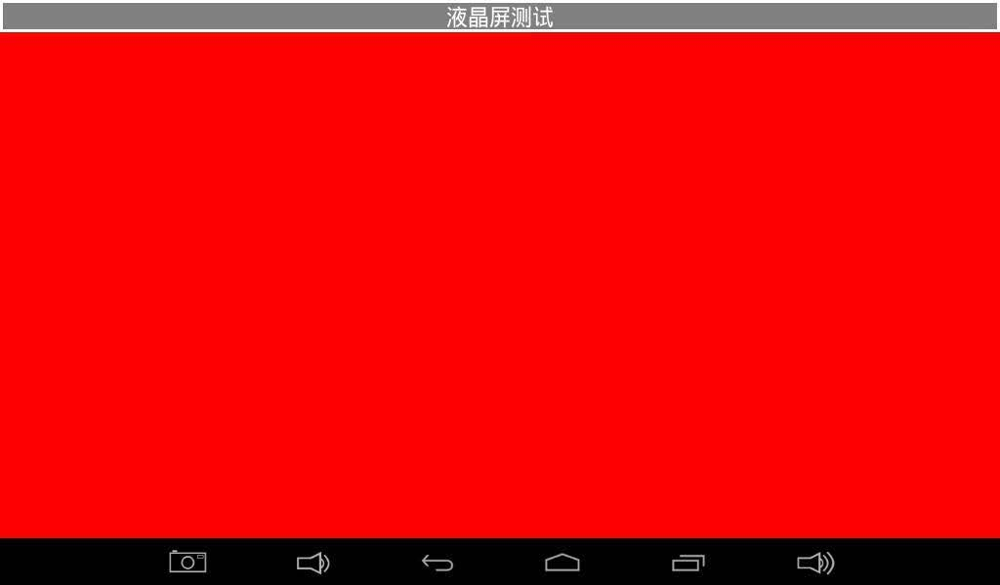
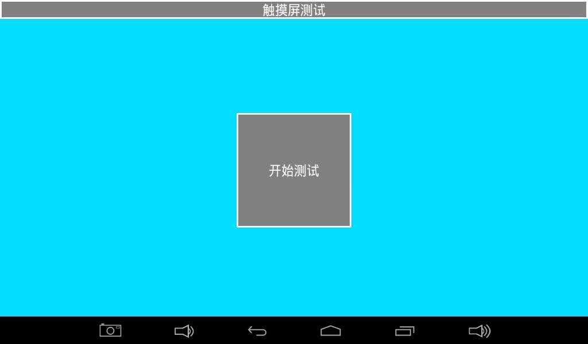
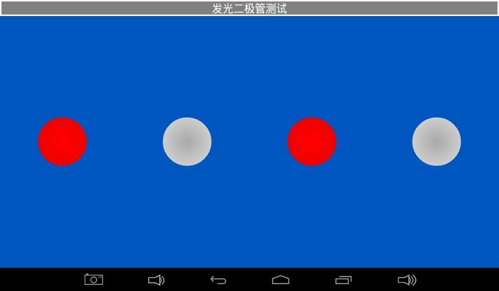
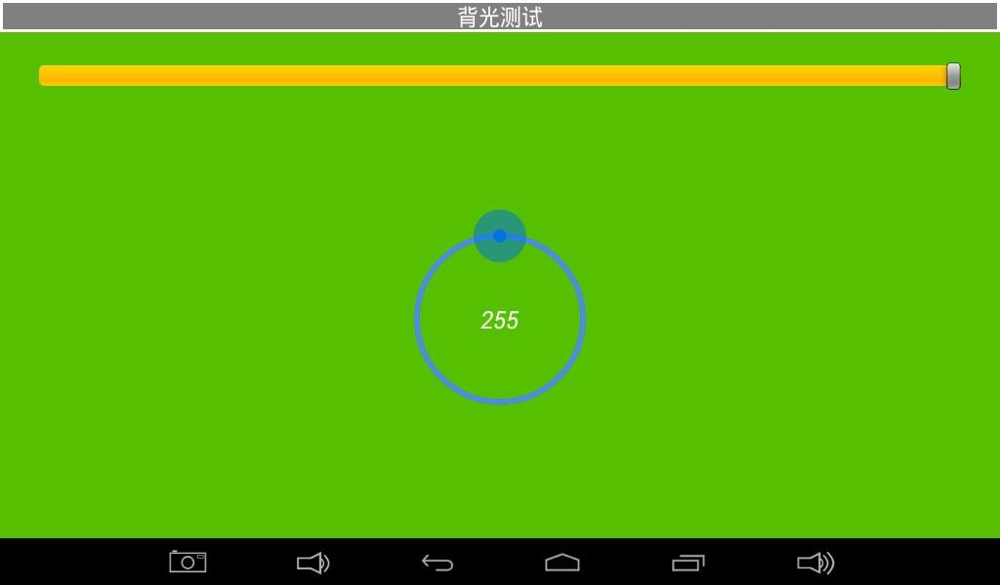
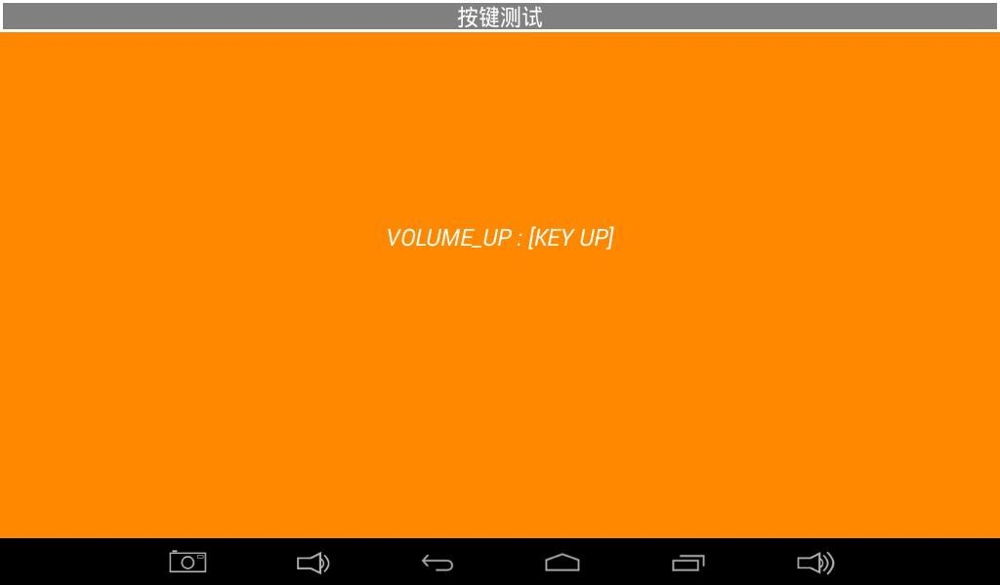
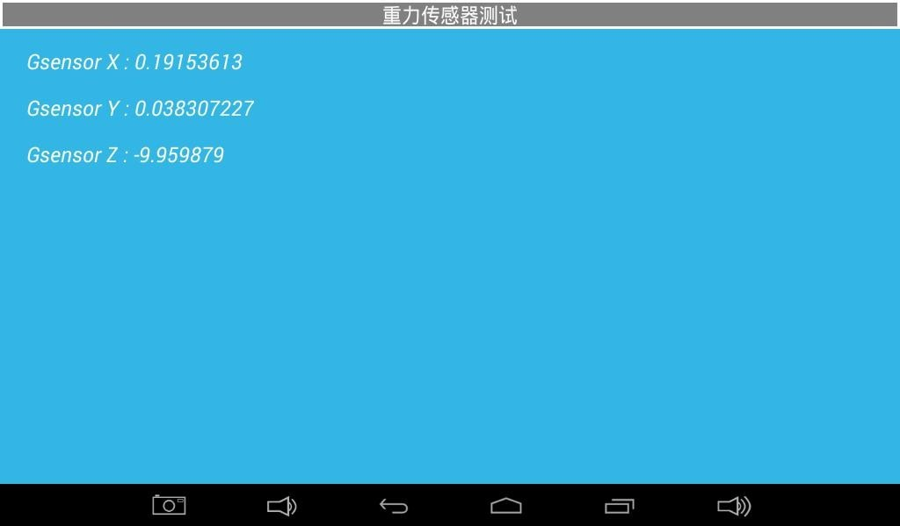
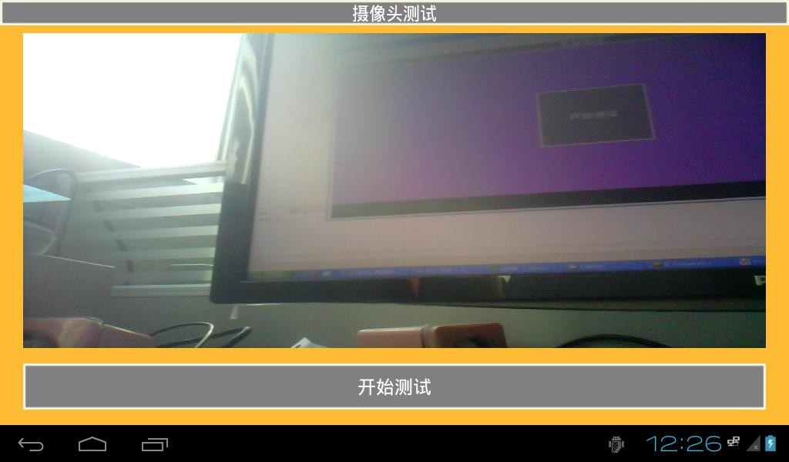
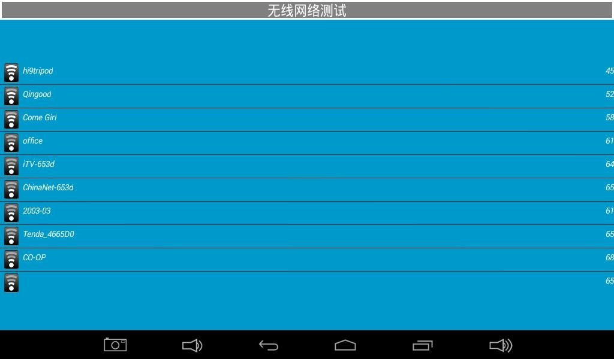
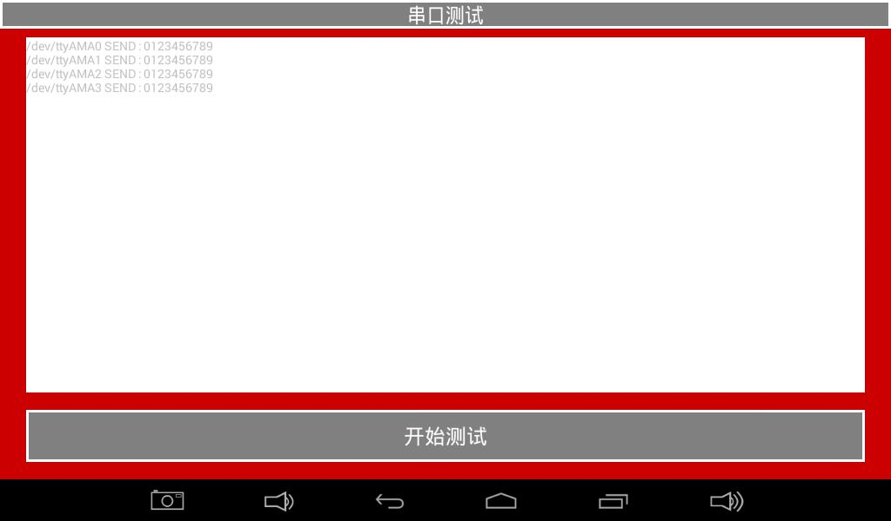
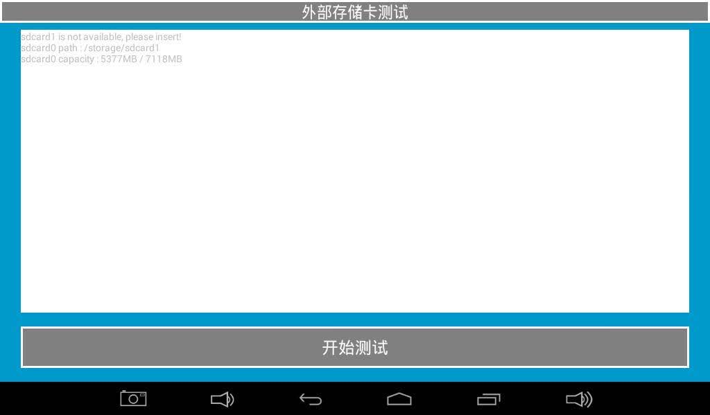

# Android Functional Tests

Open the Android Test application and swipe to change tests. Select tests for the fitted hardware and firmware. Run optional-device tests only when the corresponding hardware is present.

## LCD

Tap to cycle solid colors and inspect dead pixels, missing colors and flicker.

## Touch

Start the test and draw diagonals and edge lines to check continuity.

## LED and buzzer

Toggle LED icons and verify their state. Hold the buzzer test control to sound it and release to stop.

## Backlight

Drag the circular control and check brightness changes.

## Keys and battery

Verify press and release events. If a battery is fitted, check level and power status.

## ADC and orientation sensor

Verify exposed ADC channels. Rotate the board and observe X/Y/Z readings.

## Audio and camera

Play the test tone and verify output. Attach a compatible camera, start the test and check preview.

## Wireless and wired networking

Check the access-point list and confirm network access after connecting.

## UART

Verify the port’s signal level and pin order, loop TXD to RXD, and check for 0123456789. Remove the loopback after testing.

## TF and USB storage

Insert the medium and verify detection, mounting, capacity and file access.

