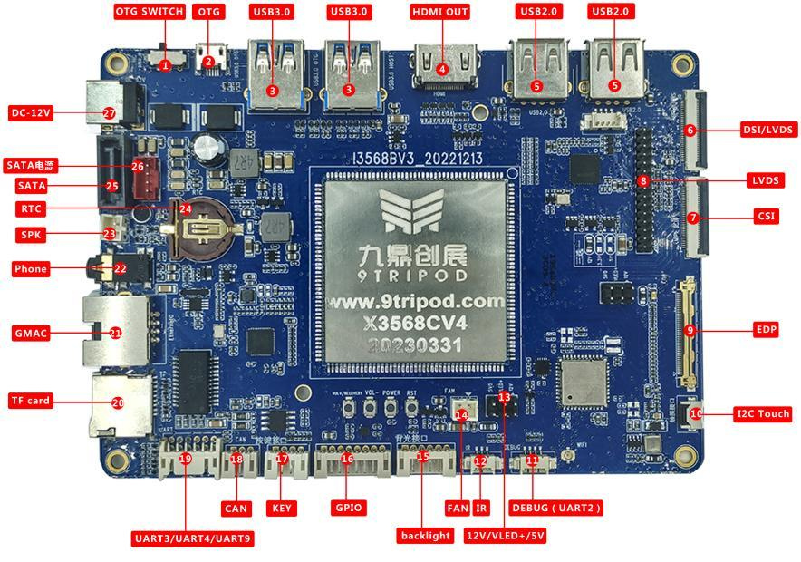

# Hardware Resources

| Callout | Name | Purpose |
| --- | --- | --- |
| 1 | USB role switch | Left for Device, right for Host |
| 2 | Micro USB OTG | Flashing and ADB, shares USB 2.0 signals |
| 3 | USB 3.0 | Two Host ports, with the port near OTG affected by the role switch |
| 4 | HDMI | Audio and video output |
| 5 | USB 2.0 | Two Type-A ports and one 4-pin, 1.25 mm header |
| 6 | DSI/LVDS | Display FPC, mode selected in firmware |
| 7 | MIPI CSI | 30-pin camera connector |
| 8 | LVDS | Output through GM8775C bridge |
| 9 | eDP | eDP panel connector |
| 10 | Touch | I2C capacitive touch |
| 11 | Debug UART | UART2 |
| 12 | IR | External IR receiver |
| 13 | Backlight jumper | 12 V / VLED+ / 5 V selection |
| 14 | Fan | 12 V fan supply |
| 15 | Backlight | Panel backlight connector |
| 16 | Expansion | 1.8 V / 3.3 V / 5 V / ADC / I/O / I2C |
| 17 | External keys | VOL− / VOL+ / POWER / RST |
| 18 | CAN | CAN bus |
| 19 | Expansion UART | UART9 / UART3 / UART4, TTL |
| 20 | TF | Memory card socket |
| 21 | GMAC0 | Gigabit Ethernet |
| 22 | Headphones | Audio output |
| 23 | Speaker | External speaker |
| 24 | RTC | Backup battery |
| 25 | SATA data | Black data connector |
| 26 | SATA power | Red power connector |
| 27 | DC input | 12 V DC |
