# Hardware Interfaces

## Power and Keys

Connect 12 V DC power. Hold POWER if the board does not start automatically. RST performs a hardware reset and VOL+ doubles as the RECOVERY download key. Verify the pin order for your revision before wiring external keys.

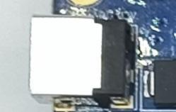

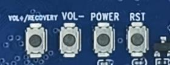

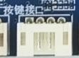

## USB Host and OTG

Set the switch left to Device for Micro USB flashing and ADB. This disables USB 2.0 on the adjacent USB 3.0 port. Set it right to Host to restore USB 2.0 compatibility on that port. Two Type-A USB 2.0 ports and one PH-header USB 2.0 port are also available.

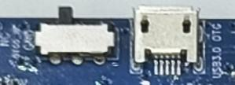

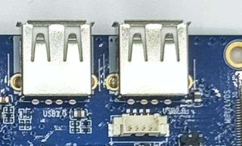

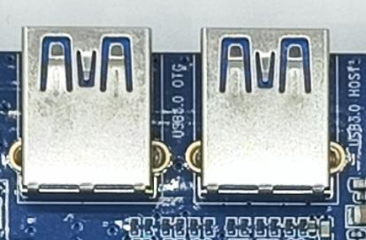

## Display and Backlight

HDMI carries video and audio. Configure the DSI/LVDS FPC mode in firmware. The separate LVDS connector uses a GM8775C bridge, and eDP uses its own panel connector. The backlight jumpers select supplies for eDP and the backlight header. Check the panel voltage and jumper positions before connection.

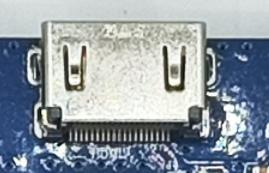

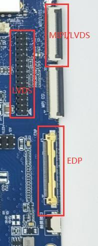

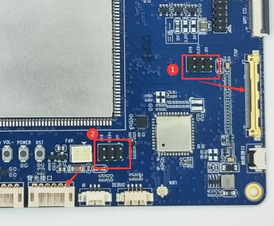

## Camera, Audio and IR

The camera uses a 30-pin MIPI CSI connector. Verify wiring, supply voltage and driver support when changing modules. The board provides headphone output, an external speaker connector and onboard recording input. Connect a compatible IR receiver to the IR header.

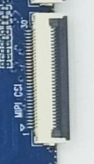

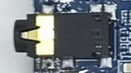

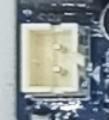

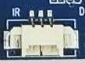

## Network, Storage and RTC

The RJ45 connector provides Gigabit Ethernet. Wi-Fi and Bluetooth use the onboard dual-band SDIO module. Use the TF card for storage. The black SATA connector carries data and the red connector supplies power. The RTC battery maintains time when main power is off.

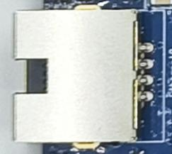

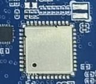

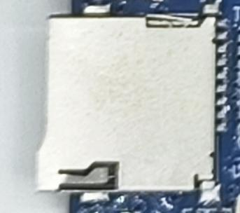

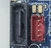

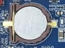

## Debug and Expansion

UART2 is the default debug port. UART3/4/9 are additional TTL ports. Cross TX/RX, share ground and verify signal levels before wiring. The board also exposes CAN and a 1.8 V / 3.3 V / 5 V / ADC / I/O / I2C header. Check each pin against the matching schematic.

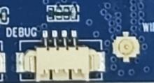

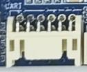

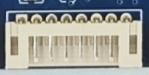
