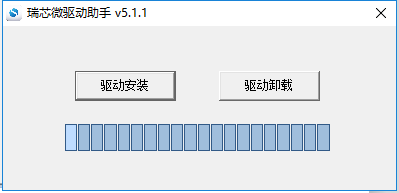
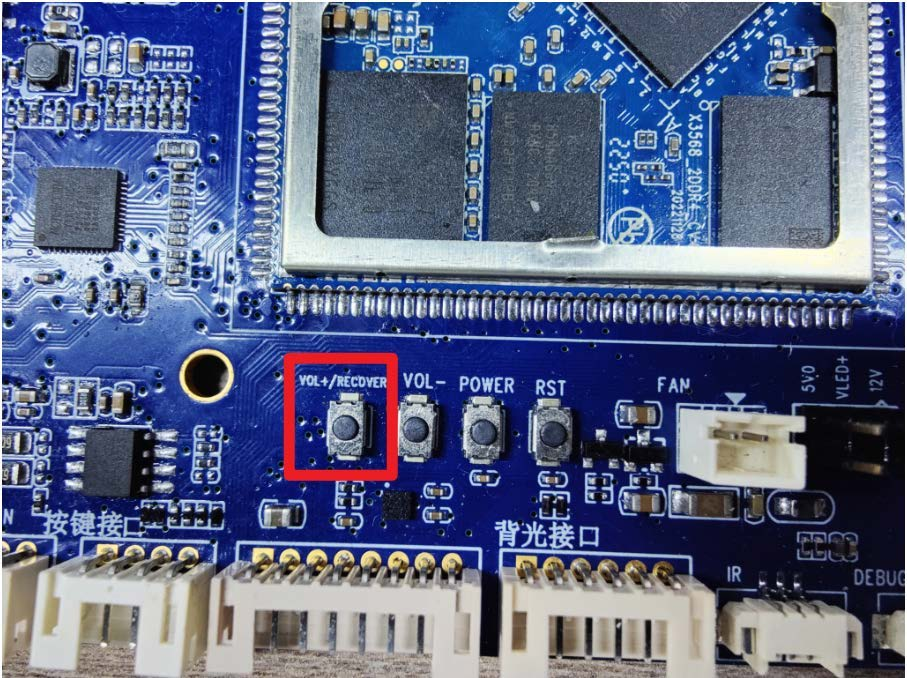

# Linux Firmware Flashing

## Upgrade with RKDevTool

1. Back up data you need and prepare the I3568BV3 Linux `rockdev/update.img`.
2. Install the supplied DriverAssitant v5.1.1 from SDK `tools/windows/`, then open RKDevTool v2.86.
3. Set OTG to Device. Hold VOL+/RECOVERY while connecting the Micro USB data cable and 12 V supply. On a powered board, hold RECOVERY and press RST.
4. Once the tool detects LOADER, select `update.img` on the Upgrade Firmware tab and start the upgrade. Wait for writing and reboot to finish.





## Detection and Recovery

If the tool only detects ADB, use its Switch control or run the command below from the board UART if the firmware supports it. If detection fails, check the driver, USB data cable, OTG switch and power supply.

```bash
reboot bootloader
```

Maskrom is available for recovery when Loader is inaccessible. Verify the recovery pads for the actual core-board revision before using the hardware method. Erase Flash clears storage data. Confirm backups and a recovery image before using it.

## Boot Debug Shortcuts

Use the matching UART settings and hold the key combination during startup. Availability depends on firmware and secure-boot settings.

| Keys | Action |
| --- | --- |
| Ctrl+C | Enter the U-Boot prompt |
| Ctrl+D | Enter Loader |
| Ctrl+B | Enter Maskrom |
| Ctrl+F | Enter Fastboot |
| Ctrl+M | Print bidram/system information |
| Ctrl+I | Enable initcall_debug |
| Ctrl+P | Print the kernel command line |
| Ctrl+S | Enter the U-Boot prompt after Starting kernel |
