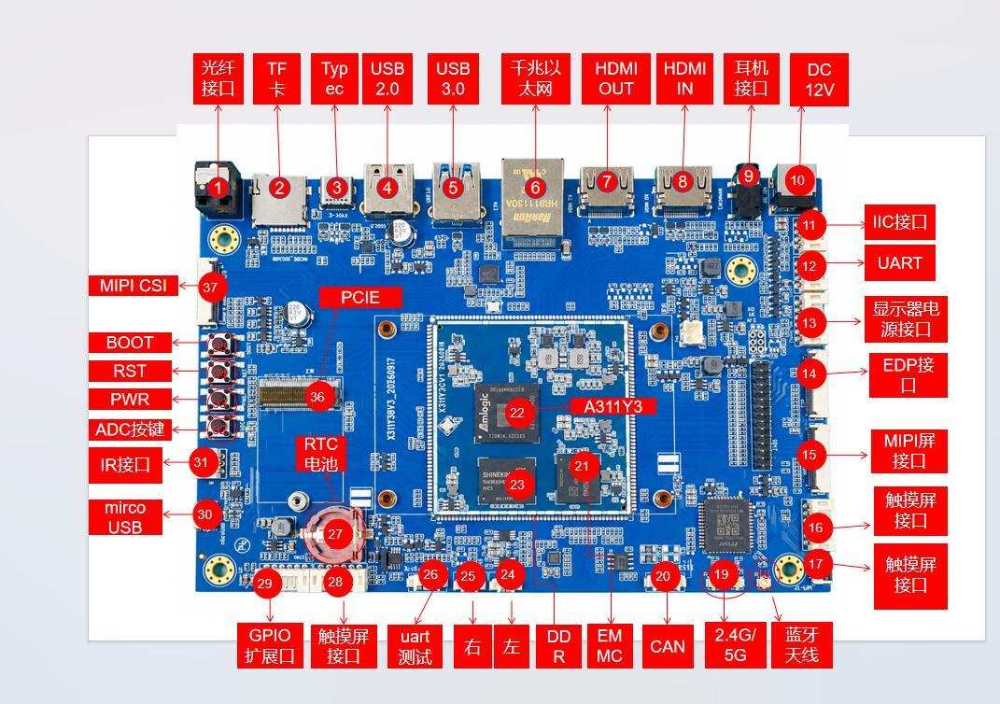

# Hardware resources

The following numbers match the interface map. The original Chinese labels are retained in the image, with English names in the table.

| Number | Name | Description |
| --- | --- | --- |
| 【1】 | Optical audio | SPDIF optical output |
| 【2】 | TF slot | TF (MicroSD) card slot |
| 【3】 | Type-C | USB Type-C connector |
| 【4】 | USB2.0 | USB 2.0 HOST connector |
| 【5】 | USB3.0 | USB 3.0 HOST connector |
| 【6】 | Gigabit Ethernet | Gigabit Ethernet port |
| 【7】 | HDMIOUT | HDMI output |
| 【8】 | HDMIIN | HDMI input |
| 【9】 | Headphone connector | Headphone output |
| 【10】 | DC12V | 12 V/2 A DC power input |
| 【11】 | I2C interface | I2C expansion connector |
| 【12】 | UART interface | UART expansion connector |
| 【13】 | Display power | Display power connector |
| 【14】 | eDP panel | eDP display connector |
| 【15】 | MIPI panel | MIPI DSI display connector |
| 【16】 | Touch-panel connector | Touch-panel connector |
| 【17】 | Touch-panel connector | Touch-panel connector |
| 【18】 | Bluetooth antenna | Bluetooth antenna connector |
| 【19】 | 2.4/5 GHz antenna | Dual-band 2.4/5 GHz Wi-Fi antenna connector |
| 【20】 | CAN connector | CAN bus connector |
| 【21】 | EMMC | eMMC device, 64 GB standard |
| 【22】 | A311Y3 | Main CPU on the core board |
| 【23】 | DDR | LPDDR4X/LPDDR5 devices, 8 GB standard |
| 【24】 | Left speaker | Left speaker connector |
| 【25】 | Right speaker | Right speaker connector |
| 【26】 | UART test | UART test connector |
| 【27】 | RTC battery | RTC coin-cell holder |
| 【28】 | Touch-panel connector | Touch-panel connector |
| 【29】 | GPIO expansion | GPIO expansion |
| 【30】 | micro USB | Micro USB connector |
| 【31】 | Infrared connector | Infrared receiver connector |
| 【32】 | ADC buttons | ADC button |
| 【33】 | Power button | Power button (PWRKEY) |
| 【34】 | Reset button | Reset button (RESET) |
| 【35】 | BOOT button | BOOT button; recovery key during upgrade |
| 【36】 | PCIe connector | PCIe 2.0 connector |
| 【37】 | MIPI camera | MIPI CSI camera connector |

## Software driver resources

The hardware manual records the following support; ● denotes a supported item in that source. Actual peripherals require matching firmware, device trees and drivers.

| Function | Android 16 / Linux 6.12 | Armbian / Linux 6.12 |
| --- | --- | --- |
| 7-inch MIPI panel (1024 × 600) | ● | ● |
| Backlight driver | ● | ● |
| Capacitive touch | ● | ● |
| eMMC driver | ● | ● |
| SD card driver | ● | ● |
| Independent buttons | ● | ● |
| ADC driver | ● | ● |
| Power control | ● | ● |
| Suspend and wake | ● | ● |
| USB HOST 2.0 driver | ● | ● |
| USB HOST 3.0 driver | ● | ● |
| USB OTG driver | ● | ● |
| PCIe driver | ● | ● |
| Optical audio driver | ● | ● |
| RTC driver | ● | ● |
| Audio | ● | ● |
| Recording | ● | ● |
| Dual-band Wi-Fi / BT 4.0 | ● | ● |
| CSI camera driver | ● | ● |
| UART | ● | ● |
| HDMI2.1a | ● | ● |
| Gigabit Ethernet | ● | ● |
| USB mouse/keyboard | ● | ● |
| uboot | ● | ● |
