# Interface details

## Power and debug UART

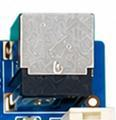

The mainboard uses 12 V DC input. Check the four-pin debug header pinout and levels against the silkscreen and use an adapter with reverse-current protection. The software flashing manual uses 921600 baud, 8N1 and no flow control.

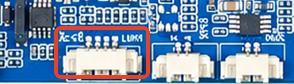

## HDMI interfaces

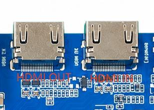

Standard HDMI Type-A input and output connectors are provided. HDMI OUT connects to an HDMI 2.1a display or TV; HDMI IN accepts external sources or HDMI cameras.

## Camera interface

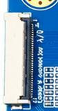

30-pin MIPI CSI camera connector. Signal names and net notes below follow the hardware manual.

| Pin | Signal / function | Notes |
| --- | --- | --- |
| 1 | GND_0 | GND |
| 2 | MIPI_D3N | CSI_A_CLKP |
| 3 | MIPI_D3P | CSI_A_CLKP |
| 4 | GND_1 | GND |
| 5 | MIPI_D2N | CSI_A_D0P |
| 6 | MIPI_D2P | CSI_A_D0N |
| 7 | GND_2 | GND |
| 8 | MIPI_CLKN | CSI_A_D1P |
| 9 | MIPI_CLKP | CSI_A_D1N |
| 10 | GND_3 | GND |
| 11 | MIPI_D1N | CSI_A_D2P |
| 12 | MIPI_D1P | CSI_A_D2N |
| 13 | GND_4 | GND |
| 14 | MIPI_D0N | CSI_A_D3P |
| 15 | MIPI_D0P | CSI_A_D3N |
| 16 | GND_5 | GND |
| 17 | CAM_MCLK | CSI_B_CLKP |
| 18 | GND_6 | CSI_B_CLKP |
| 19 | VCC_IO | VCC_IO |
| 20 | AF_CTL | CMA_I2C_G_SCL |
| 21 | PRE_TRIG | CMA_I2C_G_SDA |
| 22 | FLASH_TRIG | CMA_MCLK |
| 23 | MIPI_SCL | CMB_MCLK |
| 24 | MIPI_SDA | GPIOAO_10 |
| 25 | MIPI_PDN | CMA_PWRDN |
| 26 | MIPI_RST | CMA_RST_L |
| 27 | 27 | GPIOY_8 |
| 28 | 28 | VCC1V8_CAM1 |
| 29 | 29 | VCC2V8_CAM1 |
| 30 | 30 | MIPI_1_2V_CAM1 |

## Ethernet

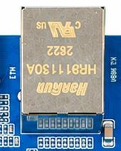

RTL8211F provides one Gigabit Ethernet port.

## Headphones and speakers

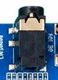

The headphone connector supports output and a headset microphone. Stereo speaker connections are listed below.

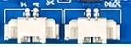

| Pin | Signal / function |
| --- | --- |
| 1 | R+ |
| 2 | R- |
| 3 | L- |
| 4 | L+ |

## TF card

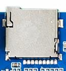

TF cards store multimedia files and can be used for upgrades with matching images and boot configuration.

## Buttons

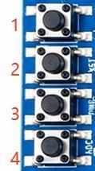

The board has BOOT, RST, PWRKEY and ADC buttons. BOOT serves as the recovery key during upgrades; the ADC button is sampled through ADC.

|  | Switch | Function |
| --- | --- | --- |
| 1 | BOOT | BOOT button; recovery key during upgrade |
| 2 | RST | Reset button |
| 3 | PWRKEY | Power button |
| 4 | ADC | ADC button |

## USB OTG and HOST

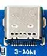

Type-C provides USB 3.0 OTG with Host/Device roles; Device mode supports flashing. A micro USB 2.0 OTG connector and one HOST 2.0 / one HOST 3.0 port are also provided.

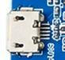

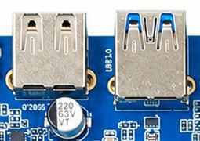

## eDP panel

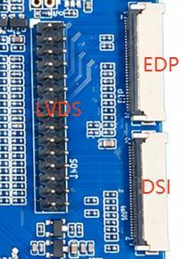

The J13 eDP connector signals and notes are listed below.

| Pin | Signal / function | Notes |
| --- | --- | --- |
| 1 | GND_0 | GND |
| 2 | LVDS_D0N | EDP_A_0N/DSI_A_D1N/VX1_A_1N |
| 3 | LVDS_D0P | EDP_A_0P/DSI_A_D1P/VX1_A_1P |
| 4 | GND_1 | GND |
| 5 | LVDS_D1N | EDP_A_1N/DSI_A_CKN/VX1_A_2N |
| 6 | LVDS_D1P | EDP_A_1P/DSI_A_CKP/VX1_A_2P |
| 7 | GND_2 | GND |
| 8 | LVDS_CLKN | EDP_A_AUXN/DSI_A_D0N/VX1_A_0N |
| 9 | LVDS_CLKP | EDP_A_AUXP/DSI_A_D0P/VX1_A_0P |
| 10 | GND_3 | GND |
| 11 | LVDS_D2N | EDP_A_2N/DSI_A_D2N/VX1_A_3N |
| 12 | LVDS_D2P | EDP_A_2P/DSI_A_D2P/VX1_A_3P |
| 13 | GND_4 | GND |
| 14 | LVDS_D3N | EDP_A_3N/DSI_A_D3N/VX1_A_4N |
| 15 | LVDS_D3P | EDP_A_3P/DSI_A_D3P/VX1_A_4P |
| 16 | GND_5 | GND |
| 17 | LCD_PWM1_IN | PANEL_A_BL_PWM_I |
| 18 | GND_6 | GND |
| 19 | VCC_IO | PANEL_VCC |
| 20 | LCD_RST | PANEL_A_RST |
| 21 | CABG_EN | eDP_HPD_VX1_HPD |
| 22 | LED_EN | PANEL_A_BL_EN |
| 23 | TP_SCL | TP_A_I2C_A_SCL |
| 24 | TP_SDA | TP_A_I2C_A_SDA |
| 25 | TP_INT | TP_A_INT |
| 26 | TP_RST | TP_A_RST |
| 27 | GND_7 | GND |
| 28 | VSYS_0 | VCC5V_EXT (12 V option) |
| 29 | VSYS_1 |  |
| 30 | VSYS_2 |  |

## MIPI panel

The 30-pin MIPI display connector is defined below. Select panel power to match the display specification.

| Pin | Signal / function |
| --- | --- |
| 1 | Selectable 5 V / 12 V supply |
| 2 | Selectable 5 V / 12 V supply |
| 3 | Selectable 5 V / 12 V supply |
| 4 | PANEL_VCC（3V3） |
| 5 | PANEL_VCC（3V3） |
| 6 | TP_B_I2C_SCL |
| 7 | TP_B_I2C_SDA |
| 8 | TP_B_INT |
| 9 | TP_B_RST |
| 10 | PANEL_VCC（3V3） |
| 11 | PANEL_VCC（3V3） |
| 12 | PANEL_B_BL_PWM_J |
| 13 | PANEL_B_RST |
| 14 | NC |
| 15 | PANEL_B_BL_EN |
| 16 | GND |
| 17 | DSI_B_D3N/LVDS_B_3N |
| 18 | DSI_B_D3P/LVDS_B_3P |
| 19 | GND |
| 20 | DSI_B_D2N/LVDS_B_CLKN |
| 21 | DSI_B_D2P/LVDS_B_CLKP |
| 22 | GND |
| 23 | DSI_B_CKN/LVDS_B_2N/VX1_A_7N |
| 24 | DSI_B_CKP/LVDS_B_2P/VX1_A_7P |
| 25 | GND |
| 26 | DSI_B_D1N/LVDS_B_1N/VX1_A_6N |
| 27 | DSI_B_D1P/LVDS_B_1P/VX1_A_6P |
| 28 | GND |
| 29 | DSI_B_D0N/LVDS_B_0N/VX1_A_5N |
| 30 | DSI_B_D0P/LVDS_B_0P/VX1_A_5P |

## Touch panel 1

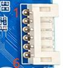

Touch panel 1 connector pinout.

| Pin | Signal / function |
| --- | --- |
| 1 | GND |
| 2 | SCL |
| 3 | SDA |
| 4 | INT |
| 5 | RST |
| 6 | GND |

## Touch panel 2

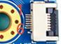

Touch panel 2 connector pinout.

| Pin | Signal / function |
| --- | --- |
| 1 | GND |
| 2 | SDA |
| 3 | SCL |
| 4 | 3V3 |
| 5 | INT |
| 6 | RST |

## RTC backup battery

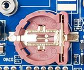

The backup battery maintains time without main power. The hardware manual specifies external RTC current below 0.6 µA.

## Infrared connector

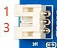

Three-pin, 2.0 mm pitch connector for an external infrared receiver.

| Pin | Signal / function |
| --- | --- |
| 1 | IR |
| 2 | GND |
| 3 | VCC |

## Optical audio

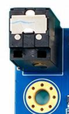

The SPDIF optical output connects to audio equipment with optical input.

## Wi-Fi and Bluetooth

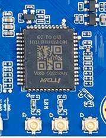

The onboard SDIO Wi-Fi/Bluetooth module supports 2.4 GHz and 5 GHz bands.

## UART_F

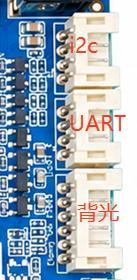

One UART_F port is exposed.

| Pin | Signal / function |
| --- | --- |
| 1 (top) | GND |
| 2 | RX |
| 3 | TX |
| 4 (bottom) | VCC |

## PCIe

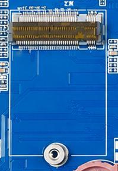

A standard PCIe 2.0 expansion connector accepts compatible devices. Check its multiplexing with USB 3.0 HOST.

## GPIO expansion

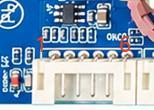

The GPIO expansion connector is defined below.

| Pin | Signal / function |
| --- | --- |
| 1 | 3V3 |
| 2 | GPIOA_3 |
| 3 | GPIOA_4 |
| 4 | GPIOA_5 |
| 5 | GPIOA_6 |
| 6 | GND |

## LVDS/DSI header

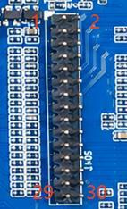

7CON2 is a 2 × 15, 30-pin display header.

| Pin | Signal / function |
| --- | --- |
| 1 | PANEL_VCC |
| 2 | PANEL_VCC |
| 3 | PANEL_VCC |
| 4 | GND |
| 5 | GND |
| 6 | GND |
| 7 | EDP_A_AUXN/DSI_A_D0N/LVDS_A_0N/VX1_A_0N |
| 8 | EDP_A_AUXP/DSI_A_D0P/LVDS_A_0P/VX1_A_0P |
| 9 | EDP_A_0N/DSI_A_D1N/LVDS_A_1N/VX1_A_1N |
| 10 | EDP_A_0P/DSI_A_D1P/LVDS_A_1P/VX1_A_1P |
| 11 | EDP_A_1N/DSI_A_CKN/LVDS_A_2N/VX1_A_2N |
| 12 | EDP_A_1P/DSI_A_CKP/LVDS_A_2P/VX1_A_2P |
| 13 | GND |
| 14 | GND |
| 15 | EDP_A_2N/DSI_A_D2N/LVDS_A_CLKN/VX1_A_3N |
| 16 | EDP_A_2P/DSI_A_D2P/LVDS_A_CLKP/VX1_A_3P |
| 17 | EDP_A_3N/DSI_A_D3N/LVDS_A_3N/VX1_A_4N |
| 18 | EDP_A_3P/DSI_A_D3P/LVDS_A_3P/VX1_A_4P |
| 19 | DSI_B_D0N/LVDS_B_0N/VX1_A_5N |
| 20 | DSI_B_D0P/LVDS_B_0P/VX1_A_5P |
| 21 | DSI_B_D1N/LVDS_B_1N/VX1_A_6N |
| 22 | DSI_B_D1P/LVDS_B_1P/VX1_A_6P |
| 23 | DSI_B_CKN/LVDS_B_2N/VX1_A_7N |
| 24 | DSI_B_CKP/LVDS_B_2P/VX1_A_7P |
| 25 | GND |
| 26 | GND |
| 27 | DSI_B_D2N/LVDS_B_CLKN |
| 28 | DSI_B_D2P/LVDS_B_CLKP |
| 29 | DSI_B_D3N/LVDS_B_3N |
| 30 | DSI_B_D3P/LVDS_B_3P |
