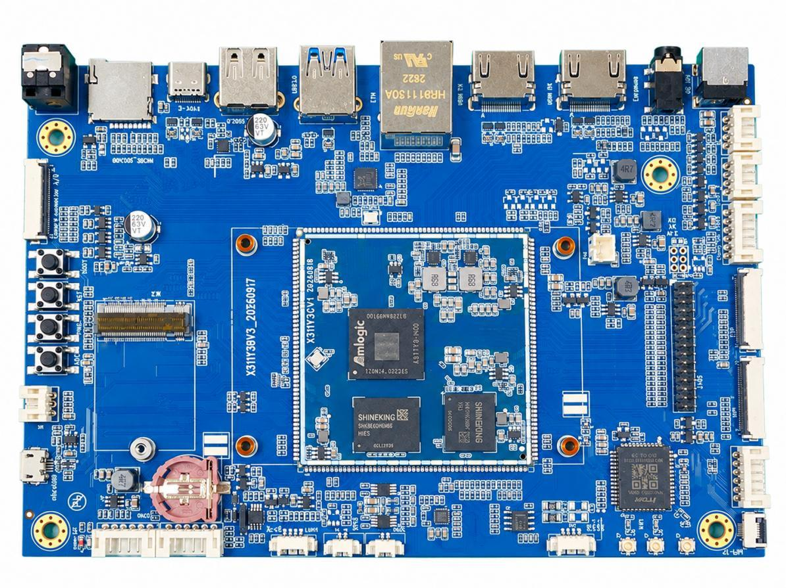

# Product introduction

X311Y3 is an Amlogic A311Y3 development board for industrial control, machine vision, edge computing and multimedia terminals. Its 6 nm SoC combines 2 × Cortex-A78 at 2.4 GHz and 6 × Cortex-A55 at 2.0 GHz, an 8 TOPS NPU and a Mali-G625 MC1 GPU.

The platform supports Android 16 and Linux 6.12.69, video capability up to 4K at 120 fps, and 13-megapixel at 30 fps / 16-megapixel at 20 fps vision input. Standard configuration is 8 GB memory and 64 GB eMMC 5.1; memory options reach 16 GB and storage options include 128/256 GB.

## Features

- One USB HOST 2.0 and one USB HOST 3.0 port; HOST 3.0 shares resources with one PCIe 2.0 interface.
- Type-C USB 3.0 OTG, micro USB 2.0 OTG, debug UART and UART_F.
- HDMI TX/RX, MIPI DSI/eDP/LVDS, touch and backlight control.
- RTL8211F Gigabit Ethernet, dual-band Wi-Fi/Bluetooth and MIPI CSI camera.
- TF card, GPIO, I2C, PCIe 2.0, RTC, infrared, SPDIF, headphones and stereo speakers.
- BOOT, RST, PWRKEY and ADC buttons; 12 V/2 A DC mainboard power.

## System configuration

| Item | Description |
| --- | --- |
| CPU | A311Y3 |
| GPU | ARM Mali-G625 MC1; OpenGL ES 3.2, Vulkan 1.4 and OpenCL 3.0 |
| NPU | 8 TOPS accelerator supporting INT4/INT8/FP16 inference |
| Clock frequency | 2 × 2.4GHz + 6 × 2.0GHz |
| Memory | LPDDR4X/LPDDR5, 8 GB standard, up to 16 GB |
| Storage | 64/128/256 GB eMMC 5.1; 64 GB standard |
| Power management | Discrete DC/DC and LDO |

## Interface specifications

| Item | Description |
| --- | --- |
| LCD interface | HDMI 2.1a / MIPI DSI / eDP / LVDS outputs |
| Touch interface | Touch-panel connector |
| Audio interface | Headphone/speaker outputs, playback and recording |
| SD card interface | 1 TF slot, SDIO 3.0 with SD/SDHC/SDXC support |
| Ethernet interface | 1 Gigabit Ethernet port, RTL8211F |
| USB HOST 2.0 | 1 HOST 2.0 port |
| USB HOST 3.0 | 1 HOST 3.0 port, shared with one PCIe 2.0 interface |
| OTG interface | 1 Type-C USB 3.0 OTG port |
| UART interface | 2 UARTs: debug UART and UART_F |
| I2C interface | 1 I2C interface |
| Camera interface | 4-lane MIPI CSI input |

## Core board electrical specifications

| Item | Description |
| --- | --- |
| Input supplies | 12 V/2 A, 3.3 V/1 A and 1.8 V/1 A (core board supplies) |
| RTC supply | 3V/0.6uA |
| Operating temperature | -10 to 70°C |
| Storage temperature | -10 to 40°C |

## Documentation

- [Hardware resources](./x311y3-hardware-resources.md)

- [Interface details](./x311y3-interface-details.md)

- [Configuration list](./x311y3-configuration-list.md)

- [USB flashing and tool installation](./x311y3-usb-flashing.md)

- [Android development environment](./x311y3-android-environment.md)

- [Android builds and OTA](./x311y3-android-build.md)

- [Linux development environment](./x311y3-linux-environment.md)

- [Linux builds and upgrades](./x311y3-linux-build.md)

- [Linux user guide](./x311y3-linux-user-guide.md)

- [Linux multimedia and AI tests](./x311y3-linux-multimedia-ai.md)

- [Troubleshooting](./x311y3-troubleshooting.md)
