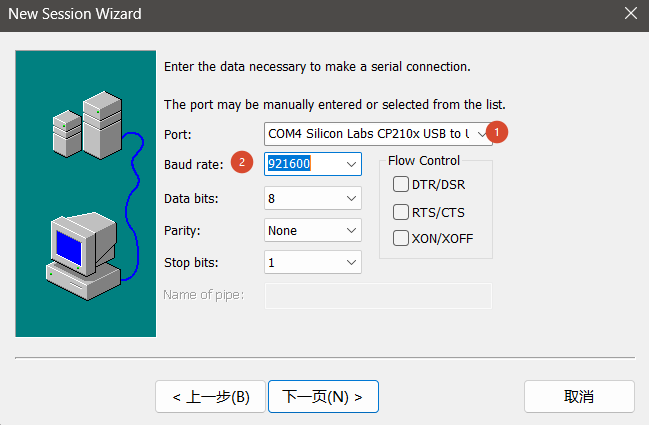
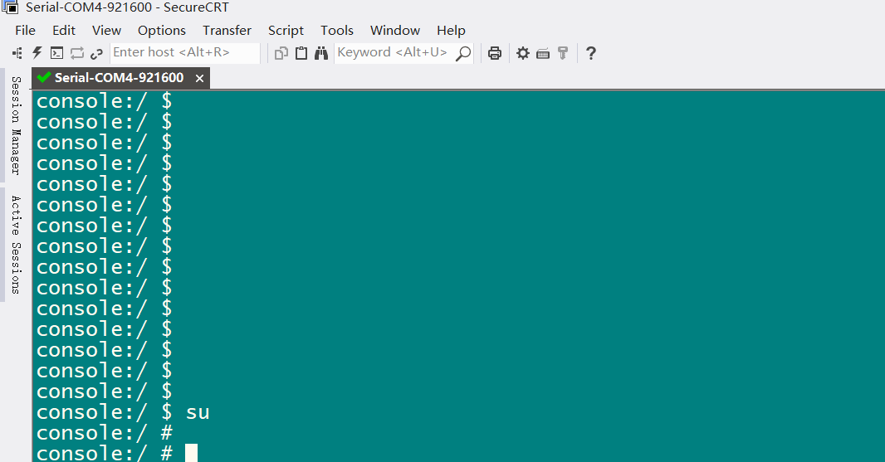
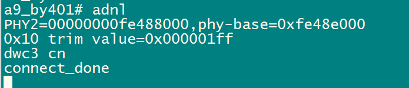
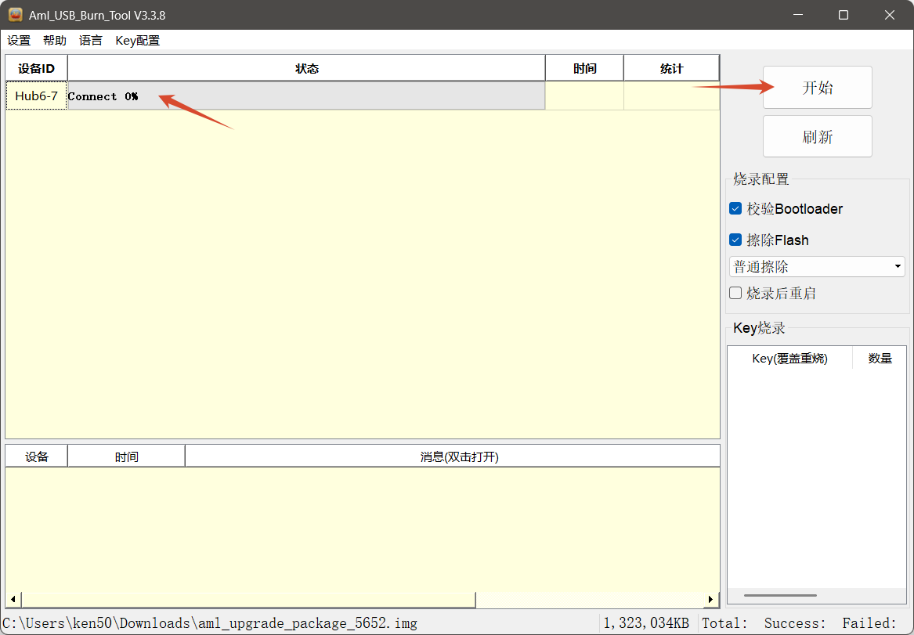
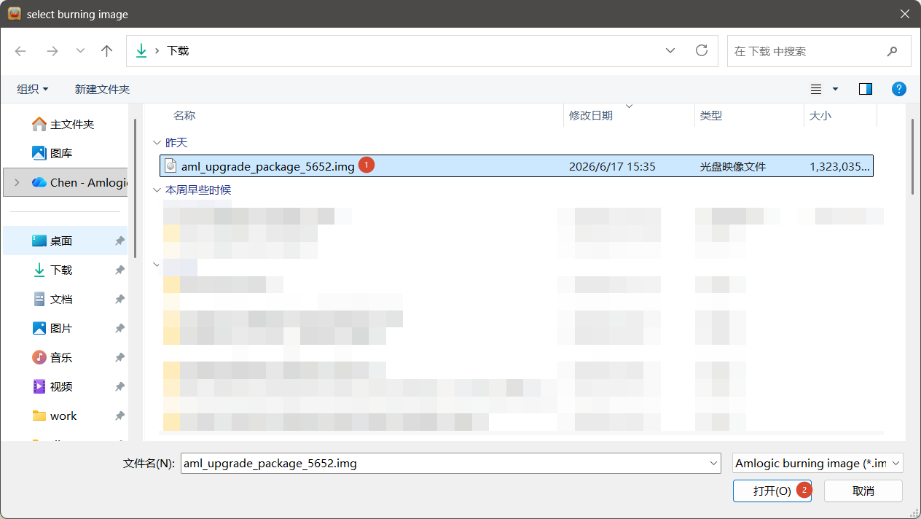
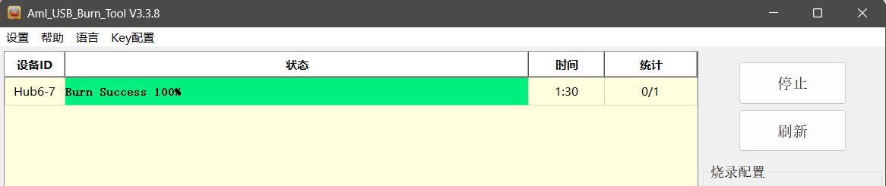

# USB flashing and tool installation

X311Y3 uses Amlogic USB Burn Tool V3: UART + Type-C → 921600 baud → power-on → Enter → adnl → V3 tool. Use an image matching the board, storage and software version, and back up data before flashing.

## UART settings

| Item | Description |
| --- | --- |
| UART | GND / TX / RX / VDD3V3 |
| Baud rate | 921600 |
| Data format | 8N1 |
| Flow control | Disabled |

Follow the UART silkscreen, cross TX/RX and do not use VDD3V3 as an external supply. Select the actual port in SecureCRT and disable DTR/DSR, RTS/CTS and XON/XOFF.





## Install the V3 tool and driver

1. Prepare the X311Y3 image and Type-C data cable on a Windows 10/11 64-bit PC.
2. Run the supplied `V3_setup_V3.*.*.exe`, selecting language and path.
3. Complete DNL driver installation and launch `Aml_Burn_Tool`.
4. Screenshots show V3.3.8; use the supplied project version.

A correctly detected device appears under `Universal Serial Bus devices → android_winusb`. For a warning icon, run `dpscat.exe`, followed by architecture-matching `dpinst64.exe` or `dpinst32.exe`, in the V3 directory. Alternatively, update the driver manually from `C:\Amlogic\Aml_Burn_Tool\V3\Driver`.

For `Load aml_usb_flow.dll failed`, verify the DLL exists in the tool directory. If it exists but still fails, install the matching VC2015 runtime, `vc_redist.x64.exe` or `vc_redist.x86.exe`.

## Enter USB download mode

1. Connect UART and Type-C, with Type-C connected to the PC.
2. Set 921600 baud, 8N1 and no flow control.
3. Power on and promptly press Enter to stop at U-Boot.
4. Run `adnl` and wait for `connect_done`.

```text
a9_by401# adnl
PHY2=00000000fe488000,phy-base=0xfe48e000
0x10 trim value=0x000001ff
dwc3 cn
connect_done
```



If `connect_done` is absent, check UART, power, Type-C data cabling and Windows USB detection first.

## Import and flash the image

1. Launch the tool, choose Settings → Import image and open the matching `.img`.
2. Confirm the device is listed and select Start.
3. Wait for success, then select Stop.
4. Restart the board and confirm boot through UART.







Matching Linux images can also use V3. Linux hosts may use `adnl_burn_pkg` with arguments supplied by the SDK/image. If Linux U-Boot has another entry method, follow that release.
