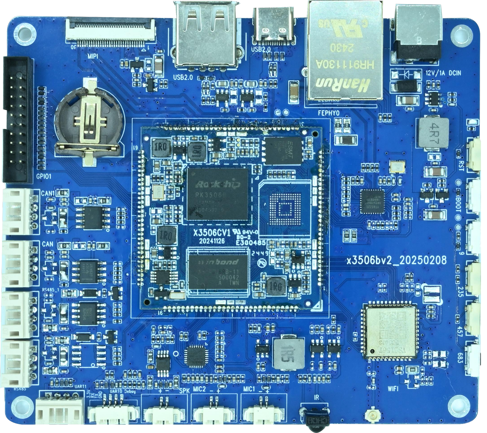

# Linux Firmware Flashing

## Prepare the Windows Flashing Tool

Prepare an `update.img` for the fitted board configuration and a data-capable USB Type-C cable. Install the Rockchip USB driver with `DriverInstall.exe` in `RKTools/windows/Release_DriverAssitant`, then start the SDK copy of `AndroidTool.exe`. The documented tool directory is `RKTools/windows/AndroidTool/AndroidTool_Release_v2.81`.

## Enter Maskrom Mode

1. Disconnect 12 V power and connect the board’s Type-C OTG port to the computer.
2. Hold the board’s `BOOT` button and reconnect 12 V power.
3. Release the button after the flashing tool detects a MASKROM device.

## Upgrade the Firmware

1. Open the **Upgrade Firmware** tab, click **Firmware**, and select `update.img`.
2. Confirm that the tool detects the board, then click **Upgrade**. Keep power and USB connected during flashing.
3. Wait for the tool to report a successful upgrade and check that the board boots.

An upgrade can overwrite onboard data. Back up any data you need before flashing. If the tool cannot detect the board, check the driver, Type-C cable and BOOT power-on sequence.
