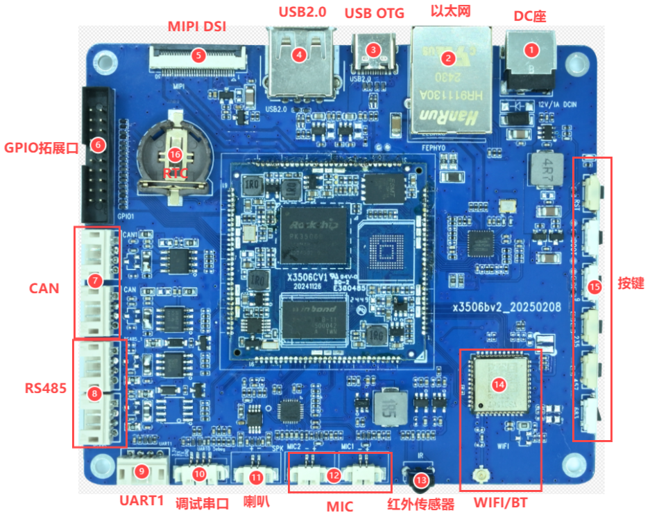

# Hardware Resources

| Callout | Interface | Purpose |
| --- | --- | --- |
| 1 | DC input | 12 V DC input |
| 2 | Ethernet | 10/100 Mbps RJ45 |
| 3 | USB OTG | Type-C for firmware flashing and ADB |
| 4 | USB host | Type-A USB 2.0 |
| 5 | MIPI DSI | 30-pin display and touch connector |
| 6 | GPIO | 2×10 header, 2.0 mm pitch |
| 7 | CAN | Two 4-pin ports, 2.0 mm pitch |
| 8 | RS485 | Two 4-pin ports, 2.0 mm pitch |
| 9 | UART1 | TTL, 4 pins, 2.0 mm pitch |
| 10 | UART0 debug | TTL, 4 pins, 1.25 mm pitch |
| 11 | Speaker | External speaker, 2 pins, 1.25 mm pitch |
| 12 | MIC | Two microphone inputs, 2 pins each, 1.25 mm pitch |
| 13 | IR | IR receiver |
| 14 | Wi-Fi / Bluetooth | Onboard AW869A module |
| 15 | Buttons | RST, BOOT and four ADC buttons |
| 16 | RTC | Backup battery holder |

Use the close-up photos and pin tables in [Hardware Interface Pinouts](./x3506-interface-details.md) when wiring peripherals.
