# Hardware Interface Pinouts

Section numbers match the callouts in [Hardware Resources](./x3506-hardware-resources.md). Disconnect power and check connector orientation against the close-up photos before wiring.

## 1. DC Power Input

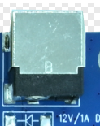

Connect 12 V DC power to the barrel jack. A 12 V, 3 A adapter is recommended.

## 2. Ethernet

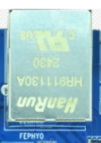

The RJ45 port uses a YT8522C PHY and supports 10/100 Mbps wired Ethernet.

## 3. USB Type-C OTG

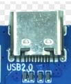

Connect the port to a computer with a data-capable USB Type-C cable for firmware flashing or ADB debugging.

## 4. USB 2.0 Host

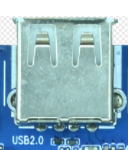

Connect USB peripherals such as flash drives and mice to the Type-A port.

## 5. MIPI DSI

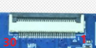

The 30-pin connector carries one 2-lane MIPI DSI interface, I2C touch, backlight PWM and reset signals. Check ribbon orientation, supply voltages and signal assignments before connecting a panel.

| Pin | Signal |
| --- | --- |
| 1 | `VCC5V0_SYS` |
| 2 | `VCC5V0_SYS` |
| 3 | `VCC5V0_SYS` |
| 4 | `VCC3V3_LCD` |
| 5 | `VCC3V3_LCD` |
| 6 | `I2C1_SCL` |
| 7 | `I2C1_SDA` |
| 8 | `TP_INT_L` |
| 9 | `TP_RST_L` |
| 10 | `VCC3V3_LCD` |
| 11 | `VCC3V3_LCD` |
| 12 | `PWM0_CH2_LCD_BL` |
| 13 | `LCD_RESET` |
| 14 | `NC` |
| 15 | `NC` |
| 16 | `GND` |
| 17 | `NC` |
| 18 | `NC` |
| 19 | `GND` |
| 20 | `NC` |
| 21 | `NC` |
| 22 | `GND` |
| 23 | `MIPI_DPHY_DSI_TX_CLKN` |
| 24 | `MIPI_DPHY_DSI_TX_CLKP` |
| 25 | `GND` |
| 26 | `MIPI_DPHY_DSI_TX_D1N` |
| 27 | `MIPI_DPHY_DSI_TX_D1P` |
| 28 | `GND` |
| 29 | `MIPI_DPHY_DSI_TX_D0N` |
| 30 | `MIPI_DPHY_DSI_TX_D0P` |

## 6. GPIO Expansion

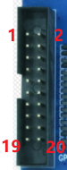

The 2×10 header has a 2.0 mm pitch and exposes 17 GPIO signals, plus 5 V, 3.3 V and ground.

| Pin | Signal |
| --- | --- |
| 1 | `5V` |
| 2 | `GND` |
| 3 | `3.3V` |
| 4 | `GPIO1_B1` |
| 5 | `GPIO1_C0` |
| 6 | `GPIO1_B0` |
| 7 | `GPIO1_C1` |
| 8 | `GPIO1_A7` |
| 9 | `GPIO1_C4` |
| 10 | `GPIO1_A6` |
| 11 | `GPIO1_C5` |
| 12 | `GPIO1_A5` |
| 13 | `GPIO1_C6` |
| 14 | `GPIO1_B7` |
| 15 | `GPIO1_C7` |
| 16 | `GPIO1_B6` |
| 17 | `GPIO1_D0` |
| 18 | `GPIO1_B5` |
| 19 | `GPIO1_D1` |
| 20 | `GPIO1_B4` |

## 7. CAN

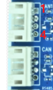

Both CAN ports use the same 4-pin, 2.0 mm connector pinout.

| Pin | Signal |
| --- | --- |
| 1 | `5V` |
| 2 | `CANL` |
| 3 | `CANH` |
| 4 | `GND` |

## 8. RS485

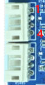

Both RS485 ports use 4-pin connectors with a 2.0 mm pitch. One connector supplies 3.3 V on VCC and the other supplies 5 V. Check the voltage on the connector you plan to use before wiring.

| Pin | Signal |
| --- | --- |
| 1 | `VCC` |
| 2 | `RS485_A` |
| 3 | `RS485_B` |
| 4 | `GND` |

## 9–10. UART1 and UART0 Debug

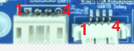

UART1 uses a 4-pin TTL connector with a 2.0 mm pitch. The UART0 debug port uses a 4-pin TTL connector with a 1.25 mm pitch. Both have the same pin order.

| Pin | Signal |
| --- | --- |
| 1 | `VCC_3V3` |
| 2 | `UART_RX` |
| 3 | `UART_TX` |
| 4 | `GND` |

## 11. Speaker

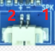

The 2-pin, 1.25 mm connector supports one 3 W, 8 Ω speaker. Connect the speaker across the two outputs shown below.

| Pin | Signal |
| --- | --- |
| 1 | `SPKN_OUT` |
| 2 | `SPKP_OUT` |

## 12. Microphone

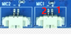

MIC1 and MIC2 are microphone inputs with 2-pin, 1.25 mm connectors.

| Pin | Signal |
| --- | --- |
| 1 | `MICP` |
| 2 | `MICN` |

## 13. IR Receiver

Callout 13 identifies the onboard IR receiver.

## 14. Wi-Fi and Bluetooth

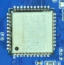

The onboard AW869A module supports Wi-Fi 6 and Bluetooth 5.2.

## 15. Onboard Buttons

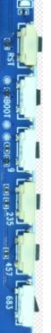

`RST` resets the board and `BOOT` is used to enter flashing mode. The other four are ADC buttons marked `9`, `235`, `457` and `683`.

## 16. RTC Battery Holder

Callout 16 identifies the RTC backup battery holder.
