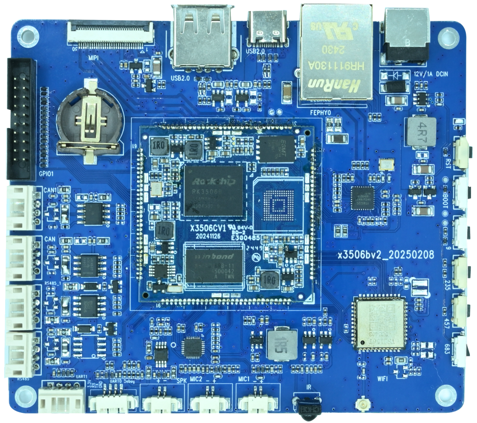

# Product Introduction

The x3506bv2 is a Linux mainboard based on the Rockchip RK3506. It provides MIPI DSI, Ethernet, Wi-Fi, Bluetooth and industrial communication interfaces.

| Item | Specification |
| --- | --- |
| Processor | RK3506 with Cortex-A7 and Cortex-M0, 1.5 GHz |
| Memory | 512 MB |
| Storage | 256 MB or 8 GB, depending on the fitted configuration |
| Power | 12 V DC input. A 12 V, 3 A adapter is recommended |
| Display and touch | One 2-lane MIPI DSI interface with I2C capacitive touch support |
| Networking | One 10/100 Mbps Ethernet port, onboard Wi-Fi 6 and Bluetooth 5.2 |
| USB | One Type-C OTG port and one Type-A USB 2.0 host port |
| Audio | Two microphone inputs and one speaker output |
| Expansion | Two CAN ports, two RS485 ports, UART1, UART0 debug, GPIO, IR receiver and RTC |

## Documentation

- [Hardware Resources](./x3506-hardware-resources.md)
- [Hardware Interface Pinouts](./x3506-interface-details.md)
- [Linux Build](./linux/x3506-linux-build.md)
- [Linux Firmware Flashing](./linux/x3506-linux-flash.md)
- [Linux Usage and Debugging](./linux/x3506-linux-debug.md)
